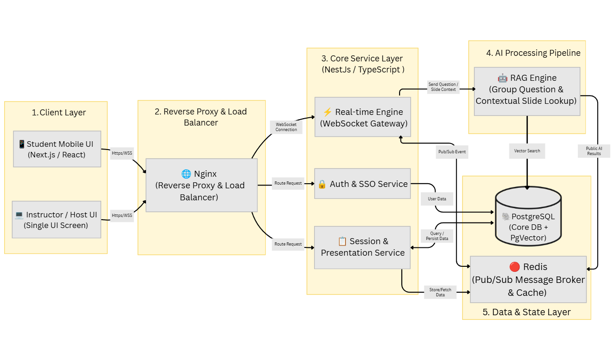
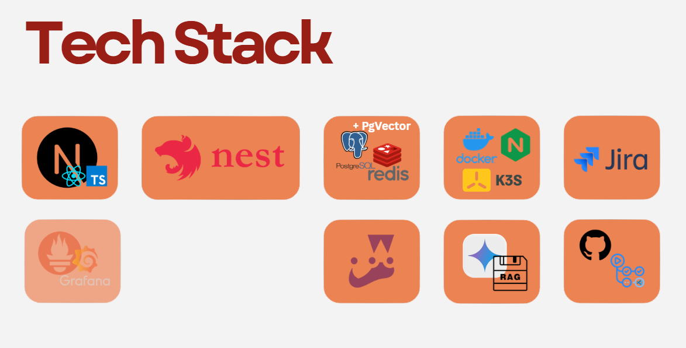

ชื่อโครงงาน แพลตฟอร์มการนำเสนอแบบมีปฏิสัมพันธ์แบบเรียลไทม์ สำหรับห้องเรียนมจธ.

โดย
- จรณะ  สุขโรจน์   รหัส 66130500012
- ภัทร์ทัศน์  จิรธรรมานุวัตร   รหัส 66130500070
- อภิวิชญ์  พิศาลอัครเลิศกุล  รหัส 66130500127

สาขาเทคโนโลยีสารสนเทศ

อาจารย์ที่ปรึกษาโครงงาน

ดร.สุณิสา สถาพรวจนา

ข้อเสนอโครงงานนี้เป็นส่วนหนึ่งของวิชา INT365/371 โครงงานรวบยอดเทคโนโลยีสารสนเทศ I

คณะเทคโนโลยีสารสนเทศ

มหาวิทยาลัยเทคโนโลยีพระจอมเกล้าธนบุรี

ประจำปีการศึกษา 2569

รายละเอียดข้อเสนอโครงงาน
## ชื่อโครงงาน (Project Title)

ชื่อโ**ครงงาน** (**ภาษาไทย**) **: แพลตฟอร์มการนำเสนอแบบมีปฏิสัมพันธ ์ แบบเรียลไทม์ สำหรับ ห้องเรียน มจธ.**

**ชื่อโครงงาน** (**ภาษาอังกฤษ**) **:** Real-time Interactive Presentation Platform for KMUTT Classroom
- ความเป็นมาและความสำคัญของปัญหา (Background and Problem Statement)
- การจัดการเรียนการสอนในระดับอุดมศึกษา โดยเฉพาะในห้องบรรยายรวมขนาดใหญ่ ที่มีจำนวนผู้เรียนตั้งแต่หลักร้อยคนขึ้นไป มักเผชิญกับอุปสรรคสำคัญจากการสื่อสารทางเดียว ซึ่งทำให้ผู้เรียนขาดการมีส่วนร่วมในชั้นเรียน และเกิดความยากลำบากในการรักษาความสนใจตลอดการบรรยาย ยิ่งไปกว่านั้นผู้สอนยังขาดเครื่องมือในการตรวจสอบและประเมินระดับความเข้าใจของผู้เรียนแบบทันท่วงที ทำให้ไม่สามารถรับรู้ได้ว่าผู้เรียนกำลังประสบปัญหาหรือมีความเข้าใจคลาดเคลื่อนในเนื้อหาส่วนใด จนกระทั่งถึงช่วงการสอบวัดผล ซึ่งทำให้การแก้ไขช่องว่างการเรียนรู้ (Learning Gaps) เกิดขึ้นล่าช้าเกินไป
- การปรับเปลี่ยนรูปแบบห้องเรียนไปสู่ การเรียนรู้แบบมีปฏิสัมพันธ์ จึงเข้ามามีบทบาทสำคัญในการแก้ปัญหาดังกล่าว โดยการนำเทคโนโลยีระบบตอบสนองของผู้เรียน และแพลตฟอร์มการนำเสนอแบบโต้ตอบ เข้ามาเชื่อมโยงการสื่อสารแบบสองทาง เครื่องมือเหล่านี้ช่วยให้ผู้สอนสามารถแทรกกิจกรรมวัดผลย่อยระหว่างการบรรยายได้ทันที เช่น การทำ Live Polling, Word Cloud, Live Q&A และการทดสอบความรู้สั้นๆ ซึ่งนอกจากจะช่วยกระตุ้นความสนใจของผู้เรียนแล้ว ยังช่วยสร้างวงจรข้อมูลป้อนกลับแบบทันทีให้ผู้สอนทราบระดับความเข้าใจของผู้เรียนในแต่ละหัวข้อ และสามารถปรับจังหวะการสอนหรืออธิบายเสริมได้อย่างตรงจุด
- อย่างไรก็ตาม แพลตฟอร์ม Interactive Presentation ชั้นนำที่มีอยู่ในท้องตลาดปัจจุบันต่างมีข้อจำกัดสำคัญในการนำมาใช้งานจริงในสถาบันการศึกษา ดังนี้:

  - ข้อจำกัดในแพ็กเกจใช้งานฟรี (Free Tier Limitations): แพลตฟอร์มส่วนใหญ่จำกัดจำนวนผู้เข้าร่วมไว้เพียง 10–100 คนต่อ Session ซึ่งไม่เพียงพอต่อชั้นเรียนขนาดใหญ่ของมหาวิทยาลัยที่มีผู้เรียน 200–600 คน อีกทั้งยังจำกัดจำนวนการสร้างสไลด์กิจกรรม และไม่สามารถส่งออกข้อมูลผลการประเมิน (Export Data) เพื่อนำไปวิเคราะห์ต่อได้

  - ภาระต้นทุนค่าลิขสิทธิ์ที่สูง (High Licensing Costs & Paywalls): การปลดล็อกข้อจำกัดเพื่อรองรับผู้เรียนจำนวนมาก จำเป็นต้องสมัครสมาชิกระดับสถาบันหรือรายบุคคล ซึ่งมีค่าบริการรายปีสูงตั้งแต่ 3,300 ถึงกว่า 21,000 บาทต่อผู้สอน 1 บัญชี ซึ่งถือเป็นภาระงบประมาณที่สูงและยากต่อการจัดสรรให้ครอบคลุมอาจารย์ผู้สอนทุกคนในมหาวิทยาลัยอย่างยั่งยืน

  - การขาดฟีเจอร์เฉพาะทางและการจัดการข้อมูลจำนวนมาก (Lack of Domain-Specific Features & Scalability in Q&A): เครื่องมือทั่วไปไม่รองรับสื่อการสอนเฉพาะทางของสายวิชาคอมพิวเตอร์และเทคโนโลยี เช่น การแสดงผลโค้ด (Syntax Highlighting) หรือโจทย์เขียนโปรแกรมแบบสด (Code Challenges) นอกจากนี้ ในคลาสเรียนขนาดใหญ่ที่มีการส่งคำถามเข้ามาเป็นจำนวนมาก ผู้สอนมักประสบปัญหาการคัดกรองคำถามที่ซ้ำซ้อนหรือไม่ตรงประเด็น ทำให้เสียเวลาในการจัดการระหว่างสอน
- จากปัญหาและข้อจำกัดข้างต้น โครงงานนี้จึงมุ่งพัฒนาระบบ “ModDeck” ซึ่งเป็น**แพลตฟอร์มการนำเสนอแบบมีปฏิสัมพันธ ์ แบบเรียลไทม์ สำหรับ ห้องเรียน มจธ.** (Real-time Interactive Presentation Platform for KMUTT Classroom ) ที่ทำงานบนโครงสร้างพื้นฐานภายในของมหาวิทยาลัย โดยมุ่งเน้นการรองรับผู้ใช้งานพร้อมกันสูงสุด 300 คนต่อ Session ได้อย่างเสถียร มีค่าความหน่วงต่ำ และไม่มีค่าใช้จ่ายด้านลิขสิทธิ์ พร้อมทั้งบูรณาการเทคโนโลยีปัญญาประดิษฐ์ เข้ามาช่วยวิเคราะห์และจัดกลุ่มคำถามของผู้เรียน รวมถึงเชื่อมโยงคำถามเข้ากับเนื้อหาสไลด์ที่เกี่ยวข้องโดยอัตโนมัติ เพื่อสนับสนุนการประเมินผลการเรียนรู้แบบเรียลไทม์ และเพิ่มประสิทธิภาพการมีส่วนร่วมในห้องเรียนของประชาคม มจธ. อย่างยั่งยืน
## วัตถุประสงค์ (Objectives)
- เพื่อศึกษาระบบ Interactive Presentation และ Audience Response System สำหรับสนับสนุนการจัดการเรียนรู้แบบมีปฏิสัมพันธ์ และการประเมินความเข้าใจแบบเรียลไทม์
- เพื่อพัฒนาระบบ Interactive Presentation และ Audience Response System แบบ Self-hosted ภายใต้โครงสร้างพื้นฐานของ มจธ. สำหรับสนับสนุนการจัดการเรียนรู้แบบมีปฏิสัมพันธ์ และการประเมินความเข้าใจแบบเรียลไทม์ โดยรองรับผู้ใช้งานพร้อมกันสูงสุด 300 คนต่อห้องเรียนที่มีค่า Latency ต่ำกว่า 150 ms และออกแบบสถาปัตยกรรมให้ขยายขีดความสามารถเพื่อรองรับได้ 50–80 ห้องเรียนพร้อมกัน หรือมากกว่า 5,000 ผู้ใช้งานพร้อมกันทั่วทั้งมหาวิทยาลัย
### กระบวนการได้มาซึ่งหัวข้อโครงงาน

การพัฒนาโครงงาน ModDeck ใช้กระบวนการคิดเชิงออกแบบ (Design Thinking) ในการทำความเข้าใจปัญหา สำรวจความต้องการจริง และกำหนดกรอบการทำงาน โดยมีรายละเอียดผลลัพธ์ในแต่ละขั้นตอน ดังนี้:

  - **ขั้นทำความเข้าใจปัญหา** (Empathize)
- ทีมผู้พัฒนาได้ดำเนินการสัมภาษณ์เชิงลึก (In-depth Interviews) กับผู้มีส่วนได้ส่วนเสีย 3 กลุ่มหลัก ได้แก่:
- **ทีมพัฒนาระบบสนับสนุนการศึกษา** (Educational Technology Services: ETS / ทีมพัฒนา LEB2)

  - แนวทางและความเข้ากันได้ของระบบ: ตัวระบบควรวางตำแหน่งเป็น เครื่องมือเสริมด้านการมีส่วนร่วมและการประเมินผลในชั้นเรียน (In-class Engagement & Assessment Tool) ที่ทำงานร่วมกับระบบหลักของมหาวิทยาลัยได้ โดยไม่ทับซ้อนกับระบบบริหารจัดการการเรียนรู้ (LMS) อย่าง LEB2

  - มาตรฐานความปลอดภัยและสถาปัตยกรรม: แนะนำให้ใช้ระบบยืนยันตัวตนกลาง (KMUTT SSO) และออกแบบการ Deployment ให้อยู่บน Infrastructure ภายในมหาวิทยาลัย เพื่อความปลอดภัยของข้อมูลและการรองรับทราฟฟิกภายในที่เสถียร
## **กลุ่มผู้เรียนและนักศึกษา** (Learners / Students)

  - จากการสำรวจนักศึกษาหลากหลายกลุ่ม พบความต้องการและพฤติกรรมในห้องเรียน ดังนี้:

    - ความต้องการพื้นที่ถาม-ตอบแบบไม่ระบุตัวตน (Anonymous Q&A): ผู้เรียนส่วนใหญ่มีความเขินอายในการยกมือถามในห้องบรรยายขนาดใหญ่ ฟีเจอร์ถาม-ตอบแบบนิรนามช่วยลดความประหม่าและกระตุ้นให้กล้าสื่อสารกับผู้สอนมากขึ้น

    - ความชื่นชอบในองค์ประกอบเกมและการมีปฏิสัมพันธ์ (Gamification & Real-time Interaction): ผู้เรียนให้ความสนใจสูงกับกิจกรรมประเภท Live Polling, Word Cloud และ Quiz ที่มี Leaderboard/Ranking สไตล์ Kahoot ซึ่งช่วยเปลี่ยนบรรยากาศห้องเรียนไม่ให้น่าเบื่อ

    - การเข้าถึงเนื้อหาหลังจบคาบ: ต้องการให้มีระบบสรุปผลการบรรยาย สไลด์ หรือประเด็นสำคัญที่สามารถดาวน์โหลดกลับไปทบทวนได้สะดวก

**2.1. User Persona**

  - Name: Student T**,** Age: 21, Gender: Male

    - Short BIO: นักศึกษาคณะเทคโนโลยีสารสนเทศ ชั้นปี 4 มีความสนใจด้าน UX/UI เป็นพิเศษ

    - Behaviors & Habits:

      - ไม่เคยยกมือตอบ หรือถามคำถาม

      - ชอบ Quiz, Word Cloud

      - สนใจเรื่อง UX/UI

      - ชอบ Activity ในคลาส เช่น Ice breaking หรือ Mini Game ต่างๆ

    - Pain Point:

      - กลัวการยกมือถาม หรือยกมือตอบ

    - Needs & Expectations:
- สามารถถาม หรือตอบคำถามได้แบบไม่รู้สึกกลัว
- กิจกรรมมีความสนุขสนาน และคลายเครียด

  - Name: Student A**,** Age: 21, Gender: Male

    - Short BIO: นักศึกษาคณะเทคโนโลยีสารสนเทศ ชั้นปี 4

    - Behaviors & Habits:

      - หากมีคำถามจะถามท้ายคาบ

      - ชอบ Kahoot & Leaderboard

      - ชอบให้มีกิจกรรมในคลาส ชอบกิจกรรมกลุ่มเป็นพิเศษ

    - Pain Point:

      - ไม่กล้าถามระหว่างคลาสเรียน เพราะรู้สึกเกรงใจคนอื่น

    - Needs & Expectations:
- สามารถถามคำถามได้ โดยไม่รู้สึกลำบากใจ
- กิจกรรมมีความสนุขสนาน และคลายเครียด
- **กลุ่มอาจารย์ผู้สอน ผู้ช่วยสอน** (TA) **และวิทยากร** (Instructors, TAs & Speakers)

  - จากการสัมภาษณ์อาจารย์ประจำวิชา (ผู้มีประสบการณ์สอนตั้งแต่ 4 ถึงกว่า 30 ปี) ร่วมกับติวเตอร์และผู้ช่วยสอน พบประเด็นสำคัญเชิงลึก ดังนี้:

  - มุมมองต่อบทบาทของเครื่องมือ (Tool Positioning): ผู้สอนส่วนใหญ่มองว่าแพลตฟอร์มประเภทนี้คือ "Assessment & Interaction Tool" ที่ใช้ตรวจสอบความเข้าใจ และดึงความสนใจของผู้เรียน ไม่ใช่ตัวสร้าง Active Learning โดยตรง แต่เป็นกลไกที่ช่วยให้การเรียนรู้แบบมีปฏิสัมพันธ์เกิดขึ้นได้จริง
- ปัญหาข้อจำกัดของเครื่องมือและต้นทุน (Limitations & Paywalls):

  - เครื่องมือฟรีจำกัดจำนวนผู้ใช้งานและล็อกฟีเจอร์สำคัญ

  - การจ่ายค่าลิขสิทธิ์เป็นภาระสูงสำหรับผู้สอนรายบุคคลและ TA ที่ต้องออกค่าใช้จ่ายเอง

  - ปัญหา Session หลุดหรือระบบล่มเมื่อใช้ในห้องบรรยายขนาดใหญ่ ทำให้ข้อมูลคะแนนสูญหาย
- ภาระในการเตรียมการและการควบคุมเวลา (Preparation Friction & Time Control):

  - การออกแบบและเตรียมกิจกรรมแบบ Interactive ใช้เวลาและพลังงานสูงมาก หากเครื่องมือใช้งานยาก ผู้สอนจะไม่นำมาใช้ในระยะยาว

  - กิจกรรมในชั้นเรียนมักทำให้ควบคุมเวลาสอนได้ยาก ผู้สอนต้องการเครื่องมือที่ตั้งเวลาได้ชัดเจนและไม่รบกวนจังหวะการสอนเนื้อหาหลัก
- ความต้องการด้านการวัดผลและการเชื่อมโยงคะแนน (Grading & Incentives): การกระตุ้นผู้เรียนในห้องใหญ่ต้องอาศัยกลไกคะแนนและการมีส่วนร่วม ผู้สอนจึงต้องการระบบบันทึกผลคะแนน Quiz/Poll ที่แม่นยำ เชื่อมโยงกับรหัสนักศึกษาได้ และส่งออกข้อมูลได้ง่าย
- ความคาดหวังต่อบทบาทของ AI:

  - AI Suggestion: ผู้สอนต้องการให้ AI ช่วยแนะนำแนวทางการตั้งคำถาม/Quiz และจุดแทรกกิจกรรมตั้งแต่ ขั้นตอนการเตรียมสไลด์ เพื่อลดภาระการออกแบบการสอน

  - AI Slide Lookup: การจัดหาสไลด์เพื่อตอบสำหรับคำถามต่างๆ ที่ได้รับเข้ามาช่วยทำให้ผู้สอนสอนได้สะดวกสบายมากขึ้น

**3 .1. User Persona**

  - Name: N**,** Age: 24, Gender: Male

    - Short BIO: อดีต นักศึกษา Computer Engineer และเป็น Senior Founder Associate and Co-Founder ของ Start Up ที่เกี่ยวกับการศึกษา

    - Behaviors & Habits:

      - ปรับวิธีสอนตามขนาดห้อง
-  ห้องเล็ก เน้นชี้ตัว/ลุกขยับ
- ห้องกลาง ใช้เครื่องมือช่วยพร้อมนั่งประกบ
- ห้องใหญ่ สอนให้จบแล้วเปิด Q&A ท้ายคาบ

      - ใช้ Quiz เก็บคะแนนเป็นตัวเร่งให้เกิดการมีส่วนร่วมในคลาส

    - Pain Point:

      - Active Learning โดยเฉพาะ Lab ใช้เวลาเตรียมสูงกว่า Passive หลายเท่าตัว

      - หลายโปรแกรม มีฟีเจอร์เยอะ แต่ใช้งานจริงไม่กี่อย่าง

      - TA ต้องเสียเงินซื้อ Subscription เครื่องมือสอนด้วยตัวเอง

    - Needs & Expectations:

      - ต้องการ Dashboard ที่แสดงข้อมูลให้เห็นถึง Learning Gap แบบ Real time

      - ลดเวลาการเตรียมการสอน ซึ่งใช้พลังงานสูง และใช้เวลาเตรียมตัวนาน

      - มีระบบทำงานร่วมกัน ไม่ผลักภาระค่าใช้จ่ายให้ผู้สอนหรือ TA จ่ายเอง

  - Name: Teacher L**,** Age: 40+, Gender: Male

    - Short BIO: อาจารย์สอนในมหาวิทยาลัยพระจอมเกล้าธนบุรี สาขาเทคโนโลยีสารสนเทศ

    - Behaviors & Habits:

      - เน้นการลงมือปฏิบัติ แสดงความเห็น และทำ Lab Sheet/Hands-on ที่เห็นผลลัพธ์ทันทีพร้อมมีคำใบ้ช่วย

      - จัดการห้องเรียนขนาดใหญ่ด้วยกติกาและแรงจูงใจ เช่น เช็กชื่อ 4 รอบ, จำกัดเวลาตอบ, ใช้ Gamification, ระบบ Ranking และมีเกณฑ์คะแนนขั้นต่ำ

    - Pain Point:

      - ปัญหาใหญ่ที่สุดของ Menti คือหากหลุด Session กลางคัน จะไม่สามารถบันทึกข้อมูล คะแนน และรหัส นศ. ที่เก็บไว้ตอนต้นได้

      - การเขียนชุดคำถามเองใช้เวลาและพลังงานเยอะ

    - Needs & Expectations:

      - สามารถเก็บคะแนนจากรหัส นศ. ได้อย่างแม่นยำ เสถียร ไม่หลุดกลางทาง

      - มีเครื่องมือช่วยสร้าง Quiz/Lab เพื่อประหยัดเวลา แต่ต้องไม่พึ่งพา AI จนทำให้ทักษะหรือมาตรฐานของผู้สอนลดลง

      - ไม่ติดปัญหาเรื่องการจ่ายเงินรายปี พร้อมลงทุนหากเครื่องมือตอบโจทย์

  - Name: Teacher B**,** Age: 40+, Gender: Male

    - Short BIO: อาจารย์สอนในมหาวิทยาลัยพระจอมเกล้าธนบุรี สาขาเทคโนโลยีสารสนเทศ

    - Behaviors & Habits:

      - เน้นการลงมือปฏิบัติ

      - ไม่บังคับเด็กที่ไม่พร้อม Active ให้ทำเท่าที่ทำไหว มีแผนสำรองสำหรับรับมือทั้งกลุ่มที่อยากทำและไม่อยากทำ ปรับตามไดนามิกของห้อง

      - เวลาสอนจริงผู้สอนต้องจ้องจอ/สไลด์ ไม่มีเวลามาคอยสลับหน้าจอหรือมอนิเตอร์ ที่ซับซ้อน

    - Pain Point:

      - กิจกรรมที่มี Output ในทุกช่วงทำให้ผู้สอนต้องใช้พลังงานมหาศาลในการตรวจและให้ฟีดแบ็ก

      - เครื่องมือที่เก็บเงินส่วนใหญ่สามารถหาทางทำเองหรือประยุกต์วิธีอื่นได้ จึงรู้สึกไม่คุ้มที่จะจ่าย

    - Needs & Expectations:

      - ฟีเจอร์ต้องเรียบง่าย ไม่ซับซ้อน ไม่ต้องเชื่อมโยงฮาร์ดแวร์แปลกใหม่ และไม่รบกวนสมาธิผู้สอนที่กำลังดูสไลด์

      - อยากได้ระบบที่ช่วยจัดกลุ่มคำถามซ้ำซ้อน ช่วยให้เห็นภาพรวมคำถามของผู้เรียนได้ทันทีโดยไม่ต้องมีผู้ช่วยมานั่งคัดกรอง

  - **ขั้นระบุและกำหนดกรอบปัญหา** (Define)
- จากการสังเคราะห์ข้อมูลผลการสัมภาษณ์ สามารถสรุปกรอบปัญหาหลักได้เป็น 3 ด้าน:

  - Infrastructure & Usability Gap: ข้อจำกัดด้านภาระต้นทุนค่าลิขสิทธิ์ที่สูง (High Licensing Costs & Paywalls) ส่งผลให้ มจธ. ขาดแคลนเครื่องมือ Interactive Presentation ที่มีเสถียรภาพ สามารถรองรับผู้ใช้งานพร้อมกันจำนวนมากสำหรับห้องบรรยายของ มจธ. โดยไม่ติดเงื่อนไขจำกัดระยะเวลาการใช้งาน (Session Limits)

  - High Preparation & Adoption Friction: ผู้สอนต้องแบกรับภาระเวลาในการออกแบบกิจกรรมและการเตรียมสื่อการสอนแบบ Interactive ส่งผลให้เกิดอุปสรรคในการนำเครื่องมือมาใช้งานจริง

  - In-class Assessment & Management Difficulty: ผู้สอนในห้องเรียนขนาดใหญ่ประสบปัญหาในการประเมินความเข้าใจของผู้เรียนแบบ Real-time, การควบคุมเวลาสอน และการจัดการคำถามซ้ำซ้อนที่เข้ามาในปริมาณมาก

  - **ขั้นระดมความคิดและออกแบบแนวทางแก้ไข** (Ideate)
- Real-time Assessment & Gamification: Live Poll, Word Cloud, Anonymous Q&A, Quiz Leaderboard
- Strict Time Boxing: ตัวจับเวลานับถอยหลังพร้อมโหมดบังคับตัดจบ (Hard Stop) เพื่อรักษาเวลาการบรรยาย
- Team Gamification: แบ่งกลุ่มนักศึกษาในห้องตามโซนที่นั่งเพื่อตอบคำถามสะสมแต้มร่วมกัน ลดความกดดันจากการแข่งรายบุคคล
- Slide-to-Quiz Generator**:** เครื่องมือแปลงไฟล์ PowerPoint, PDF หรือ Google Slides ที่มีอยู่เดิมเป็นสไลด์ Interactive พร้อมคำถาม/โพลล์ที่ AI สร้างให้อัตโนมัติ
- Voice-Prompted Live Poll: ฟีเจอร์ที่อาจารย์เพียงพูดคำถามสดในห้อง เช่น "เข้าใจประเด็นนี้ไหม" ระบบจะจับเสียงแล้วสร้างโพลล์แบบ True/False หรือ Rating ขึ้นบนจอทันทีโดยไม่ต้องพิมพ์ล่วงหน้า
- Semantic Question Clustering & Deduplication: AI รวมคำถามของนักศึกษาที่มีความหมายเหมือนหรือคล้ายกันเข้าเป็นกลุ่มเดียวแบบ Real-time พร้อมแสดงจำนวนคนที่สงสัยประเด็นนั้น
- Speed-Check Confidence Matrix: กราฟิกแบบ 2 มิติที่ให้นักศึกษาเลือกทั้ง "คำตอบ" และ "ระดับความมั่นใจ" เพื่อแยกแยะว่านักศึกษาตอบถูกเพราะรู้จริง หรือตอบถูกเพราะเดา
- Class Rhythm Metronome: แถบสถานะส่วนตัวบนหน้าจออาจารย์ที่แจ้งเตือนเมื่ออาจารย์พูดต่อเนื่องเกิน 12 นาทีโดยไม่มีการโต้ตอบ เพื่อกระตุ้นให้หยุดถามคำถามสั้นๆ
## จุดเด่นของระบบที่เสนอ
- 100% Free & Self-hosted for KMUTT: ใช้งานฟรีสำหรับประชาคม มจธ. รองรับผู้ใช้พร้อมกันสูงสุด 300 คนต่อ Session โดยไม่ติดข้อจำกัดด้าน Paywall
- Dual AI-Powered Assistant:

  - ก่อนสอน: **ระบบ** AI Suggestion **วิเคราะห์เนื้อหาสไลด์เพื่อแนะนำจุดแทรกกิจกรรม และช่วยสร้างโจทย์** Poll/Quiz **อัตโนมัติ**

  - ระหว่างสอน: AI Q&A Clustering จัดกลุ่มคำถามซ้ำซ้อน และ Contextual Slide Lookup ดึงสไลด์ที่เกี่ยวข้องมาตอบได้ทันที **เพื่อลดความซ้ำซ้อนในห้องเรียนขนาดใหญ่**
- Code & Math Syntax Support: รองรับ Syntax Highlighting และโจทย์ฝึกเขียนโค้ดและสูตรทางคณิตศาสตร์แบบ Real-time ออกแบบเฉพาะสำหรับวิชาสายไอทีและวิศวกรรมศาสตร์
- Group-based Team Mode, Team Competition, Streak Multipliers **และแสดงผล** Live Leaderboard**: การแข่งขัน ตอบคำถาม แบบกลุ่ม สร้างการเรียนรู้ร่วมกัน แก้ปัญหาทางเทคนิค และ**ลดความกดดันจากการแข่งรายบุคคล
- **แดชบอร์ดสรุปผลหลังจบการสอน (**Host Session Analysis): **แสดง** Engagement Density Heatmap **รายสไลด์ และระบุจุดบกพร่องในการเรียนรู้ของผู้เรียน**
## **Challenges** ของระบบ
### Technical Challenges

  - **การรองรับ** Concurrency **สูงและปัญหาการส่งคำตอบพร้อมกัน (**High-Burst Real-time Concurrency):

    - **การรักษาความเสถียรของสถาปัตยกรรม** WebSocket **ร่วมกับ** Redis Pub/Sub **ให้รองรับผู้ใช้งานพร้อมกันสูงสุด** 300 **คนต่อ** Session **โดยมีค่าความหน่วงต่ำ (**<150 ms)

    - **การจัดการปัญหาการเขียนข้อมูลฉับพลัน (**High-burst Write Traffic) **เมื่อผู้เรียน** 300 **คนกดยืนยันคำตอบใน** Live Poll **หรือ** Team Quiz **พร้อมกันในเสี้ยววินาที เพื่อป้องกัน** Database Bottleneck **และการเกิด** Race Condition **ในการ คำนวณคะแนนและจัดอันดับ**

  - **ความเร็วและความแม่นยำของ** AI Pipeline **แบบ** Real-time (Low-Latency RAG & Vector Search):

    - **ความแม่นยำในการแมปคำถามของผู้เรียนเข้ากับเนื้อหาสไลด์ที่ถูกต้อง ผ่าน** PgVector **และเทคนิค** RAG

    - **การทำ** Semantic Clustering **เพื่อจัดกลุ่มคำถามที่ซ้ำซ้อนกันในชั้นเรียนขนาดใหญ่แบบสตรีมมิ่ง โดยต้องใช้เวลาประมวลผลสั้นที่สุดเพื่อไม่ให้รบกวนจังหวะการสอนของผู้สอน**

  - **การแสดงผลนิพจน์ทางคณิตศาสตร์และบล็อกโค้ดบนทุกอุปกรณ์ (**Math & Code-First Dynamic Rendering):

    - **การแปลงและ** Render **สื่อการสอนเฉพาะทาง ทั้ง** Math Syntax ("LaTeX"  / KaTeX) **สำหรับโจทย์คำนวณ/สถิติ และ** Programming Code Syntax **สำหรับวิชาสายคอมพิวเตอร์ ให้แสดงผลได้อย่างถูกต้อง รวดเร็ว สวยงาม ทั้งบนจอโปรเจกเตอร์ของผู้สอน และจอมือถือของผู้เรียน**

  - **ความทนทานต่อข้อผิดพลาดของเครือข่าย (** ):

    - **การออกแบบระบบกู้คืนสถานะ (**State Reconciliation) **เมื่อผู้เรียนเผชิญปัญหาสัญญาณอินเทอร์เน็ตหลุดในห้องบรรยายรวม ให้สามารถเชื่อมต่อกลับเข้ามาใหม่ ได้ทันทีโดยไม่สูญเสียข้อมูลคะแนน , สถานะของทีม หรือประวัติการตอบ**
### Business & User Adoption Challenges

  - **การลดแรงเสียดทานในการเปลี่ยนผ่านเครื่องมือ (**Low-Friction Onboarding & Switching Cost):

    - **การจูงใจให้อาจารย์ผู้สอนและ** TA **เปลี่ยนมาใช้** ModDeck **แทนเครื่องมือเดิมที่คุ้นเคย โดยระบบต้องไม่เพิ่มภาระในการจัดเตรียมสไลด์ใหม่**

  - **การลดภาระการรับรู้ของผู้สอนระหว่างการบรรยาย (**Minimizing In-class Cognitive Load):

    - **ผู้สอนส่วนใหญ่ต้องการโฟกัสที่การสอนและเนื้อหาสไลด์เป็นหลัก ไม่มีเวลาคอยสลับหน้าจอควบคุมหลายระบบ** ModDeck **จึงต้องออกแบบ** User Experience **ให้เรียบง่าย ควบคุมกิจกรรมทุกอย่างได้จากหน้าจอเดียว และมี** AI **คอยช่วยคัดกรองข้อมูลสำคัญให้โดยอัตโนมัติ**
## **การศึกษาความเป็นไปได้ เบื้องต้น (**Feasibility Studies)
- **การศึกษาสถาปัตยกรรม Real-time Concurrency และ High-Burst Load** (WebSocket + Redis)

  - วัตถุประสงค์: เพื่อพิสูจน์ว่าระบบสามารถรองรับผู้ใช้งานพร้อมกันสูงสุด 300 คนต่อ Session ในการตอบ Live Poll, Word Cloud, ส่ง Q&A และรับมือกับการส่งคำตอบ Quiz พร้อมกันในเสี้ยว เพื่อคำนวณคะแนนและจัดอันดับ ได้โดยมี Latency ต่ำ (<150 ms) และไม่เกิด Data Loss หรือระบบล่ม

  - การดำเนินการ (Spike): ทำการทดสอบประสิทธิภาพ (Load/Stress Testing) โดยจำลองการเชื่อมต่อ WebSocket ผ่าน NestJS ร่วมกับ Redis Pub/Sub และ Redis Sorted Sets (ZSET) เพื่อวัด Response Time, Throughput และการจัดการหน่วยความจำเมื่อมี Traffic และ Race Condition สูงพร้อมกัน
## **การบูรณาการ AI Vector Search และ RAG** (PgVector + LLM)

  - วัตถุประสงค์: เพื่อยืนยันความแม่นยำและความเร็วในการจัดกลุ่มคำถามที่ซ้ำซ้อน (Semantic Q&A Clustering) การค้นหาสไลด์ที่เกี่ยวข้องอัตโนมัติ และการรวมคำพ้องความหมายใน Word Cloud

  - การดำเนินการ (Spike): ทดลองแปลงเนื้อหาสไลด์และคำถามเป็น Embedding Vectors จัดเก็บบน PostgreSQL ด้วย Extension PgVector แล้วทดสอบวัดความแม่นยำ (Search Relevance / Cosine Similarity) และเวลาในการประมวลผล (Latency Benchmark) ให้อยู่ในระดับ Real-time
- **การแสดงผล Code Syntax และนิพจน์คณิตศาสตร์** (Math & Code-First Rendering)

  - วัตถุประสงค์: ตรวจสอบความสามารถของ Frontend (Next.js/React) ในการ Render โค้ดโปรแกรมมิ่ง (Syntax Highlighting) และสูตรคณิตศาสตร์เชิงลึก ("LaTeX"  / KaTeX) บนหน้าจอพรีเซนต์และหน้าจอมือถือของผู้เรียนได้อย่างถูกต้อง คมชัด และโหลดเร็ว

  - การดำเนินการ (Spike): ทดสอบการผสานไลบรารี KaTeX ร่วมกับ Syntax Highlighting (เช่น PrismJS/Shiki) ผ่าน WebSocket Payload เพื่อยืนยันการแสดงผลโจทย์ที่ซับซ้อนแบบ Real-time โดยไม่ทำให้ Client กระตุก
- **การศึกษาความทนทานต่อข้อผิดพลาดเครือข่ายและการกู้คืนสถานะ** (Network Resilience & State Recovery Spike)

  - วัตถุประสงค์: เพื่อแก้ปัญหาการหลุดของการเชื่อมต่อในห้องบรรยายขนาดใหญ่ ป้องกันไม่ให้ Session และข้อมูลคะแนนของผู้เรียนสูญหาย

  - การดำเนินการ (Spike): ทดสอบกลไก Local State Reconciliation บน Client ร่วมกับ Reconnection Handshake ของ Server เพื่อให้ผู้เรียนที่หลุดจากสัญญาณ WiFi สามารถซิงค์กลับเข้าสู่ Session เดิมและทำงานต่อเนื่องได้ทันที
- **การวิเคราะห์เปรียบเทียบข้อจำกัดและต้นทุนของเครื่องมือในท้องตลาด** (Market & Cost Analysis)

  - ข้อมูลสนับสนุน: จากการรวบรวมข้อมูลเครื่องมือ เช่น Slido, Mentimeter, Kahoot, AhaSlides และ Poll Everywhere พบว่าเวอร์ชันฟรีส่วนใหญ่จำกัดผู้ใช้เพียง 10–100 คน หรือจำกัดจำนวนคำถามต่อ Session ขณะที่ค่าบริการรายปีสำหรับสถาบันการศึกษามีราคาสูงตั้งแต่ 3,300 ถึง 21,000 บาท/คน/ปี

  - ข้อสรุป: การพัฒนาระบบ Self-hosted ภายใน มจธ. (KMUTT) มีความคุ้มค่าเชิงต้นทุนในระยะยาว และตอบโจทย์คลาสเรียนขนาดใหญ่ได้อย่างสมบูรณ์
- **การศึกษาพฤติกรรมผู้ใช้และแนวทางการสร้างแรงจูงใจในการใช้งาน** (User Adoption Strategy)

  - ข้อมูลสนับสนุน: จากการศึกษาแนวทางการใช้งานของอาจารย์ผู้สอน พบว่าผู้สอนต้องการความสะดวก และไม่อยากเสียเวลาทำสไลด์ใหม่ทั้งหมดบนระบบใหม่

  - แนวทางแก้ไข: ระบบจึงออกแบบให้รองรับการนำเข้าไฟล์สไลด์เดิม (Slide Import PDF/Background) มีการทำ Slide Text Extraction เพื่อป้อนให้ AI Suggestion แนะนำจุดแทรกกิจกรรมตั้งแต่ขั้นตอนเตรียมสอน รวมถึงวางแผนพัฒนา Add-ins สำหรับ PowerPoint และ Canva ในระยะถัดไป
## **ระบบที่เสนอ** (Proposed System)

  - **กลุ่มเป้าหมาย**

    - **อาจารย์ผู้สอน ผู้ช่วยสอน** (TA) **และวิทยากร** (Instructors, TAs & Speakers)

  - **ต้องการเครื่องมือส่งเสริมการเรียนรู้แบบมีปฏิสัมพันธ์ และการประเมินความเข้าใจผู้เรียนระหว่างเรียน โดยเฉพาะในห้องบรรยายขนาดใหญ่และวิชาเฉพาะทาง**

  - **ต้องการความสะดวกในการนำเข้าสไลด์เดิม และมีเครื่องมือช่วยลดภาระเวลาในการเตรียมกิจกรรม (**AI Suggestion)

  - **ต้องการควบคุมกิจกรรมและการนำเสนอได้จากหน้าจอเดียว โดยไม่ต้องสลับหลายหน้าจอ**

  - **ต้องการระบบประเมินผล บันทึกคะแนน และส่งออกข้อมูลที่แม่นยำ ปราศจากข้อจำกัดด้านค่าใช้จ่ายและจำนวนผู้เรียน**

    - **นักศึกษาและผู้เข้าร่วมฟังการบรรยาย** (Students / Audience):

  - **เข้าใช้งานผ่านอุปกรณ์เคลื่อนที่ (**Smartphones/Tablets) **หรือคอมพิวเตอร์ส่วนบุคคล โดยไม่ต้องติดตั้งแอปพลิเคชันเพิ่มเติม**

  - **ต้องการความรวดเร็วและง่ายในการเข้าร่วม** Session **ผ่านการสแกน** QR Code **หรือรหัส** 6-Digit PIN

  - **ต้องการช่องทางสื่อสารและถามคำถามแบบไม่ระบุตัวตน เพื่อลดความประหม่าในห้องเรียนขนาดใหญ่**

  - **ชื่นชอบกิจกรรมการเรียนรู้ที่มีองค์ประกอบของเกม เช่น การแข่งขันตอบควิซแบบทีม**, **การจัดอันดับคะแนนสด และการส่งปฏิกิริยาโต้ตอบ**

  - **ภาพรวมระบบ**
-  ModDeck คือแพลตฟอร์มการนำเสนอแบบมีปฏิสัมพันธ์ในชั้นเรียนแบบเรียลไทม์ (Real-time Interactive Presentation Platform) แบบ Self-hosted ที่พัฒนาขึ้นเพื่อให้บริการแก่ประชาคม มจธ. (KMUTT) โดยเฉพาะ เพื่อแก้ปัญหาข้อจำกัดด้านค่าใช้จ่ายลิขสิทธิ์และข้อจำกัดฟังก์ชันในแพลตฟอร์มเชิงพาณิชย์  ระบบทำงานในรูปแบบเว็บแอปพลิเคชัน (Web Application) โดยแบ่งกระบวนการทำงานหลักออกเป็น 3 ขั้นตอน:
- **การเตรียมและการนำเสนอ** (Presentation Setup & Delivery):

  - **ผู้สอนสามารถนำเข้าสไลด์การสอนเดิม (**Slide Import **จาก** PDF/**รูปภาพ) ได้ทันที**

  - **มีระบบ** AI Suggestion **ช่วยวิเคราะห์เนื้อหาในสไลด์และแนะนำจุดที่ควรแทรกกิจกรรม รวมถึงสร้างคำถามโพลล์และควิซให้อัตโนมัติตั้งแต่ขั้นตอนเตรียมสอน**

  - **รองรับการแทรกกิจกรรมแบบ** Real-time **ได้หลากหลายรูปแบบ ทั้ง** Live Poll, Word Cloud, Live Q&A **รวมถึงโจทย์คำนวณและโปรแกรมมิ่งที่รองรับทั้ง** Math Syntax (LaTeX) **และ** Code Syntax Highlighting
- **การมีส่วนร่วมของผู้เรียน** (Real-time Interaction):

  - **ผู้เรียนเข้าร่วม** Session **ได้อย่างสะดวกผ่านการยืนยันตัวตนด้วย** KMUTT SSO **หรือเข้าร่วมแบบ** Guest **ผ่าน** QR Code **หรือใส่** 6-Digit PIN

  - **ผู้เรียนสามารถตอบ** Live Poll, **ร่วมส่งคำศัพท์ใน** Word Cloud **ส่งคำถามแบบนิรนาม และร่วมกด** Upvote **ประเด็นที่สนใจ**

  - Group-based Team Mode, Team Competition, Streak Multipliers **และแสดงผล** Live Leaderboard
- **การประมวลผลด้วย AI และสรุปผล** (AI Insight & Session Analysis):

  - **ระหว่างการสอน: ใช้เทคโนโลยี** Vector Search (PgVector + RAG) **ในการจัดกลุ่มคำถามที่มีเนื้อหาใกล้เคียงกัน และค้นหาสไลด์ที่เกี่ยวข้องกับคำถามนั้นขึ้นมาแสดงผลโดยอัตโนมัติ เพื่อช่วยให้ผู้สอนตอบคำถามได้ตรงจุด**

  - **หลังจบการสอน: สร้างแดชบอร์ดสรุปผลการ สอน (**Host Session Analysis**) แสดง** Engagement Density Heatmap **รายสไลด์ และระบุจุดบกพร่องในการเรียนรู้ของผู้เรียน**

  - **ฟีเจอร์หรือ ฟังก์ชันการทำงาน ที่เป็นความต้องการของระบบ**

| กลุ่มผู้ใช้งาน (User Roles) | ฟีเจอร์ / ฟังก์ชันการทำงานหลัก (Core Features) |
| --- | --- |
| **กลุ่มผู้เรียนและนักศึกษา (**Learners / Students) | • **เข้าใช้งานผ่าน** University SSO **หรือ** Guest Join **ผ่านการสแกน** QR Code / 6-Digit PIN Code • **โหวตตอบ** Live Polling **และดูผลการวิเคราะห์แบบ** Dynamic Real-time • **ร่วมส่งข้อความในกิจกรรม** Word Cloud Generator **พร้อมระบบรวมคำพ้องความหมาย** • **ถามคำถามใน** Live Q&A **แบบเปิดเผยตัวตนหรือไม่ระบุตัวตน พร้อมกด** Upvote **คำถามที่สนใจ** • **ส่งสัญญาณตอบรับและปฏิกิริยาแบบสด (**Live Cheering Emojis) **ขึ้นบนหน้าจอพรีเซนต์** • **ตอบคำถาม** Live Quiz **และเข้าร่วมแข่งขันในโหมดกลุ่ม พร้อมระบบตัวคูณคะแนน** |
| **ผู้สอน / ผู้นำเสนอ (**Instructors / Host) | • **จัดการสไลด์นำเสนอ และนำเข้าไฟล์สไลด์เดิมได้ทันที (**Slide Import **จาก** PDF/Background) • **ระบบ** AI Suggestion **วิเคราะห์เนื้อหาสไลด์เพื่อแนะนำจุดแทรกกิจกรรม และช่วยสร้างโจทย์** Poll/Quiz **อัตโนมัติตั้งแต่ขั้นตอนเตรียมสอน (**Pre-session Planner) • **สร้างและควบคุมกิจกรรมแบบ** Real-time **ครบวงจร (**Live Poll, Word Cloud, Q&A, Team Quiz, Code & Math Syntax Supported) **ผ่านหน้าจอควบคุมเดียว** • **ระบบ** AI Q&A Clustering **จัดกลุ่มคำถามที่มีความหมายใกล้เคียงกันแบบ** Real-time **เพื่อลดความซ้ำซ้อนในห้องเรียนขนาดใหญ่** • **ระบบ** Contextual Slide Lookup **ค้นหาสไลด์ที่ตรงกับบริบทของคำถามอัตโนมัติ เพื่อให้ผู้สอนกดกระโดดไปยังสไลด์หน้าที่เกี่ยวข้องได้ทันที** • **ควบคุมตัวจับเวลา**, **สั่งแสดงผลเฉลย และแสดงอันดับคะแนนสด** • **แดชบอร์ดสรุปผลหลังจบการสอน (**Host Session Analysis): **แสดง** Engagement Density Heatmap **รายสไลด์ และระบุจุดบกพร่องในการเรียนรู้ของผู้เรียน** • **ส่งออกรายงานผลการประเมิน คะแนน และสถิติการมีส่วนร่วม (**Data Export) |

  - **สถาปัตยกรรมระบบ**

**สถาปัตยกรรมของระบบ** ModDeck **ถูกออกแบบในลักษณะ** Microservices **/** Containerized Architecture **ที่เน้นประสิทธิภาพ** Real-time **การรองรับ** Concurrency **สูง และการประมวลผลข้อมูล** AI **โดยแบ่งออกเป็นชั้นต่างๆ ดังนี้:**
- **Client & Presentation Layer** (Frontend):

  - **เว็บแอปพลิเคชันสำหรับผู้เรียน** (Student UI) **รองรับการใช้งานผ่านอุปกรณ์เคลื่อนที่ (**Mobile Dynamic Responsive) **และผู้สอน (**Host UI/Single UI Screen) **พัฒนาด้วย** Next.js / React

  - **การเชื่อมต่อกิจกรรม** Real-time (Live Polling, Word Cloud, Q&A, Code Challenge) **ผ่านเทคโนโลยี** WebSockets
- **API & Service Layer** (Backend):

  - Core Application Server (NestJS / TypeScript): **จัดการ** Business Logic, SSO Authentication, Management API, Session Control

  - Real-time Engine: **ใช้** WebSockets **ร่วมกับ** Redis Pub/Sub **เพื่อกระจายข้อความ (**Message Brokering) **ช่วยให้ระบบรองรับผู้ใช้งานพร้อมกันอย่างน้อย** 300 **คนต่อ** Session **ได้อย่างรวดเร็วโดยมี** Latency **ต่ำ**
- **AI & Vector Search Engine** (RAG Processing):

  - AI Processing Pipeline: **ใช้เทคโนโลยี** Retrieval-Augmented Generation (RAG) **ในการจัดกลุ่มคำถาม และค้นหาสไลด์ที่เกี่ยวข้องกับคำถามผู้เรียนโดยอัตโนมัติ**

  - PgVector Extension: **แปลงเนื้อหาสไลด์และคำถามเป็น** Embedding Vectors **เพื่อทำ** Semantic Search **บนฐานข้อมูล** PostgreSQL
### Data Persistence & Cache Layer

  - PostgreSQL: **ฐานข้อมูลหลักสำหรับเก็บข้อมูลผู้ใช้ , สไลด์ , ผลโพลล์ , คำถาม และ** Session Analytics

  - Redis Cache: **เก็บข้อมูลสถานะ** Session **แบบ** Real-time **และทำ** In-Memory Caching **เพื่อลดภาระของฐานข้อมูล**
- **Infrastructure & Deployment** (DevOps Pipeline):

  - Docker & Kubernetes (K3S): **จัดทำ** Containerization **เพื่อให้ง่ายต่อการ** Deployment **แบบ** Self-hosted **บนโครงสร้างพื้นฐานภายใน มจธ. (**KMUTT Infrastructure)

  - Nginx: **ทำหน้าที่เป็น** Reverse Proxy **และ** Load Balancer

  - 

> **[Image1 description – Architecture diagram]** 5 layers. 1 Client Layer: Student Mobile UI (Next.js/React), Instructor/Host UI (single UI screen) -> Https/WSS -> 2 Reverse Proxy & Load Balancer: Nginx. Nginx -> WebSocket Connection -> Real-time Engine (WebSocket Gateway); Route Request -> Auth & SSO Service; Route Request -> Session & Presentation Service. 3 Core Service Layer (NestJS/TypeScript) contains those three. Real-time Engine -> Send Question/Slide Context -> 4 AI Processing Pipeline: RAG Engine (Group Question & Contextual Slide Lookup). RAG Engine -> Vector Search -> PostgreSQL (Core DB + PgVector); RAG Engine -> Public AI Results -> Redis. Auth -> User Data -> PostgreSQL. Session Service <-> Query/Persist Data <-> PostgreSQL; Session Service -> Store/Fetch Data -> Redis. Redis (Pub/Sub Message Broker & Cache) -> Pub/Sub Event -> Real-time Engine. 5 Data & State Layer = PostgreSQL + Redis.
CI/CD Pipeline & Tooling: **บริหารจัดการโค้ดและ** CI/CD **ผ่าน** GitHub / GitHub Actions, **ติดตามและจัดการงานด้วย** Jira, **วัดผลและตรวจสอบระบบด้วย** Grafana **และ** Jest

  - **Technology Stack**

Frontend: Next.js (React Framework), TypeScript, Tailwind CSS

Backend Framework**:** NestJS (Node.js TypeScript Framework)

Real-Time Communication: WebSockets, Redis Pub/Sub

Database & Vector Search: PostgreSQL, PgVector Extension, Redis

AI & Machine Learning: RAG Architecture (Retrieval-Augmented Generation),

LLM Integration, Vector Embeddings

DevOps & Infrastructure: Docker, K3S (Lightweight Kubernetes), Nginx

Testing & Monitoring: Jest, Grafana

Project & Version Control: GitHub, GitHub Actions, Jira

> **[Image2 description – Tech Stack slide]** Next.js + React + TypeScript; NestJS; PostgreSQL + PgVector + Redis; Docker + Nginx + K3S; Jira; Prometheus + Grafana (faded); Jest; Gemini/AI + RAG; GitHub + GitHub Actions.

## **แผนการส่งมอบงาน** (Roadmap)

| Release | 1 | 2 | 3 |
| --- | --- | --- | --- |
| Date | 30 **พฤศจิกายน** 2569 | 23 **กุมภาพันธ์** 2570 | 30 **มีนาคม** 2570 |
| Goal | Foundation & Core Interactions | Slide Management, Gamification & AI Q&A | AI Pre-session Assistant & Session Analytics |
| Features | • **เข้าสู่ระบบผ่าน** KMUTT SSO **และ** Guest Join (QR Code / 6-Digit PIN) • **โครงสร้างพื้นฐาน** Real-time WebSocket + Redis **รองรับ** 300 Concurrency • Live Polling **พร้อม** Dynamic Visualization **แสดงผลสด** • Word Cloud Generator **แบบ** Real-time • Live Q&A **และระบบกด** Upvote **คำถาม (รองรับ** Anonymous) • **รองรับการแสดงผล** Code & Math Syntax Support ( / KaTeX) **บนทุกอุปกรณ์** | • **ระบบนำเข้าไฟล์สไลด์เดิม (**Slide Import PDF / Background Images) • **ระบบ** Live Quiz **พร้อมนาฬิกานับถอยหลังและ** Live Leaderboard • **โหมดทำงานกลุ่ม (**Group-based Team Mode, Team Competition **และ** Streak Multipliers) • **แดชบอร์ดวิเคราะห์ผลหลังจบการสอน (**Host Session Analysis) **พร้อม** Engagement Density Heatmap **รายสไลด์** • **ระบบ** AI Semantic Q&A Clustering (**จัดกลุ่มคำถามซ้ำซ้อนด้วย** PgVector/RAG) | • **ระบบ** AI Contextual Slide Lookup (**ค้นหาสไลด์ที่ตรงกับบริบทคำถามอัตโนมัติ)** • **ระบบ** AI Merge Synonyms **สำหรับรวมกลุ่มคำใน** Word Cloud • **ระบบ** AI Suggestion **วิเคราะห์เนื้อหาสไลด์เพื่อแนะนำจุดแทรก** Interactive Slide **และสร้างโจทย์** Quiz/Poll **อัตโนมัติ (**Pre-session Planner) • **สถาปัตยกรรมรองรับการพัฒนา** Add-ins (PowerPoint & Canva) **ในอนาคต** |