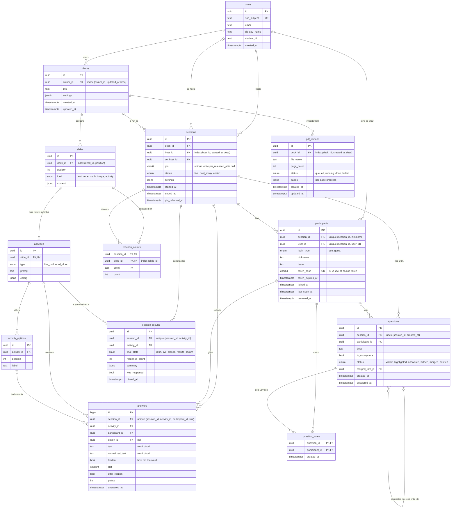

# Database ERD (Release 1)

Source of truth: [`apps/api/prisma/schema.prisma`](../../apps/api/prisma/schema.prisma). Design notes and the ORM decision: [schema.md](schema.md).

GitHub renders the diagram below. To edit it, change `schema.prisma` first, then update this file in the same pull request.

## Indexes for the main lookups

| Lookup                         | Index                                                                                   |
| ------------------------------ | --------------------------------------------------------------------------------------- |
| Session by PIN (join)          | `sessions_pin_active_key`: unique on `pin` where `pin_released_at IS NULL` (partial)    |
| Decks of an owner, newest edit | `decks (owner_id, updated_at DESC)`                                                     |
| Sessions of a host, newest     | `sessions (host_id, started_at DESC)`                                                   |
| Participants of a session      | `participants (session_id, nickname)` and `(session_id, user_id)` unique keys           |
| Resume by cookie token         | `participants (token_hash)` unique                                                      |
| Answers of a session           | `answers (session_id, activity_id)` and the unique key that starts with `session_id`    |
| Questions of a session         | `questions (session_id, created_at)`                                                    |
| Results of a session           | `session_results (session_id, activity_id)` unique                                      |
