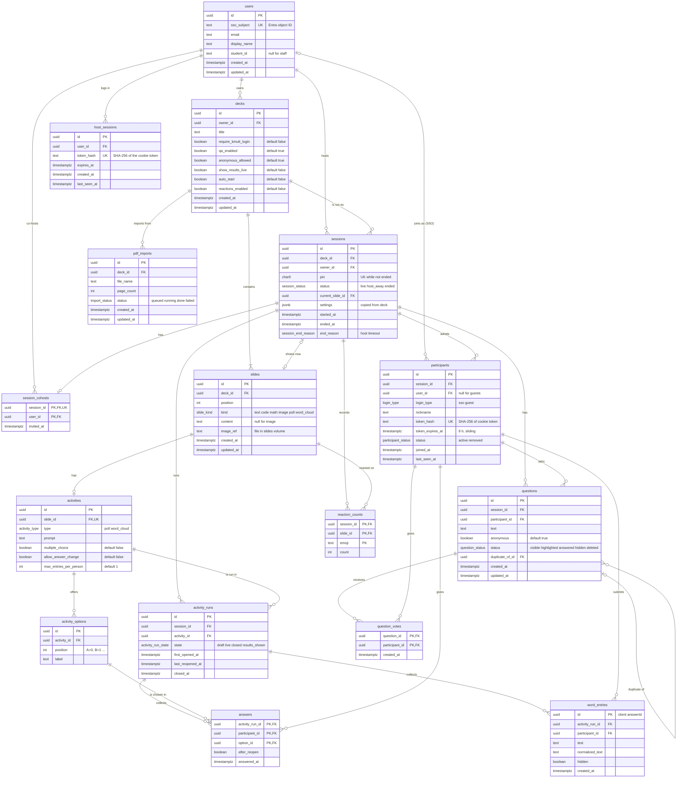

# Database schema — Release 1

- **Ticket:** R1-1 (Sprint 3, 19–24 Oct 2026)
- **Source of truth:** [`apps/api/prisma/schema.prisma`](../../apps/api/prisma/schema.prisma). This page explains it. If the two disagree, the schema wins.
- **Conceptual model:** [Technical design §4](../exam02/technical-design.md#4-db-conceptual-db-design). This page is the physical version of that model: PostgreSQL tables, column types, keys and indexes.

## 1. ORM and migration tool: Prisma 7

**Decision:** Prisma (`prisma` and `@prisma/client` 7.x, with the `@prisma/adapter-pg` driver adapter). Recorded as a team decision on 18 Oct 2026 ([technical design §7.1](../exam02/technical-design.md#71-team-decisions-18-oct-2026)).

Why Prisma, not TypeORM:

| Reason | Detail |
| --- | --- |
| One schema file | `schema.prisma` is the model, the migration source and the type source. TypeORM spreads the model over entity classes and decorators. |
| Migrations are plain SQL | `prisma migrate dev` writes a reviewable `migration.sql`. `prisma migrate deploy` applies pending files only, which is what the deploy job needs (technical design §1.5). |
| Drift check in CI | `prisma migrate diff --exit-code` fails the build when someone edits the schema without a migration. |
| Typed queries | The generated client types every query and relation. Fewer runtime errors in the many small CRUD endpoints (decks, slides, settings). |
| The hot path does not need an ORM | Answers go to Redis first and are flushed with one raw `INSERT ... ON CONFLICT DO NOTHING` (MD-9). Prisma's `$executeRaw` covers that. TypeORM's strengths (active record, complex entity listeners) are not needed. |
| Partial indexes | Prisma 7 supports `where:` on indexes (`partialIndexes` preview), used for the live-session PIN rule. |

Trade-offs we accept: the generated client must be rebuilt after a schema change (`pnpm db:generate`, also run by `build` and `dev`); `partialIndexes` is a preview feature; pgvector columns (R2) need raw SQL.

## 2. Ticket names to table names

The ticket lists the tables by working names. The technical design (§4.1) refined the model later. The schema follows the technical design.

| Ticket name | Table | Note |
| --- | --- | --- |
| users | `users` | |
| — | `host_sessions` | Host login after KMUTT SSO (MD-7). Not in the ticket list |
| decks | `decks` | Holds the session default settings |
| slides | `slides` | |
| activities | `activities` | Poll or word cloud, one per slide |
| activity_options | `activity_options` | Poll options (`POLL_OPTION` in the conceptual model) |
| sessions | `sessions` | |
| participants | `participants` | Holds the MD-13 participant token hash and expiry |
| answers | `answers` | Poll answers (`POLL_RESPONSE`). Word cloud entries are in `word_entries` |
| questions | `questions` | |
| question_votes | `question_votes` | Upvotes (`UPVOTE`) |
| session_results | `activity_runs` | State of each activity in one session. Results are **counted** from `answers` and `word_entries`, never stored as counters (technical design §4.2, MD-9 §3) |
| — | `session_cohosts`, `pdf_imports`, `word_entries`, `reaction_counts` | In the technical design, needed by F3, F9, F8 and F11 |

## 3. ERD

Crow's foot notation. PK = primary key, FK = foreign key, UK = unique. Types are PostgreSQL types. Every `id` is a `uuid` (UUIDv7, made by the Prisma client, so ids sort by creation time).

## 4. Indexes

The three lookups named in the ticket:

| Lookup | Index | Used by |
| --- | --- | --- |
| Session by PIN | `sessions_live_pin_key`: `UNIQUE (pin) WHERE status <> 'ended'`, plus `sessions_pin_idx` on `pin` | `GET /pins/{pin}`, join. The partial unique index stops two open sessions from sharing a PIN. Ended sessions keep their PIN, so the plain index also finds them for the 410 "session ended" answer in the first 24 h |
| Decks by owner | `decks_owner_id_updated_at_idx` on `(owner_id, updated_at DESC)` | `GET /decks` (my decks, newest first) |
| Rows by session ID | `participants (session_id, nickname)` UK, `participants (session_id, user_id)` UK, `activity_runs (session_id, activity_id)` UK, `questions (session_id, created_at)`, `sessions (deck_id, status)`, `sessions (owner_id, started_at DESC)`, and the composite keys of `session_cohosts` and `reaction_counts` | Live screens, rejoin, results, export, history, "live now" count, `DECK_LIVE` check |

Other indexes:

- `participants.token_hash` UK: resolve the participant cookie on every socket `hello` (MD-13).
- `host_sessions.token_hash` UK: resolve the host cookie on every host request. `host_sessions (expires_at)`: delete expired logins.
- `answers (activity_run_id, option_id)`: count votes per option for results and export.
- `word_entries (activity_run_id, normalized_text)`: group words for the cloud.
- Each foreign key column that is not the first column of another index has its own index, so cascading deletes do not scan whole tables.

## 5. Rules carried by keys

| Rule | How |
| --- | --- |
| One answer per participant per option per run; a repeat is dropped | PK `answers (activity_run_id, participant_id, option_id)`. The Redis flush uses `INSERT ... ON CONFLICT DO NOTHING` (MD-9) |
| A retried word submit is stored once | `word_entries.id` is the client `answerId` (`crypto.randomUUID()`, technical design §2.5) |
| One upvote per participant per question | PK `question_votes (question_id, participant_id)` |
| One co-host per session (MD-5 Q17) | UK `session_cohosts.session_id` |
| Nickname unique in a session (`NICKNAME_TAKEN`) | UK `participants (session_id, nickname)` |
| An SSO user rejoins as the same participant | UK `participants (session_id, user_id)` (PostgreSQL treats nulls as distinct, so guests are not affected) |
| Activity state is per session; the deck does not change | `activity_runs`, UK `(session_id, activity_id)` |
| Vote counts are not stored | No counter column on `activity_options` |

## 6. Relation to Redis (MD-9) and tokens (MD-13)

Redis holds the live copy of open activities ([technical design §5.2](../exam02/technical-design.md#52-redis-keys)). The keys map to these tables:

| Redis key | Flushed to / rebuilt from |
| --- | --- |
| `ans:{sid}:<runId>`, `votes:{sid}:<runId>`, `flush:{sid}` | `answers` (`<runId>` = `activity_runs.id`) |
| `aid:{sid}` | Not stored. Short-lived idempotency map |
| `log:{sid}`, `seq:{sid}` | Not stored. Live event log only |
| `presence:{sid}` | `participants.last_seen_at`, written now and then, not on every heartbeat |

If Redis loses data, the API rebuilds `ans:` and `votes:` for open runs from `answers` before it accepts new answers (MD-9 §7.6).

Participant token (MD-7, MD-13): the server makes a random token, puts it in the `md_pt` `HttpOnly` cookie and stores only its SHA-256 hash in `participants.token_hash`. `token_expires_at` is 8 h after issue and moves forward when less than half the lifetime is left (MD-13 fix 2). A missing or past expiry fails closed. Removing a participant sets `status = 'removed'`, which blocks the token for that session.

Host login (MD-7): after KMUTT SSO the server makes a random token, puts it in the `host_session` `HttpOnly` cookie and stores only its SHA-256 hash in `host_sessions.token_hash`, with the same 8 h sliding expiry. A host signs in before any session exists, so a host login is not a participant. Logout deletes the row; expired rows are deleted on the next login.

## 7. Deletes

- Deleting a deck deletes its slides, imports and **all its past sessions and results** (cascade). The API refuses while a session is live (`409 DECK_LIVE`).
- Deleting a slide or activity deletes its past runs and answers. The API refuses while the activity is live (`409 ACTIVITY_LOCKED`). Keeping history after a deck edit is a candidate change for R2 (copy the activity into the session at start).
- A user who owns decks or sessions cannot be deleted (`RESTRICT`). There is no user delete in R1.
- R1 never deletes participants; removal is a status change.
- Deleting a user deletes their host logins (cascade).

## 8. How to run

All commands run in `apps/api`. Without `DATABASE_URL`, they use the docker-compose Postgres on `localhost:5432`.

| Command | What it does |
| --- | --- |
| `pnpm db:migrate --name <change>` | Create a migration from schema changes and apply it (development only) |
| `pnpm db:deploy` | Apply pending migrations (compose, CI, deploy job) |
| `pnpm db:seed` | Add the demo host, deck and poll. Does nothing if the demo deck exists |
| `pnpm db:generate` | Rebuild the Prisma client in `src/generated/prisma` (git-ignored) |

`docker compose up` runs generate, deploy and seed before the API dev server starts. CI starts a `pgvector/pgvector:pg17` service, runs deploy, checks that the schema matches the migrations, runs the seed, and then runs the unit and e2e tests. The e2e suite `test/schema.e2e-spec.ts` checks the seed, the live-PIN rule and the duplicate-answer guard.

Migration rule (technical design §1.5): add before you remove (expand, then contract), because an image rollback cannot undo a data change.
