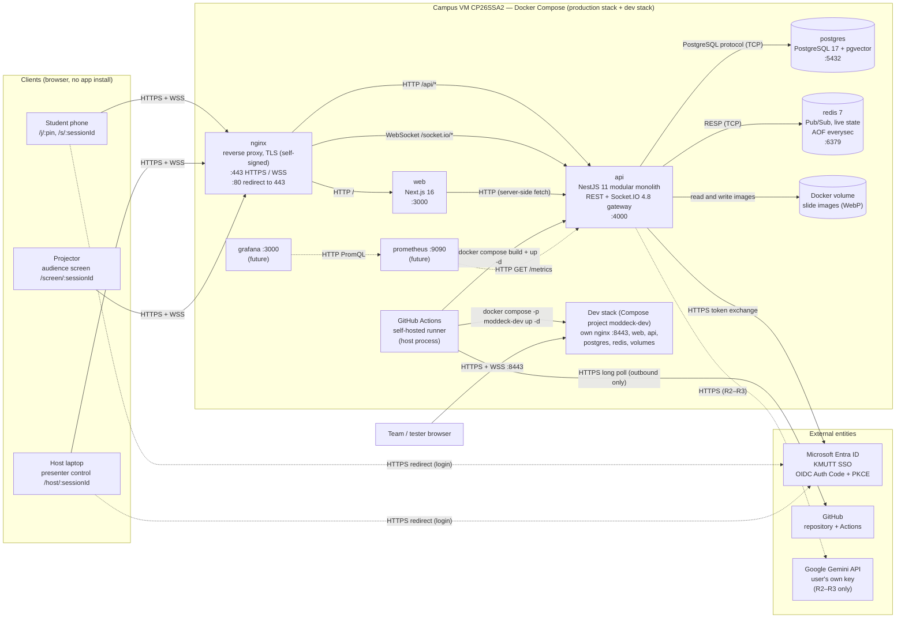
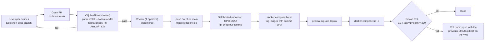
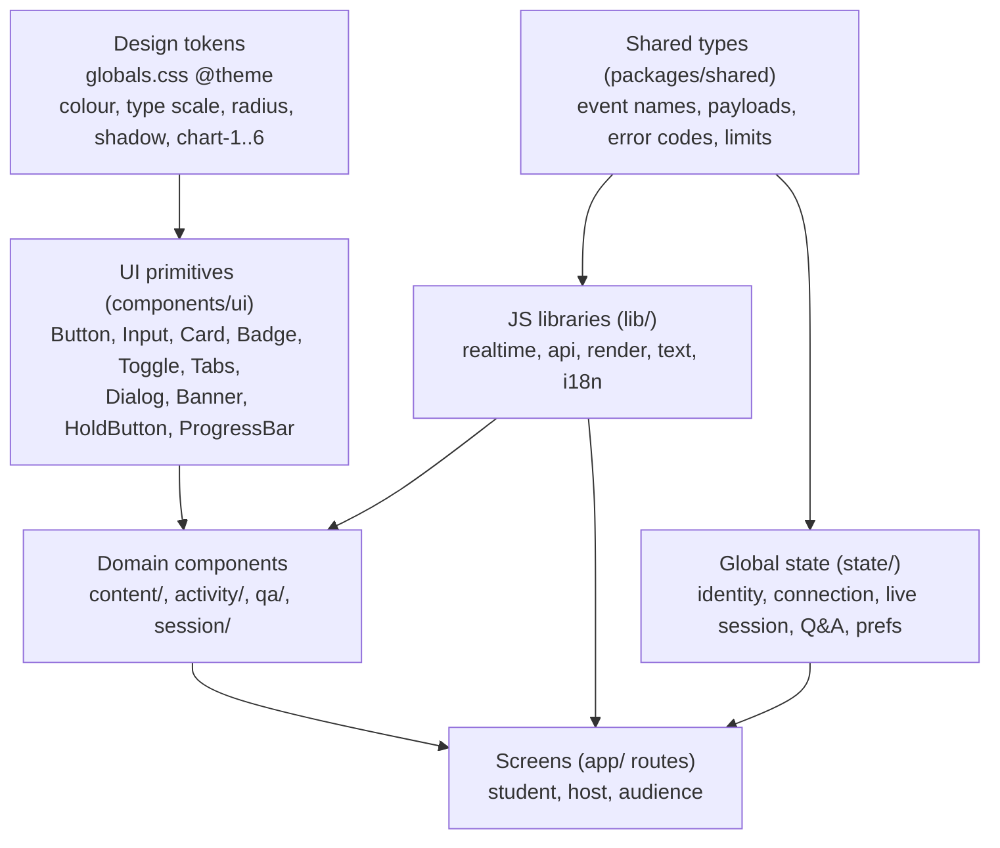
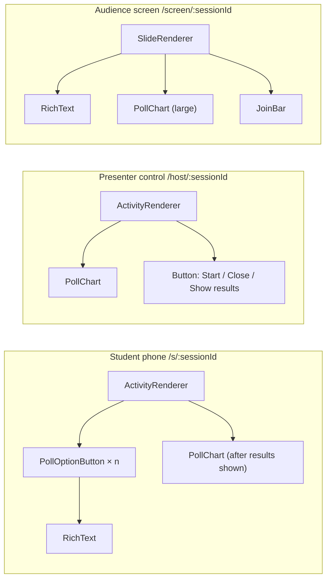
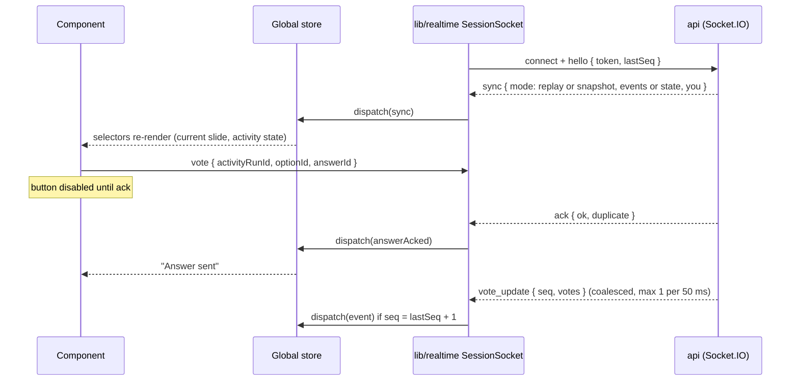
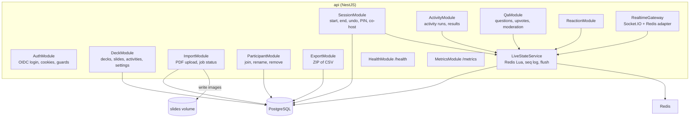
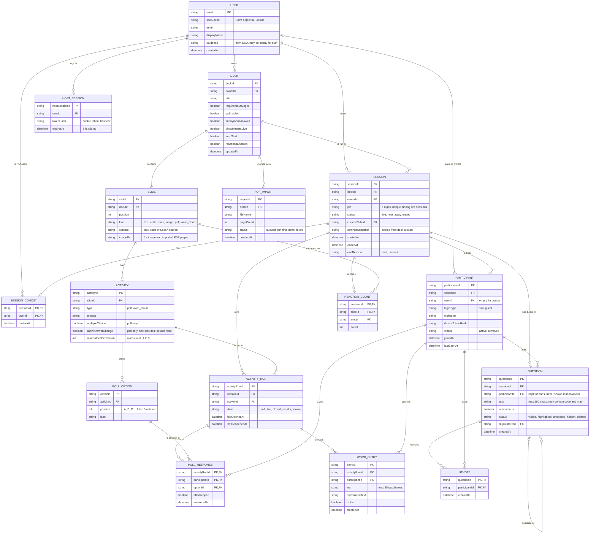
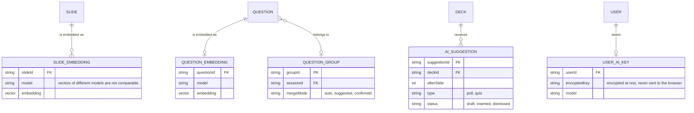
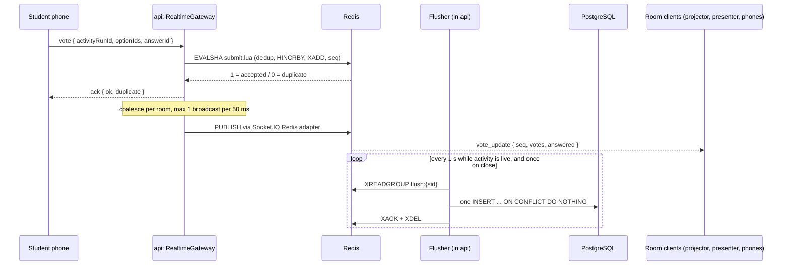

# การออกแบบทางเทคนิค (Technical Design) — Release 1

- **Project:** ModDeck — Real-time Interactive Presentation Platform for KMUTT Classroom
- **Scope:** Release 1 "Foundation & Core Interactions" (due 30 Nov 2026), features F1–F14 in [MD-5 §1.1](../ux/md-5-ia-and-flows.md#11-in-scope)
- **For:** Exam02 (INT365/INT371, 1/2569), topic "การออกแบบทางด้านเทคนิค": Infrastructure, Frontend, Backend, DB
- **Status:** Draft for team review. Team decisions from 18 Oct 2026 are in [section 7](#7-decisions-and-open-questions). No open questions are left.

The design builds on the spike results in [`spikes/`](../../spikes) and the UX decisions in [`docs/ux/`](../ux). Each design choice links to its evidence in [section 6](#6-traceability-design-choice-to-evidence).

## Contents

1. [Infrastructure: Architecture](#1-infrastructure-architecture)
2. [Frontend: Component Design](#2-frontend-component-design)
3. [Backend: API Design](#3-backend-api-design)
4. [DB: Conceptual DB Design](#4-db-conceptual-db-design)
5. [Other design: live state and real-time flow](#5-other-design-live-state-and-real-time-flow)
6. [Traceability: design choice to evidence](#6-traceability-design-choice-to-evidence)
7. [Decisions and open questions](#7-decisions-and-open-questions)

---

## 1. Infrastructure: Architecture

### 1.1 Environments

| Environment | Branch | Purpose | Host | How it runs |
| --- | --- | --- | --- | --- |
| **Local** | feature branches | Daily development on each member's machine | Developer PC / laptop with Docker Desktop | `docker compose up` ([`docker-compose.yml`](../../docker-compose.yml)): `web`, `api`, `postgres`, `redis`. Source mounted, hot reload |
| **CI** | every PR | Format, lint, unit and e2e tests | GitHub Actions, GitHub-hosted runner (`ubuntu-latest`) | [`.github/workflows/ci.yml`](../../.github/workflows/ci.yml) |
| **Dev** | `dev` | Integration: test merged work before it goes to production | Same campus VM `CP26SSA2` | Second Docker Compose project (`docker compose -p moddeck-dev`) with its own `nginx`, `web`, `api`, `postgres`, `redis` and volumes. Public port 8443. Deployed automatically after each merge to `dev` |
| **Production** | `main` | Real classes | Campus VM `CP26SSA2`: 4 vCPU, 7.2 GiB RAM + 4 GiB swap, Ubuntu. Reachable from the internet | Docker Compose. Images are built on the VM. A self-hosted runner deploys after each merge |

- The two long-lived branches follow [CONTRIBUTING.md](../../CONTRIBUTING.md): `main` is production only, `dev` collects work in progress. The `dev` branch does not exist on GitHub yet.
- R1 uses **Docker Compose** on one host. K3S (in the proposal) is a later step when one host is not enough.

### 1.2 Architecture diagram

**Style: modular monolith.** One NestJS `api` holds all business modules (§3.2). PDF import also runs inside `api`, as a background job in a Node worker thread so the Socket.IO event loop is not blocked. The host uploads the PDF from the browser (frontend); there is no separate worker container. This is not a microservice system.

R1 runs **one** `api` instance: MD-8 showed one instance serves a 300-student room at p95 ≤ 73.5 ms with the API under 26% of one core. The Socket.IO Redis adapter (MD-2) lets us add `api` instances later without code changes.



Arrow = direction of the request. Dashed arrow = not used in R1: a browser redirect, a later release, or the future monitoring stack. The runner rebuilds and restarts every app container (`web`, `api`); the diagram shows one arrow to keep it readable.

### 1.3 Containers and services

| Container | Image / base | Service | Port (in container) | Reachable from | Protocol | Evidence |
| --- | --- | --- | --- | --- | --- | --- |
| `nginx` | nginx | Reverse proxy, TLS end (self-signed certificate in R1), WebSocket upgrade | 443, 80 | Internet | HTTPS, WSS | Config draft: [`spikes/md-8-load-test/nginx/nginx.conf`](../../spikes/md-8-load-test/nginx/nginx.conf) |
| `web` | `node:22-alpine` | Next.js 16 (App Router), React 19, Tailwind 4 | 3000 | `nginx` only | HTTP | [`apps/web`](../../apps/web) |
| `api` | `node:22-alpine` | NestJS 11 modular monolith: REST API + Socket.IO gateway + `/metrics` | 4000 | `nginx`, `web` | HTTP, WebSocket | [`apps/api`](../../apps/api), MD-2, MD-8 |
| `postgres` | `pgvector/pgvector:pg17` | Main database. pgvector is installed now for R2 | 5432 | `api` | PostgreSQL wire (TCP) | [`docker/postgres/init.sql`](../../docker/postgres/init.sql) |
| `redis` | `redis:7-alpine` | Socket.IO adapter (Pub/Sub), live counters, answer dedup, flush stream | 6379 | `api` | RESP (TCP) | MD-2, MD-9. MD-9 §7: production must run `--appendonly yes --appendfsync everysec` |
| volume `slides` | Docker volume on the VM | Slide images (WebP, 1920 px, about 75–90 KB per slide) | — | `api` (read and write) | file system | MD-14 §6 |
| `prometheus` *(future)* | `prom/prometheus:v3.15.0` | Scrapes `api` metrics: connections, fan-out packets/s, event-loop lag | 9090 | internal | HTTP | MD-8 §11. Not deployed in R1 |
| `grafana` *(future)* | `grafana/grafana:13.2.3` | Dashboards | 3000 | team only | HTTP | MD-8 monitoring. Not deployed in R1 |
| dev stack | Same images, built from branch `dev` | Full copy of the stack above for the dev environment. Separate containers, network, database, Redis and volumes, so dev data never mixes with production | nginx 443 → host 8443 | Team | HTTPS, WSS | Team decision |
| runner (not a container) | GitHub Actions self-hosted runner on `CP26SSA2` | Runs the deploy job after a merge to `main` or `dev` | no inbound port | — | HTTPS outbound to GitHub | Team decision |

**nginx routes**

| Path | Upstream | Notes |
| --- | --- | --- |
| `/socket.io/*` | `api:4000` | `Upgrade` / `Connection` headers, `proxy_buffering off`, read timeout 1 h. With more than one `api` instance, add sticky routing (`hash $remote_addr consistent` or cookie) because browsers may start with HTTP long-polling (MD-8 nginx config, MD-2 §7) |
| `/api/*` | `api:4000` | REST |
| `/` | `web:3000` | Pages and static assets |

### 1.4 External entities

| Entity | Used for | Release | Data that leaves KMUTT | Evidence |
| --- | --- | --- | --- | --- |
| **Microsoft Entra ID** (KMUTT SSO) | Host login, optional student login. Single-tenant app, OIDC Authorization Code + PKCE | R1 | Login only (Microsoft handles the password) | MD-7: ID token received with a KMUTT account |
| **GitHub** | Source code, pull requests, Actions | R1 | Source code | Repo `lnwwaveza007/ModDeck` |
| **Google Gemini API** | Embeddings (Q&A clustering, slide lookup) and AI Suggestion, with the **user's own API key** | R2–R3 | Question text and slide text, under the user's key | MD-10 §5, AI Suggestion §7 |
| Hugging Face | One-time download of the self-hosted embedding model (`bge-m3`), if the self-hosted option stays | R2 | None (download only) | MD-10 §5 |

### 1.5 CI/CD pipeline

CI runs on GitHub-hosted runners for every pull request. The **self-hosted runner on `CP26SSA2`** only runs the deploy job: it starts automatically after a merge, builds the images on the VM, and restarts the stack. No image registry is used.



| Trigger | Runner | Jobs | Target |
| --- | --- | --- | --- |
| Pull request to `dev` or `main` | GitHub-hosted | CI | — |
| Push (merge) to `main` | Self-hosted on `CP26SSA2` | Build on VM, migrate, deploy, smoke test | Production |
| Push (merge) to `dev` | Self-hosted on `CP26SSA2` | Same steps, with `docker compose -p moddeck-dev` | Dev stack on the same VM (port 8443) |

Notes:

- The CI job already exists in [`ci.yml`](../../.github/workflows/ci.yml). The deploy job is new.
- **Security (the repo is public):** GitHub advises against self-hosted runners on public repositories, because untrusted code could run on the runner. The deploy job must use only `on: push` to protected branches, never `pull_request`. Also turn on "Require approval for all outside collaborators" for fork workflows, and run the runner as a non-root user.
- The runner only makes outbound HTTPS calls to GitHub, so the VM needs no new inbound port for CI/CD.
- Rollback needs the image of the previous commit. Keep the last few SHA-tagged images on the VM and prune older ones.
- A migration that changes data cannot be undone by an image rollback. Write migrations that add before they remove (expand, then contract).

### 1.6 Operational risks in R1

| Item | R1 state | Risk | Note |
| --- | --- | --- | --- |
| TLS certificate | Self-signed | Browsers show a security warning. Students must accept it on each phone, and some in-app browsers (from QR scanner or chat apps) may refuse the page or the WSS connection. Office add-ins only load over trusted HTTPS (MD-21 §4), so the PowerPoint add-in cannot work with it | Plan a trusted certificate before the add-in release |
| Database backup | None | Losing the VM disk or the `pgdata` volume loses all decks, sessions and results | Accepted for R1. Add a backup plan before real classes depend on the data |
| Monitoring | Not deployed | No early warning for connection count, fan-out or event-loop lag | Prometheus and Grafana are drawn as future containers (§1.2); MD-8 has a working setup |
| Single host | One VM, one `api` | A VM or Docker failure stops every session | Redis AOF + reconnect protocol (MD-9, MD-13) limit data loss on a restart |
| PDF import inside `api` | Same container as live rooms | A large import uses CPU and can slow a live class | Run import in a worker thread, allow one import at a time, keep the 150-page and 50 MB limits |
| Dev and production share the VM | Both stacks on 4 vCPU, 7.2 GiB RAM | A heavy dev task (load test, large PDF import, image build) slows a live class | Set `cpus` and `mem_limit` on dev containers. Do not run load tests on dev during class hours. Image builds also run on this VM |

---

## 2. Frontend: Component Design

### 2.1 Design principles

| Principle | How ModDeck applies it |
| --- | --- |
| **Atomic Design layers** | Tokens → UI primitives → domain components → screens. A layer only uses layers below it. |
| **One source of truth for style** | Figma variables map 1:1 to Tailwind tokens in [`globals.css`](../../apps/web/src/app/globals.css) (`color/primary/600` = `--color-primary-600` = `bg-primary-600`). Components use tokens, never raw hex. |
| **Presentational vs container** | Domain components get data by props and raise events. Screens connect them to global state and the socket. The same `PollChart` then works on the phone, the presenter control and the projector. |
| **Server is the source of truth** | Live state comes from the server (snapshot + numbered events, MD-13). The client never shows "Answer sent" before the server acks (MD-5 rule 6). |
| **Open for extension** | `ActivityRenderer` picks a component by activity type. R2 adds Live Quiz by registering one new type, with no change to screens. |
| **Mobile first, projector aware** | Light theme only, 44 × 44 px touch targets, Thai line heights, chart colour + letter (MD-5 §2.7, MD-11). |

### 2.2 Layer diagram



### 2.3 Folder structure (`apps/web/src`)

```text
app/                      routes from the MD-5 sitemap
  page.tsx                landing + PIN entry          /
  j/[pin]/                join: identity choice        /j/:pin
  s/[sessionId]/          student live screen          /s/:sessionId
  decks/                  my decks, deck editor        /decks, /decks/:deckId
  host/[sessionId]/       presenter control, co-host   /host/:sessionId, /host/:sessionId/qa
  screen/[sessionId]/     audience screen (projector)  /screen/:sessionId
  sessions/               history, results, export     /sessions, /sessions/:sessionId
  design-system/          token specimen page (exists)
components/
  ui/                     primitives (MD-11)
  content/                RichText, SlideRenderer, SlideThumbnail
  activity/               ActivityRenderer, PollOptionButton, PollChart, WordCloudInput, WordCloudView
  qa/                     QuestionCard, QuestionList, AskForm, AnonymousToggle
  session/                PinInput, QrCode, JoinBar, WaitingView, ReactionBar, ReactionLayer,
                          ConnectionBanner, ParticipantList, PresenterOverlay, ImportProgress
lib/
  realtime/               SessionSocket: connect, hello/sync, seq, ack, offline state
  api/                    typed fetch wrapper, error mapping, TanStack Query hooks (useDecks, useDeck, …)
  render/                 KaTeX, code highlight, sanitize
  text/                   grapheme length, word normalise
  i18n/                   th / en messages
state/                    Zustand stores, one per slice
```

`packages/shared` is a new workspace package used by `web` and `api`. It needs `packages/*` in [`pnpm-workspace.yaml`](../../pnpm-workspace.yaml).

### 2.4 Component library (common components)

| Component | Layer | Used on | Why it is shared |
| --- | --- | --- | --- |
| `Button`, `Input`, `Card`, `Badge`, `Toggle`, `Tabs`, `Dialog` | ui | All screens | MD-11 core set, token-based |
| `HoldButton` | ui | End session | Hold 2 s to confirm (Q16 in MD-5). Can be reused for any dangerous action |
| `Banner` | ui | Reconnecting, host reconnecting, Q&A closed, session full | One component for all status messages |
| `RichText` | content | Text slide, poll question and options, Q&A question, ask preview | One parser for text + `` `code` `` + fenced code + `$math$`. Same output on phone, presenter and projector (F7) |
| `SlideRenderer` | content | Editor canvas, presenter control, audience screen, thumbnails | Text, code, math and image slides |
| `ActivityRenderer` | activity | Student Activity tab, presenter control, audience screen | Picks the view by `type` (poll, word cloud) and `state` (draft, live, closed, results shown) |
| `PollChart` | activity | Presenter, projector, student results | Fixed colour per option (`chart-1..6`) **plus** letter A, B, C … (not colour only) |
| `PollOptionButton` | activity | Student poll | Large touch target, renders `RichText` |
| `WordCloudInput`, `WordCloudView` | activity | Student / projector, presenter | 25-character limit by grapheme |
| `QuestionCard` | qa | Student Q&A, host Q&A panel, co-host panel, projector highlight | Variants by role: student (upvote), host (hide, answered, duplicate, show on screen), projector (large) |
| `AskForm` + `AnonymousToggle` | qa | Student Q&A | Always shows "You will appear as: …" (MD-5 §2.4) |
| `PinInput` | session | Landing | 6 digits, numeric keypad, auto-submit, paste |
| `QrCode`, `JoinBar` | session | Lobby slide, audience screen corner, presenter | Encodes `https://<host>/j/<pin>` |
| `WaitingView` | session | Student on lobby / content slides | "Look at the screen", slide N of M |
| `ReactionBar`, `ReactionLayer` | session | Student, projector | 5 emojis, 1 tap/s, max 30 on screen |
| `ConnectionBanner` | session | Every live screen | Reads connection state from the store |
| `ParticipantList` | session | Presenter, session results | Rename, remove (host only) |
| `PresenterOverlay` | session | Mirror mode (one display) | Key `O` |
| `ImportProgress` | session | Deck editor | Per-page PDF import progress |

**Example: one component, three surfaces (Live Poll)**



### 2.5 Shared JS library (common functions)

| Module | Functions | Used by | Origin |
| --- | --- | --- | --- |
| `lib/realtime` | `SessionSocket.connect()`, `hello({ token, lastSeq })`, apply `sync` (`replay` or `snapshot`), track `seq`, `send(event, payload)` with ack and client `answerId` (`crypto.randomUUID()`), expose `online / reconnecting / offline` | All live screens | MD-13 `client.mjs`, MD-2 schema |
| `lib/api` | `apiFetch<T>()`: base URL, cookies, JSON, maps the error body (§3.5) to a typed `ApiError` | Decks, sessions, join, export | New |
| `lib/render` | `renderMath()` (KaTeX, `throwOnError: false`), `highlightCode()` (Shiki for instructor content, created once; PrismJS only if a phone must highlight), `sanitizeHtml()` | `RichText`, editor preview | MD-3 `render.ts` |
| `lib/text` | `graphemeLength()` (`Intl.Segmenter`) for nickname 2–20 and word 25, `normalizeWord()` (trim, case, spaces) | Join, Word Cloud, Ask | MD-5 §2.6 |
| `lib/i18n` | `t(key)`, language from phone setting, switch | All screens | MD-5 §2.7 (F14) |
| `packages/shared` | Event names, payload types, error codes, limits (`MAX_PARTICIPANTS = 300`, `PIN_PATTERN = /^\d{6}$/`) | `web` and `api` | Team decision |

### 2.6 State management (global state)

Several components on one screen need the same live data (connection, current slide, activity state, counts). This data lives in one global store. Each slice has one owner.

| Slice | Content | Updated by | Persisted |
| --- | --- | --- | --- |
| `identity` | Host user (SSO) or participant (id, login type, nickname) | REST `/me`, join | Cookie (server). Not in JS |
| `connection` | `status`, `lastSeq`, `resumeMode` | `SessionSocket` | No |
| `liveSession` | Session status, current slide, each activity's state, response counts, participant count, reactions on/off, Q&A open | Socket events (server-authoritative) | No (rebuilt from snapshot) |
| `myResponses` | Own poll answer, own words, own upvotes | Socket acks | No (rebuilt from snapshot `you`) |
| `qa` | Question list, sort, highlighted question | Socket events | No |
| `drafts` | Typed text: question, word, nickname | User input | `localStorage` (MD-5 rule 6: typed text survives a drop) |
| `prefs` | Language, reduce motion | User | `localStorage` |

Data that is not live (deck list, deck editor content, session history) is server data loaded by REST and cached per screen.



**Library: Zustand.** Each slice is one small store (`useConnectionStore`, `useLiveSessionStore`, …). Components subscribe with selectors, so a `vote_update` re-renders the chart only, not the whole screen. `SessionSocket` calls the store actions from outside React. `persist` middleware covers the `drafts` and `prefs` slices. 

**REST data: TanStack Query.** Deck list, deck editor, session history and results are server data, not live state. TanStack Query caches them, shows loading and error states, and refetches after a change (for example, invalidate `["decks"]` after creating a deck). Zustand keeps only client and live state, so the two never hold the same data.

### 2.7 Expected benefits

| Goal | How this design reaches it |
| --- | --- |
| **Design consistency** | Tokens from one file. `RichText` and `PollChart` render the same on every surface. |
| **Maintenance** | One place per concern: socket logic in `lib/realtime`, render logic in `lib/render`, event types in `packages/shared` (checked by the TypeScript compiler on both sides). |
| **Scalability** | Server-authoritative state with `seq` and snapshots scales to 300 phones and survives Wi-Fi drops (MD-13). |
| **Faster future development** | R2 Live Quiz, leaderboard and team mode plug into `ActivityRenderer` and reuse `PollOptionButton`, `PollChart`, `RichText`, `SessionSocket`. |

**Evidence in the project today:** token file and specimen page ([`apps/web/src/app/design-system/page.tsx`](../../apps/web/src/app/design-system/page.tsx)), MD-3 render helpers ([`spikes/md-3-math-code-rendering/src/lib/render.ts`](../../spikes/md-3-math-code-rendering/src/lib/render.ts)), MD-13 client with resume ([`spikes/md-13-Reconnect-and-state-recovery/src/client.mjs`](../../spikes/md-13-Reconnect-and-state-recovery/src/client.mjs)), MD-6 wireframes and MD-15 hi-fi mockups.

### 2.8 Components on each page

Every route from the [MD-5 sitemap](../ux/md-5-ia-and-flows.md#3-sitemap) is built only from the components in 2.4. `/login` has no screen of its own: it redirects to KMUTT SSO. The [visual review page](technical-design-visual.html#pages) draws one diagram per page.

| Page | Route | Components | State, REST and socket |
| --- | --- | --- | --- |
| Landing | `/` | `PinInput`, `Button`, `Banner`, `Tabs` (language) | `prefs` · `GET /pins/{pin}` |
| Join | `/j/:pin` | `Card`, `Banner`, `Button`, `Input`, `Tabs` (language) | `drafts`, `identity`, `prefs` · `GET /pins/{pin}`, `POST …/participants` |
| Student live screen | `/s/:sessionId` | `ConnectionBanner`, `Tabs`, `Badge`, `WaitingView`, `ActivityRenderer` (`PollOptionButton`, `WordCloudInput`, `PollChart`), `QuestionList` (`QuestionCard`), `AskForm` (`AnonymousToggle`), `ReactionBar`, `RichText` | `connection`, `liveSession`, `myResponses`, `qa`, `drafts` · socket `hello`, `vote`, `word`, `question`, `upvote`, `reaction` |
| My decks | `/decks` | `Button`, `Card`, `Badge`, `Dialog`, `Input` | TanStack Query `["decks"]` · `GET/POST /decks`, `POST …/copies`, `DELETE /decks/{id}` |
| Deck editor | `/decks/:deckId` | `Button`, `Banner`, `SlideThumbnail`, `Dialog`, `ImportProgress`, `SlideRenderer`, `RichText`, `Input`, `Toggle` | TanStack Query `["deck", id]` · slides, `slide-order`, `settings`, `imports` · socket `import_progress` |
| Presenter control | `/host/:sessionId` | `JoinBar`, `ConnectionBanner`, `Banner`, `SlideRenderer`, `SlideThumbnail`, `ActivityRenderer` (`PollChart`, `WordCloudView`), `Button`, `QuestionList` (`QuestionCard`), `ParticipantList`, `Toggle`, `HoldButton`, `PresenterOverlay` | `connection`, `liveSession`, `qa` · `PATCH` session, activity, question · socket `slide_changed`, `activity_state`, `vote_update`, `participant_count`, `question_posted` |
| Co-host Q&A | `/host/:sessionId/qa` | `ConnectionBanner`, `Banner`, `Button`, `Tabs`, `QuestionList` (`QuestionCard`) | `connection`, `qa` · `PATCH` question, `POST …/sender-removals`, `POST …/takeovers` |
| Audience screen | `/screen/:sessionId` | `SlideRenderer`, `RichText`, `ActivityRenderer` (`PollChart`, `WordCloudView`), `JoinBar`, `QuestionCard`, `ReactionLayer`, `Card` | `connection`, `liveSession` (read only) · socket `slide_changed`, `activity_state`, `vote_update`, `word_update`, `reaction_burst`, `session_ended` |
| Session history | `/sessions` | `Card`, `Badge`, `Button` | TanStack Query `["sessions"]` · `GET /sessions` |
| Session results | `/sessions/:sessionId` | `Tabs`, `Button`, `PollChart`, `WordCloudView`, `Badge`, `QuestionList` (`QuestionCard`), `ParticipantList` | TanStack Query `["session", id]` · `GET` session, results, questions, participants, export |

---

## 3. Backend: API Design

### 3.1 Conventions

| Item | Rule |
| --- | --- |
| Style | REST over HTTPS for resources. Socket.IO for live, high-frequency actions (votes, words, questions, upvotes, reactions) and for server push. |
| Base path | REST under `/api/v1`. All live traffic on **one** Socket.IO namespace (the default `/`), one room per session |
| Resources | Plural nouns, nested at most two levels: `/decks/{deckId}/slides/{slideId}` |
| Methods | `GET` read, `POST` create, `PATCH` partial update, `PUT` replace (order, settings), `DELETE` remove. No verbs in paths. State changes are `PATCH` on a `state` / `status` field. |
| Format | JSON, `camelCase`. Times in ISO 8601 UTC. |
| IDs | Opaque string IDs. The PIN is not an ID: it is a lookup key for joining. |
| Auth: host | Session cookie after OIDC login (`HttpOnly`, `Secure`, `SameSite=Lax`) |
| Auth: participant | Room-scoped participant token in a cookie (`HttpOnly`, `Secure`), from MD-7. Expiry 8 h, sliding (MD-13 fix 2) |
| Roles | `owner` (deck owner / session owner), `cohost` (Q&A only), `participant` |
| Async work | Long jobs (PDF import) return `202 Accepted` + `Location` of a job resource |
| Rate limits | Wrong PIN: 5 per minute per device, 200 per minute per IP. Questions: 1 per 20 s. Reactions: 1 per s (MD-5 §5.2, §6.4) |
| Persistence | **Prisma** for schema, migrations (`prisma migrate deploy` in the deploy job) and normal queries. The hot paths stay outside Prisma: Redis Lua scripts for answers, and one raw-SQL batch `INSERT` (`$executeRaw`) for the flush (MD-9) |

### 3.2 Backend modules (NestJS)



### 3.3 REST endpoints (Release 1)

Paths are relative to `/api/v1`. "Errors" lists the main non-2xx codes. The common codes (401, 403, 404, 500) apply to every protected endpoint and are not repeated.

**Health and auth (F1, F2)**

| Method | Path | Purpose | Auth | Success | Errors |
| --- | --- | --- | --- | --- | --- |
| GET | `/health` | Liveness for nginx and the deploy smoke test | none | 200 | 503 (DB or Redis down) |
| GET | `/auth/login?returnTo=` | Start OIDC login with Entra ID | none | 302 to Entra | 400 bad `returnTo` (only own paths) |
| GET | `/auth/callback` | OIDC redirect URI: check `state` and PKCE, create user session | none | 302 to `returnTo` | 400 invalid state, 502 Entra error |
| POST | `/auth/logout` | End the host session | host | 204 | — |
| GET | `/me` | Current user or participant | any | 200 | 401 |

**Decks, slides, activities (F4, F5, F7, F8)**

| Method | Path | Purpose | Auth | Success | Errors |
| --- | --- | --- | --- | --- | --- |
| GET | `/decks` | My decks, with "live now" count | host | 200 | — |
| POST | `/decks` | Create a deck (name only; one blank title slide) | host | 201 + `Location` | 422 empty name |
| GET | `/decks/{deckId}` | Deck with slides, activities, options | owner | 200 | 404 |
| PATCH | `/decks/{deckId}` | Rename | owner | 200 | 422 |
| DELETE | `/decks/{deckId}` | Delete a deck (soft: past sessions and results stay) | owner | 204 | 409 `DECK_LIVE` (a session is live) |
| POST | `/decks/{deckId}/copies` | Duplicate a deck | owner | 201 + `Location` | — |
| GET / PUT | `/decks/{deckId}/settings` | Session defaults: require KMUTT login, Q&A on, anonymous allowed, show results live, auto-start, reactions | owner | 200 | 422 |
| POST | `/decks/{deckId}/slides` | Add a slide (content, poll, word cloud) at a position | owner | 201 | 422 invalid content |
| PATCH | `/decks/{deckId}/slides/{slideId}` | Save the canvas of a content slide: `{ elements }`, the whole list back to front (text, code, formula, image, each with position and size). Activity wording is edited with the activity endpoints | owner | 200 | 422 invalid element or activity slide |
| DELETE | `/decks/{deckId}/slides/{slideId}` | Delete a slide | owner | 204 | 409 `ACTIVITY_LOCKED` (activity slide while live) |
| POST | `/decks/{deckId}/slides/{slideId}/copies` | Duplicate a slide; the copy sits right after it | owner | 201 + `Location` | 404 |
| PUT | `/decks/{deckId}/slide-order` | Reorder: full list of slide IDs | owner | 200 | 422 list does not match |
| POST | `/decks/{deckId}/slide-images` | Upload an image (`multipart/form-data`, field `file`; PNG, JPEG, WebP or GIF, 5 MB). An image element then points at the returned `imageRef` | owner | 201 `{ imageRef }` | 413 over 5 MB, 415 not an image, 422 no file |
| GET | `/slide-images/{imageRef}` | Read a slide image. No login: the projector and student phones read it. The name is a random uuid | none | 200 | 404 |

**PDF import (F9)**

| Method | Path | Purpose | Auth | Success | Errors |
| --- | --- | --- | --- | --- | --- |
| POST | `/decks/{deckId}/imports` | Upload a PDF (`multipart/form-data`), start the background job | owner | 202 + `Location: /imports/{importId}` | 413 over 50 MB, 415 not PDF, 422 over 150 pages or password-protected |
| GET | `/imports/{importId}` | Job status and per-page progress | owner | 200 | 404 |
| POST | `/imports/{importId}/retries` | Retry failed pages | owner | 202 | 409 job still running |

Progress is also pushed over the socket (`import_progress`), so the editor does not have to poll.

**Sessions (F3, F10, F12, F13)**

| Method | Path | Purpose | Auth | Success | Errors |
| --- | --- | --- | --- | --- | --- |
| POST | `/decks/{deckId}/sessions` | Start a session: copy settings, assign PIN | owner | 201 `{ sessionId, pin }` | 422 `DECK_INCOMPLETE` with the slides to fix, 409 import still running |
| GET | `/sessions` | Session history, newest first | host | 200 | — |
| GET | `/sessions/{sessionId}` | Session detail and current state | owner, cohost | 200 | 404 |
| PATCH | `/sessions/{sessionId}` | `status: "ended"` (end), `status: "live"` (undo within 60 s), current slide, live settings (reactions, Q&A open) | owner | 200 | 409 `UNDO_EXPIRED`, 409 `SESSION_ENDED` |
| POST | `/sessions/{sessionId}/cohosts` | Invite one co-host (KMUTT account or link) | owner | 201 | 409 `COHOST_EXISTS` |
| DELETE | `/sessions/{sessionId}/cohosts/{userId}` | Remove co-host | owner | 204 | — |
| POST | `/sessions/{sessionId}/takeovers` | Co-host takes over after the owner is away for 2 min | cohost | 201 | 409 `OWNER_ONLINE` |
| PATCH | `/sessions/{sessionId}/activities/{activityId}` | Change activity state: `live`, `closed`, `results_shown` (start, close, show / hide, reopen) | owner | 200 | 409 `INVALID_TRANSITION` (see MD-5 §7.1) |
| GET | `/sessions/{sessionId}/activities/{activityId}/results` | Counts or word list | owner, cohost | 200 | — |
| PATCH | `/sessions/{sessionId}/activities/{activityId}/words/{wordKey}` | Hide or show one Word Cloud word | owner | 200 | 404 |
| GET | `/sessions/{sessionId}/export` | ZIP: `responses.csv`, `questions.csv` (UTF-8 with BOM) | owner | 200 `application/zip` | — |

**Join and participants (F2, F13)**

| Method | Path | Purpose | Auth | Success | Errors |
| --- | --- | --- | --- | --- | --- |
| GET | `/pins/{pin}` | Check a PIN before join: title, `requireLogin`, `allowGuest` | none | 200 | 400 not 6 digits, 404 `PIN_NOT_FOUND`, 410 `SESSION_ENDED` (24 h), 409 `SESSION_FULL`, 429 too many attempts |
| POST | `/sessions/{sessionId}/participants` | Join. Guest: `{ nickname }`. SSO user: no body (uses the login). Sets the participant cookie | none / host cookie | 201 (new) or 200 (rejoin, same participant) | 403 `LOGIN_REQUIRED`, 409 `SESSION_FULL`, 409 `NICKNAME_TAKEN`, 422 `NICKNAME_INVALID`, 403 `PARTICIPANT_REMOVED` |
| GET | `/sessions/{sessionId}/participants` | Participant list with online / offline | owner | 200 | — |
| PATCH | `/sessions/{sessionId}/participants/{participantId}` | Rename (to "Guest N") | owner | 200 | 422 |
| DELETE | `/sessions/{sessionId}/participants/{participantId}` | Remove a participant and block the device token for this session | owner | 204 | — |

**Q&A moderation (F6)**

| Method | Path | Purpose | Auth | Success | Errors |
| --- | --- | --- | --- | --- | --- |
| GET | `/sessions/{sessionId}/questions?sort=popular\|recent` | Question list (REST copy for first load and results page) | owner, cohost, participant | 200 | — |
| PATCH | `/sessions/{sessionId}/questions/{questionId}` | `status`: `visible`, `highlighted`, `answered`, `hidden`; `duplicateOf` | owner, cohost | 200 | 409 `INVALID_TRANSITION` |
| DELETE | `/sessions/{sessionId}/questions/{questionId}` | Author deletes own question | participant (author) | 204 | 403 not author |
| POST | `/sessions/{sessionId}/questions/{questionId}/sender-removals` | "Remove sender": remove the author without showing the name | owner, cohost | 201 | — |

### 3.4 Socket.IO events (live channel)

All live traffic uses one Socket.IO namespace (`/`). Each session is one room. Every server event carries `seq` (per session, increasing). Client actions send an ack callback. The names extend the MD-2 schema; MD-13 adds the join handshake, `state` and `seq`. The schema is code in [`packages/shared/src/events.ts`](../../packages/shared/src/events.ts); room events are sent as `{ seq, type, sessionId, at, data }`.

| Direction | Event | Payload (main fields) | Notes |
| --- | --- | --- | --- |
| C → S | `join` | `sessionId`, `lastSeq` (token from the cookie or `auth.token` in the handshake) | First message after every (re)connect. A socket without a valid token is refused at the handshake; a `sessionId` other than the token's gets `ROOM_FORBIDDEN` |
| S → C | `state` | `mode: "replay" \| "snapshot"`, `seq`, `events[]` or `snapshot` | Also returned in the `join` ack. Replay if `lastSeq` is still in the log (cap 500 events), else snapshot |
| C → S | `vote` | `activityRunId`, `optionIds[]`, `answerId` | Ack: `{ ok, duplicate }`. Lua script, one answer per participant (MD-9). Default: the first answer counts and a second vote returns `duplicate` (the fastest path, proven in MD-9). If the host turns on "allow answer change" for this poll, a new vote replaces the old one until the poll closes |
| C → S | `word` | `activityRunId`, `text`, `answerId` | Ack, limit per person |
| C → S | `question` | `text`, `anonymous`, `clientMsgId` | Ack. 1 per 20 s |
| C → S | `upvote` | `questionId`, `on: true \| false` | Ack |
| C → S | `reaction` | `emoji` | 1 per s, no ack needed |
| S → C | `slide_changed` | `slideId`, `index` | |
| S → C | `activity_state` | `activityId`, `state` | |
| S → C | `vote_update` | `votes` (tally), `answered`, `batch` | **Coalesced per room, max 1 per 50 ms** (MD-8 fix). Leading edge in a quiet room (MD-8 §11) |
| S → C | `word_update` | `words[]` with counts | Coalesced like votes |
| S → C | `question_posted` / `question_updated` | question fields (author hidden if anonymous) | |
| S → C | `participant_count` | `online`, `total` | Coalesced. Replaces per-person `user_joined` (MD-8 §9: join was quadratic) |
| S → C | `reaction_burst` | counts per emoji | Audience screen only |
| S → C | `import_progress` | `importId`, `page`, `status` | Host only |
| S → C | `session_ended` | `reason: "host" \| "timeout"` | |
| S → C | `error` | `code`, `message`, `seq` | Same codes as REST |

### 3.5 Error handling and status codes

One error body for REST and socket errors:

```json
{
  "error": {
    "code": "SESSION_FULL",
    "message": "This session is full (300 people). Ask the host.",
    "details": { "limit": 300 },
    "requestId": "req_8f3c2a"
  }
}
```

- `code`: stable, machine-readable (the frontend maps it to Thai / English text).
- `message`: English, for logs and developers.
- `details`: optional, for example field errors `{ "fields": { "nickname": "TOO_SHORT" } }`.
- `requestId`: matches the server log line. Stack traces are never sent to the client.

| Status | When |
| --- | --- |
| 200 OK | Read or update succeeded |
| 201 Created | Resource created (`Location` header set) |
| 202 Accepted | Background job started (PDF import) |
| 204 No Content | Delete or logout succeeded |
| 302 Found | OIDC redirects |
| 400 Bad Request | Malformed input (bad JSON, PIN not 6 digits) |
| 401 Unauthorized | No or expired login / participant token |
| 403 Forbidden | Logged in but not allowed (co-host changing slides, removed participant, login required) |
| 404 Not Found | Resource or PIN does not exist |
| 409 Conflict | State conflict: `SESSION_FULL`, `NICKNAME_TAKEN`, `ACTIVITY_LOCKED`, `INVALID_TRANSITION`, `UNDO_EXPIRED`, `DECK_LIVE` |
| 410 Gone | PIN of a session that ended in the last 24 h |
| 413 Payload Too Large | PDF over 50 MB |
| 415 Unsupported Media Type | Upload is not a PDF |
| 422 Unprocessable Entity | Valid JSON that breaks a rule: empty poll question, under 2 options, nickname rules, over 150 pages |
| 429 Too Many Requests | Rate limit hit (`Retry-After` header) |
| 500 Internal Server Error | Unexpected error |
| 502 Bad Gateway | Entra ID (or Gemini in R2) failed |
| 503 Service Unavailable | Health check: DB or Redis down |

### 3.6 Example: guest join

```http
POST /api/v1/sessions/ses_7Q2k/participants
Content-Type: application/json

{ "nickname": "ปลา" }
```

```http
HTTP/1.1 201 Created
Location: /api/v1/sessions/ses_7Q2k/participants/par_91xd
Set-Cookie: md_pt=<token>; HttpOnly; Secure; SameSite=Lax; Path=/; Max-Age=28800

{ "participantId": "par_91xd", "loginType": "guest", "nickname": "ปลา", "sessionId": "ses_7Q2k" }
```

```http
HTTP/1.1 409 Conflict

{ "error": { "code": "NICKNAME_TAKEN", "message": "Nickname is already used in this session.", "requestId": "req_1b7e" } }
```

---

## 4. DB: Conceptual DB Design

### 4.1 ER diagram (Release 1)

Notation: crow's foot. `||` exactly one, `|o` zero or one, `|{` one or more, `o{` zero or more. The diagram is product-agnostic: it shows entities, attributes and relationships, not tables or column types of one database product.



### 4.2 Main rules shown by the model

| Rule | Where in the model | Source |
| --- | --- | --- |
| A deck is reusable; each run is a separate session with its own PIN, participants and answers | Deck-to-session is one-to-many; answers hang off `ACTIVITY_RUN` and `PARTICIPANT`, not off `ACTIVITY` | MD-5 §2.1 |
| Activity state is per activity **per session**; the deck is never changed by a session | `ACTIVITY_RUN.state` | MD-5 §7.1 |
| One answer per participant per option per run; a repeat is ignored | Key of `POLL_RESPONSE` (MD-9 used the same key with `ON CONFLICT DO NOTHING`) | MD-9 §3 |
| The host decides per poll whether students can change their answer before it closes. Default: first answer counts | `ACTIVITY.allowAnswerChange` (default false) | Team decision, 18 Oct 2026 |
| Answers after a reopen are flagged in the export | `POLL_RESPONSE.afterReopen` | MD-5 Q15 |
| Anonymous questions still store the participant (for bans and upvote rules) | `QUESTION.participantId` + `anonymous` | MD-5 §2.4 |
| One upvote per participant per question | Key of `UPVOTE` | MD-5 §5.2 |
| One co-host per session in R1 | Session has zero or one `SESSION_COHOST` | MD-5 Q17 |
| Reactions store counts only, no person | `REACTION_COUNT` has no participant | MD-5 §5.2 |
| Vote counts are not stored as counters; they are counted from answers | No count field on `POLL_OPTION` | MD-9 §3 |

### 4.3 Preview: entities for Release 2–3 (not in R1 scope)

Shown so the R1 model leaves room for them. Details come with the R2 design.



Note for R2: with Prisma, a `vector` column is created in a SQL migration (`CREATE EXTENSION vector`) and searched with raw SQL in Prisma 6/7; Prisma 8 adds a pgvector extension pack (`@prisma/orm-extension-pgvector`). Pick the way that matches the Prisma version chosen in R1.

Note for the slide version: Mermaid places lines automatically and can cross lines in a large diagram. For the exam slide, redraw §4.1 in a diagram tool with the same entities and notation, and route the lines so they do not overlap.

---

## 5. Other design: live state and real-time flow

### 5.1 Two stores, two jobs

| Store | Holds | Why |
| --- | --- | --- |
| **Redis** (live, in memory, AOF) | Answers of open activities, counts, seq event log, participant presence, Socket.IO Pub/Sub | 300 answers in one second without a database bottleneck or race (MD-9: Lua script 22–32 µs per submit) |
| **PostgreSQL** (durable) | Everything in §4.1 | Results, history, export. Filled from Redis by a batch flush |

### 5.2 Redis keys

All keys of one session share the hash tag `{sid}` (one Redis Cluster slot).

| Key | Type | Content | Written with | Source |
| --- | --- | --- | --- | --- |
| `ans:{sid}:<runId>` | hash | participant → option(s) | `HSETNX` inside Lua | MD-9 |
| `votes:{sid}:<runId>` | hash | option → count | `HINCRBY` inside Lua | MD-9 |
| `flush:{sid}` | stream | one entry per accepted answer | `XADD` inside Lua | MD-9 |
| `aid:{sid}` | hash | `answerId` → result (idempotent retry) | Lua | MD-13 |
| `log:{sid}` | list / stream | last 500 server events with `seq` | on every broadcast | MD-13 |
| `seq:{sid}` | string | last `seq` | `INCR` | MD-13 |
| `presence:{sid}` | sorted set | participant → last seen time | on heartbeat | MD-5 Q10, Q22 |

The host decides per poll whether students can change their answer (`allowAnswerChange`, default off: the first answer counts). MD-9 tested only "first answer wins" (`HSETNX`), which covers polls with the option off. With the option on, the Lua script must, in one atomic step, read the old answer, decrement the old option, increment the new one and write the new answer. The flush must then replace that participant's rows (delete and insert in one transaction) instead of `ON CONFLICT DO NOTHING`. This path needs its own concurrency test before R1.

### 5.3 Vote path (sequence)



On "Close activity", the UI shows the closed state only after the final flush returns (MD-9 §7.3). If Redis loses data, the API rebuilds the session keys from PostgreSQL before it accepts new answers (MD-9 §7.6).

---

## 6. Traceability: design choice to evidence

| Design choice | Evidence | Result |
| --- | --- | --- |
| Socket.IO + Redis adapter for real time | [MD-2](../../spikes/md-2-websocket-pubsub/FINDINGS.md) | Pass: broadcast across 2 instances |
| One `api` instance for 300 per room; coalesce `vote_update` every 50 ms | [MD-8](../../spikes/md-8-load-test/FINDINGS.md) | Pass on campus VM: p95 65 / 71 / 6 ms, 0 dropped of 3.24 M |
| Redis first, Lua submit, stream flush, AOF `everysec` | [MD-9](../../spikes/md-9-burst-writes/FINDINGS.md) | Pass: no lost or double-counted answers in 10 rounds |
| `hello` / `sync` / `seq`, idempotent `answerId`, 8 h sliding token | [MD-13](../../spikes/md-13-Reconnect-and-state-recovery/FINDINGS.md) | Pass: 36/36 tests (drops of 5 s, 30 s, 2 min; restart) |
| Entra ID OIDC + PKCE for hosts; anonymous guest session with cookie | [MD-7](../../spikes/MD-7/kmutt%20sso%20and%20guest%20model.md) | ID token received with a KMUTT account |
| PDF import as a background job, pdf.js + Thai repair, WebP 1920 px | [MD-14](../../spikes/md-14-pdf-import/FINDINGS.md) | Pass with conditions (Thai repair; Google Slides / Canva exports not tested) |
| KaTeX for math; Shiki for instructor content, PrismJS fallback | [MD-3](../../spikes/md-3-math-code-rendering/FINDINGS.md) | Feasible. Device tests still open |
| pgvector now, embeddings and Gemini in R2–R3 | [MD-10](../../spikes/md-10-embeddings/FINDINGS.md), [AI Suggestion](../../spikes/ai-suggestion/FINDINGS.md) | Pass; user's own Gemini key |
| Tokens and Thai font | MD-11 ([`globals.css`](../../apps/web/src/app/globals.css)) | Done |
| Screens, routes, states, rules | [MD-5](../ux/md-5-ia-and-flows.md), [MD-6](../ux/md-6-wireframes.md) | Done |
| Docker Compose on `CP26SSA2`, build on VM, self-hosted runner deploy, Zustand, Prisma, `packages/shared`, modular monolith | Team decisions, 18 Oct 2026 (§7.1) | Decided |

---

## 7. Decisions and open questions

### 7.1 Team decisions (18 Oct 2026)

| Topic | Decision |
| --- | --- |
| Environments | Two deployed environments: **dev** (branch `dev`) and **production** (branch `main`), both on `CP26SSA2` |
| Production host | Campus VM `CP26SSA2` |
| Orchestration | Docker Compose for the first version. K3S later, if needed |
| Self-hosted runner | Used to trigger the automatic deploy after a merge. CI stays on GitHub-hosted runners |
| Images | Built directly on the VM. No registry |
| TLS and access | Self-signed certificate for now. The server is reachable from the internet (risks in §1.6) |
| Slide images | Docker volume on the VM |
| PDF import | Runs inside `api` as a background job (worker thread). No separate worker container. The host uploads the PDF from the frontend. Revisit in R2 if embedding jobs are heavy |
| Monitoring | Not deployed in R1. Prometheus and Grafana stay in the diagram as future containers |
| Backup | No backup plan in R1 (risk in §1.6) |
| Frontend state | Zustand |
| ORM and migrations | Prisma |
| API shape | REST under `/api/v1`, one Socket.IO namespace |
| Guest token | `HttpOnly` cookie (MD-7). MD-5 §2.3 updated |
| MD-17 | Walking skeleton was replaced by a prototype. No skeleton code to match |
| Architecture style | Modular monolith (one `api`), not microservices |
| Shared types | `packages/shared` workspace |
| Changing a poll answer | The host decides per poll (`allowAnswerChange`). Default off: the first answer counts. MD-5 §5.2 updated |
| Dev environment | Same VM `CP26SSA2`, second Compose project, auto-deploy on merge to `dev` |
| REST data on the frontend | TanStack Query (Zustand for client and live state only) |
| Document language | English |

### 7.2 Still open

None. MD-5 §2.3 and §5.2 were updated on 18 Oct 2026 to match (guest token in an `HttpOnly` cookie, poll answers locked by default).
