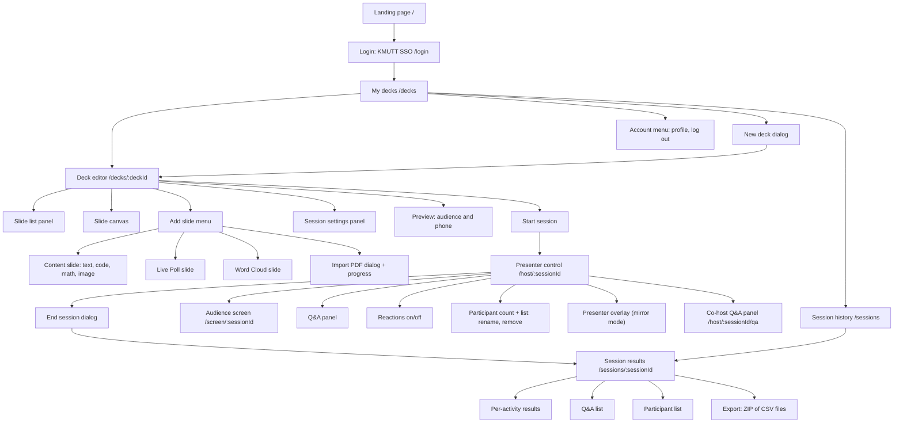
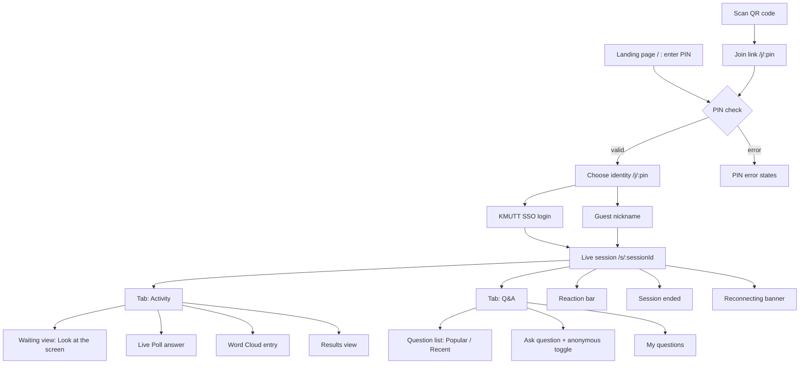
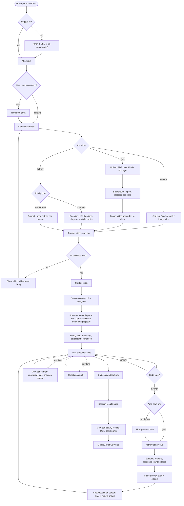
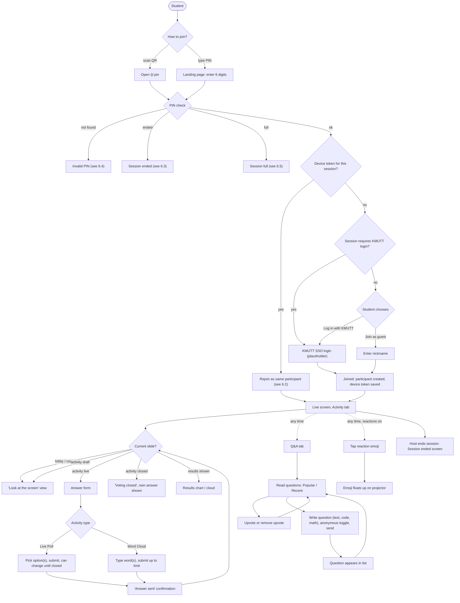
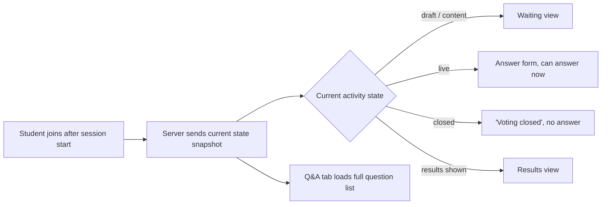
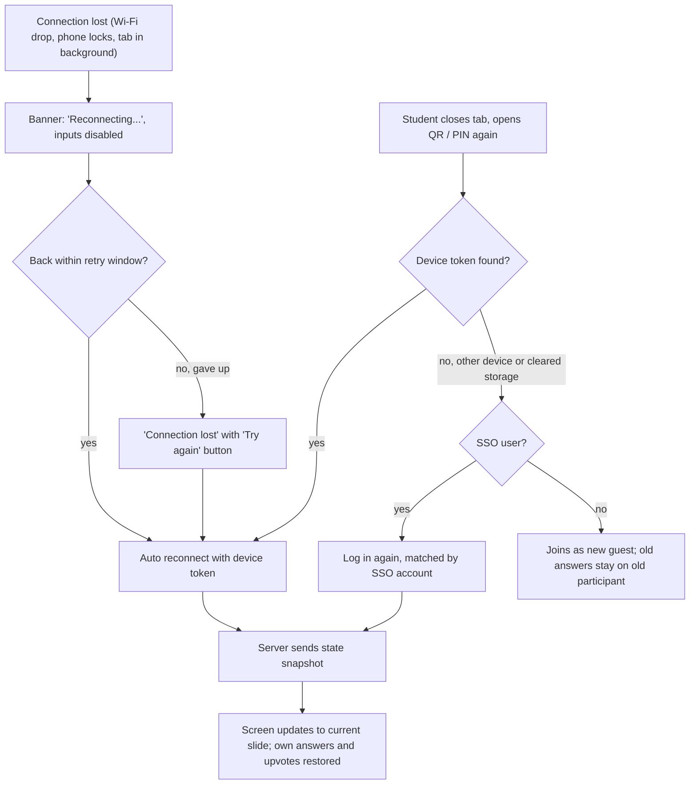
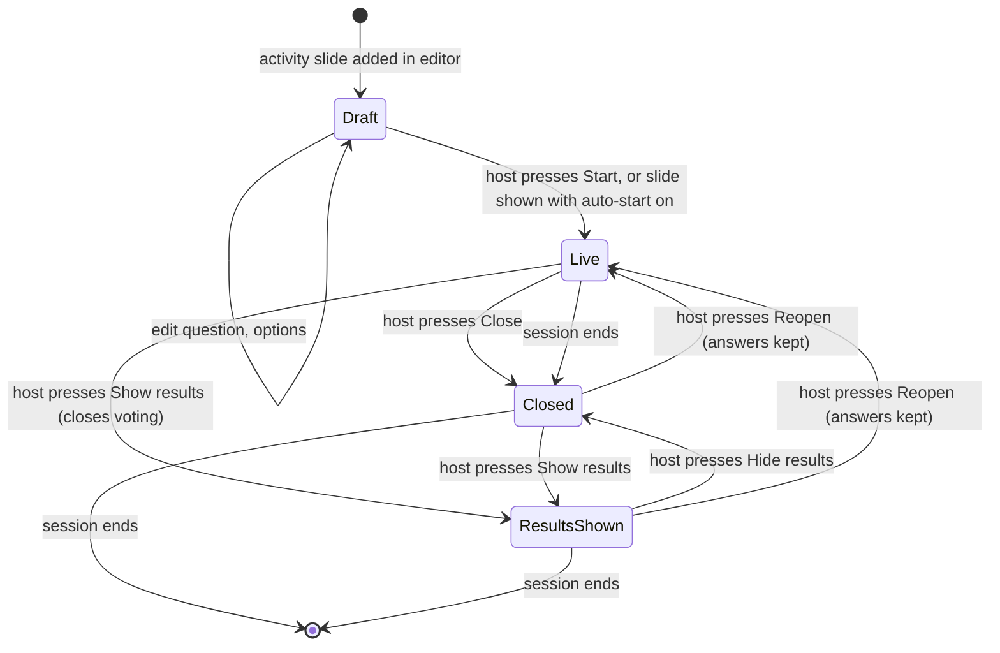
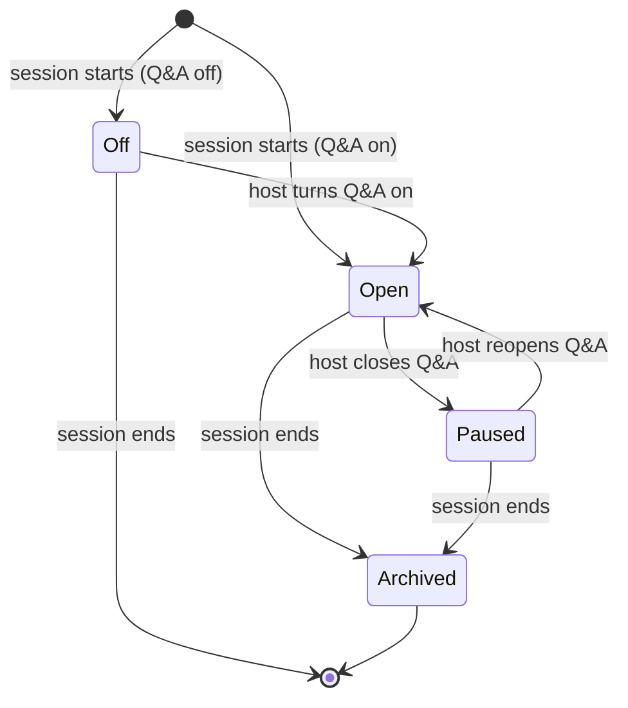
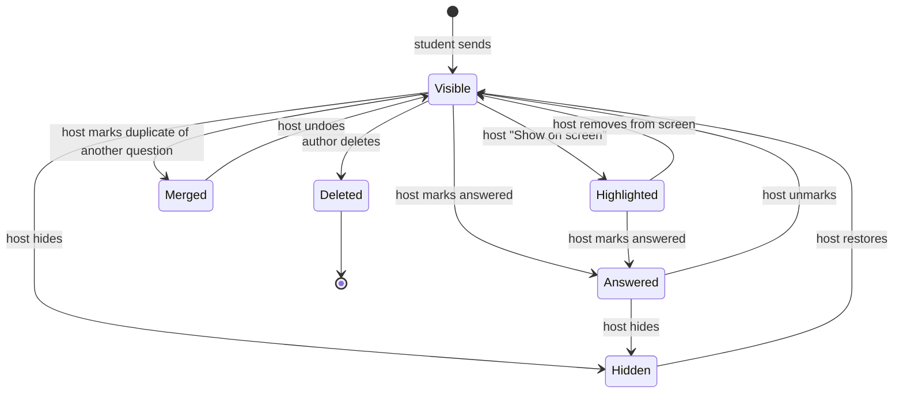
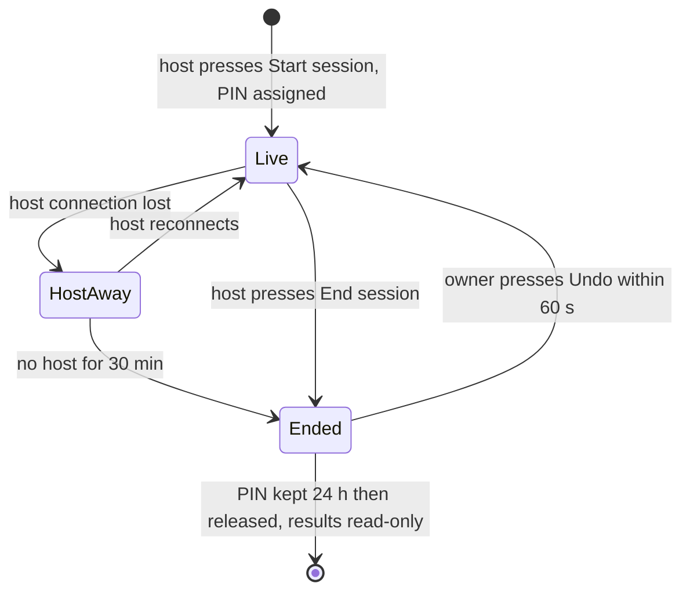

# MD-5 Information Architecture and User Flows (Release 1)

- **Ticket:** MD-5 (Jira MOD-9) · Sprint 1 · Track: UX
- **Status:** Draft. Open questions decided on 2026-10-09 (see [section 8](#8-decisions)). Updated the same day after a student and an instructor role review (decisions Q14–Q23). Waiting for team review (see [section 9](#9-team-review)).
- **Feeds:** MD-6 low-fi wireframes (every screen in [section 3](#3-sitemap) needs a wireframe)
- **Soft blockers:**
  - MD-4 (competitor review, journey maps): not done yet. When it is done, check the flows against the journey pain points.
  - MD-7 (SSO, guest identity): ETS has not replied. The SSO step is a placeholder box. The guest rules in [section 2.3](#23-identity-placeholder-until-md-7) are a working guess.

## At a glance

Read this part first. The rest of the doc gives the details, and long tables are folded (click "Show …" to open them).

**The two main flows**

- **Host:** log in with KMUTT → create a deck → add slides (text, code, math, PDF pages) and activities (Live Poll, Word Cloud) → start session → present and run activities → moderate Q&A → end session → view results and export.
- **Student:** scan the QR code or type the 6-digit PIN → log in with KMUTT or join as a guest → answer activities → ask and upvote in Q&A → send reactions.

**Ten rules to remember**

1. The phone shows activities only. Slides stay on the projector.
2. The host runs everything from one screen. With one display, keyboard shortcuts and a `Tab` overlay.
3. Activities start when the host presses Start. Auto-start is optional.
4. Anonymous questions never show a name: not to the host, not to classmates, not in the export.
5. Poll answers of KMUTT-login users are exported with their student ID. The join screen says so.
6. A vote counts when the phone shows "Answer sent". Offline, buttons are disabled and typed text is kept.
7. After an activity starts, only wording can change. Activities cannot be deleted during a live session.
8. End session: hold for 2 s, then 60 s to undo.
9. Max 300 people per session. An offline person keeps their seat for 15 min.
10. Thai and English UI in Release 1.

**Activity states:** Draft → Live → Closed → Results shown. Reopen goes back to Live and keeps answers.

**Status:** Q1–Q13 were decided by the team. Q14–Q23 are defaults from a role-play review and need team confirmation (section 8).

**Easier to read:** an interactive version of this doc (tabs for host, student, edge cases, states, decisions) is at <https://claude.ai/artifact/7Cxndsnd3Hp95UuE1dp55c>. It is private until the owner shares it. If the two disagree, this file wins.

## Contents

1. [Release 1 scope](#1-release-1-scope)
2. [Concepts and rules](#2-concepts-and-rules)
3. [Sitemap](#3-sitemap)
4. [Host flow](#4-host-flow)
5. [Student flow](#5-student-flow)
6. [Edge cases](#6-edge-cases)
7. [Activity and session states](#7-activity-and-session-states)
8. [Decisions](#8-decisions)
9. [Team review](#9-team-review)

---

## 1. Release 1 scope

Source: proposal roadmap, Release 1 "Foundation & Core Interactions" (due 30 Nov 2026), plus team decisions for MD-5.

### 1.1 In scope

| #   | Feature                                                          | Source             | Where it shows in the flows                                          |
| --- | ---------------------------------------------------------------- | ------------------ | -------------------------------------------------------------------- |
| F1  | Host login with KMUTT SSO                                        | Roadmap R1         | Host flow, step 1                                                    |
| F2  | Student join by QR code or 6-digit PIN, with KMUTT SSO or guest  | Roadmap R1         | Student flow                                                         |
| F3  | Real-time engine, up to 300 participants per session             | Roadmap R1         | "Session full" edge case, all live screens                           |
| F4  | Live Poll with live chart                                        | Roadmap R1         | Deck editor, presenter control, student activity screen              |
| F5  | Word Cloud, real time                                            | Roadmap R1         | Deck editor, presenter control, student activity screen              |
| F6  | Live Q&A with upvote and anonymous option                        | Roadmap R1         | Student Q&A tab, host Q&A panel                                      |
| F7  | Code and math rendering (syntax highlight, KaTeX) on all screens | Roadmap R1         | Content slides (projector), poll question and options, Q&A questions |
| F8  | Native slide editor (text, code, math, image slides)             | Team decision      | Deck editor                                                          |
| F9  | PDF import, each page becomes one image slide                    | Team decision      | Deck editor, import progress                                         |
| F10 | Session history with per-activity results and CSV export         | Team decision      | Host "Sessions" area                                                 |
| F11 | Live reactions (cheering emojis) on the projector                | Team decision (Q9) | Student reaction bar, audience screen                                |
| F12 | Co-host (TA) role: moderate Q&A, take over a session             | Role review (Q17)  | Presenter control, section 2.5                                       |
| F13 | Host participant management: rename, remove                      | Role review (Q21)  | Presenter control, section 2.5                                       |
| F14 | Thai and English UI                                              | Role review (Q23)  | All screens, section 2.7                                             |

Notes:

- **F9 is images only.** Text extraction (MD-14) stays a back-end detail for later AI features. The MD-14 findings say a 50-slide deck takes 7–14 s, so import runs as a background job with progress per page. The flow must not block the host while import runs.
- **F10 is not the R2 analytics dashboard.** No heatmap, no learning-gap view. It is a plain list of results and an export.
- **F11 is not in the proposal roadmap.** It is in the proposal feature table only. The team moved it into R1 (Q9). Tell the advisor at the next review.
- **F12–F14 were added after the role review** (see section 8, Q14–Q23). F12 is kept small: one co-host with Q&A moderation and take-over, no slide editing.

### 1.2 Out of scope for Release 1

Do not draw screens for these.

| Feature                                             | Release |
| --------------------------------------------------- | ------- |
| Live Quiz, countdown timer, leaderboard             | R2      |
| Team mode, team competition, streak multipliers     | R2      |
| Host Session Analysis dashboard, engagement heatmap | R2      |
| AI Q&A clustering                                   | R2      |
| AI contextual slide lookup                          | R3      |
| AI synonym merge in Word Cloud                      | R3      |
| AI Suggestion / Pre-session Planner                 | R3      |
| PowerPoint and Canva add-ins                        | Later   |

---

## 2. Concepts and rules

These terms are used the same way in every diagram below.

### 2.1 Objects

| Term            | Meaning                                                                                                                                                       |
| --------------- | ------------------------------------------------------------------------------------------------------------------------------------------------------------- |
| **Deck**        | An ordered list of slides owned by one host. A deck is reusable.                                                                                              |
| **Slide**       | One of: content slide (text, code, math, image) or activity slide (Live Poll, Word Cloud).                                                                    |
| **Activity**    | The interactive part of an activity slide. Each activity has a state (see [section 7](#7-activity-and-session-states)).                                       |
| **Q&A**         | One Q&A board per session. It is not a slide. Students can use it at any time while the session is live.                                                      |
| **Reaction**    | A cheering emoji a student taps. It floats up on the projector for a few seconds. It is not a slide and has no name attached.                                 |
| **Session**     | One run of a deck, for example "INT365 lecture, 12 Oct". A deck can have many sessions. Each session has its own PIN, participants, responses, and questions. |
| **PIN**         | 6 digits. Unique among live sessions. Kept for 24 h after the session ends, then released.                                                                    |
| **Participant** | A student or audience member in one session. Either an SSO user or a guest.                                                                                   |

### 2.2 Host screens during a session

The host uses two screens at once:

- **Presenter control** (host laptop): current slide, next slide, activity controls, Q&A panel, reactions toggle, participant count. The host runs everything from this one screen.
- **Audience screen** (projector): the slide, live results, reactions, PIN and QR code. It has no controls. The host opens it in a second window and drags it to the projector.

**Mirror mode (one display, Q19).** If the host has only one display, the audience screen runs full screen and the host controls it with keyboard shortcuts and a **presenter overlay**. The overlay is a small panel, opened with `Tab`, that shows: next slide thumbnail, "N answered of M online", unanswered Q&A count, reactions on/off, and the session clock. It hides when `Tab` is pressed again, and it never appears on the projector copy of the screen when two displays are used.

Shortcut list (shown with `?`): `→` / `←` next / previous slide, `Space` start or close the current activity, `S` show or hide results, `Q` open the Q&A panel, `R` reactions on/off, `B` blank screen, `G` then slide number to jump, `Tab` overlay. A slide jump list is always in presenter control, so a wrong advance is fixed in one click.

### 2.3 Identity (placeholder until MD-7)

| Rule                  | Rule in this draft                                                                                                                                       |
| --------------------- | -------------------------------------------------------------------------------------------------------------------------------------------------------- |
| Host login            | KMUTT SSO only. Any SSO account can host, staff or student (Q1). No guest hosts.                                                                         |
| Student login         | Choose "Log in with KMUTT" or "Join as guest". Default session setting allows both.                                                                      |
| Guest identity        | Nickname (required, 2–20 characters). A device token in local storage keeps the same participant on rejoin.                                              |
| SSO identity          | Name and student ID from SSO. Used in the CSV export.                                                                                                    |
| Anonymous Q&A         | Default on (Q4). The host and other students never see the name. The server still stores the participant ID (needed for upvote rules and abuse checks). |
| "Require KMUTT login" | Session setting, default off. When on, the guest option is hidden.                                                                                       |

Show detailed rules: privacy, roles, nicknames, language (2.4–2.7)

### 2.4 Privacy rules (Q18)

Students must be able to read these rules on their phone. Both reviews found that Student T will not ask a question unless the app says clearly who can see the name.

| Item                                 | Who sees the name                                                                                                 |
| ------------------------------------ | ----------------------------------------------------------------------------------------------------------------- |
| Question sent as Anonymous           | Nobody on screen: not the host, not classmates, not the co-host. The server keeps the participant ID for bans only (2.5). Never in the export. |
| Question sent with the name on       | Everyone: host, classmates, projector. SSO users show their real name, guests show their nickname.               |
| Poll and Word Cloud answers          | Classmates never see who answered what. The host sees counts only. The export links answers to the participant (student ID for SSO users) so the instructor can give participation scores. |
| Reactions                            | Nobody. Counts only.                                                                                             |

Where the student sees this:

- **Join screen:** one line under the identity buttons: "Poll answers are saved with your student ID if you log in with KMUTT. Questions marked Anonymous never show your name."
- **Ask form:** always shows "You will appear as: Anonymous" or "You will appear as: <name>". The anonymous toggle is the first control, default on. Switching it off asks no confirm, but the line above the send button changes colour and wording, so a slip is easy to see.
- **Guests:** a guest who wants no link to a student ID just joins as a guest. The host sees "Guest" in the export. Hosts who need scores turn on "Require KMUTT login" (it is remembered per deck, Q17).

### 2.5 Host roles and moderation (Q17, Q21)

| Role            | Can do                                                                                                                                         | Cannot do                                                         |
| --------------- | ---------------------------------------------------------------------------------------------------------------------------------------------- | ----------------------------------------------------------------- |
| **Owner**       | Everything: edit deck, run session, moderate, export, invite one co-host                                                                       | —                                                                 |
| **Co-host**     | Open `/host/:sessionId/qa` (Q&A panel only): hide, restore, mark answered, show on screen, remove sender. Take over the session if the owner is away for 2 min (becomes Owner for this session) | Change slides, start or close activities, end session, edit deck |

- The owner invites a co-host from presenter control by link, or by KMUTT account. The co-host must log in with SSO. One co-host per session in R1.
- **Take over:** if the owner's connection has been lost for 2 min, the co-host sees "Take over this session". After take-over the original owner becomes a co-host when they return.
- **Remove sender (abuse):** on any question, the host or co-host can choose "Remove sender". The server removes that participant from the session, hides their questions, and blocks their device token for this session. The moderator never sees the name. Nobody gets a name through the app. If the course needs a real-name lookup for a serious case, the department requests it from the ModDeck admin (outside the R1 screens).
- **Rename or remove a participant:** in the participant list the host can rename (to "Guest N") or remove any participant. Removed participants see "You were removed from this session."
- **Duplicate questions:** the host can mark a question "Duplicate of …" and pick the original. The duplicate collapses under the original, and its upvotes are added to the original. This is manual in R1. AI clustering stays in R2.

### 2.6 Nickname and text rules (Q23)

| Rule                    | Detail                                                                                                                                                                       |
| ----------------------- | ---------------------------------------------------------------------------------------------------------------------------------------------------------------------------- |
| Length                  | Nickname 2–20 characters, counted as visible characters (grapheme clusters), so a Thai consonant with vowels and tone marks counts as 1. Thai, English, digits, and spaces are allowed. |
| Blocked names           | Names that match a blocklist (profanity in Thai and English) are refused with "Choose another name". The names `admin`, `host`, `teacher`, `ajarn`, `อาจารย์`, `ผู้ดูแล`, `TA`, and the host's own display name are refused for guests. SSO users show their SSO name. |
| Duplicate nickname      | Guest names must be unique in the session. If a name is taken, the app asks for another one. It does not add a number silently, because `Ploy 2` makes impersonation easy.    |
| Word Cloud entry length | 25 visible characters per entry. Thai has no spaces, so one entry is one word or phrase as typed. Entries are trimmed and compared ignoring case and spaces. No synonym merge in R1 (R3). |
| Double tap on Send      | The button disables until the server confirms, so a double tap sends once.                                                                                                   |

### 2.7 Language and accessibility (Q23)

- **Language:** the UI has Thai and English. Default follows the phone language. A language switch is always visible on the join screen and in the Live screen menu. The host and student choose separately. Slide content is shown as the host typed it.
- **Contrast and colour:** text and chart contrast at least 4.5:1. Poll options use a shape or letter (A, B, C, D) next to the colour, so the chart does not depend on colour only.
- **Touch targets:** at least 44 × 44 px for answer buttons, tabs, upvote, and reaction buttons.
- **Motion and battery:** live charts update at most twice per second on phones, and a "Reduce motion" setting (or the phone's own setting) turns off animation and floating emoji previews.
- **Screen readers:** answer buttons and tabs have text labels. New activity and "voting closed" are announced.
- **Keyboard on a small phone:** when the keyboard opens, the reaction button and tab bar hide so the input stays visible.
- **Dark mode:** follows the phone setting.

---

## 3. Sitemap

Proposed routes are in `code font`. They are a starting point for the front end, not a final decision.

### 3.1 Host side

Show host screen list

| Screen                      | Purpose                                                                                       | Main actions                                                                                                  |
| --------------------------- | --------------------------------------------------------------------------------------------- | ------------------------------------------------------------------------------------------------------------- |
| Landing `/`                 | Shared entry for hosts and students                                                           | Enter PIN (student), "Host login" link                                                                        |
| Login `/login`              | SSO redirect (placeholder until MD-7)                                                         | Log in                                                                                                        |
| My decks `/decks`           | Home for hosts. Deck cards with last-edited date and "Live now" badge if a session is running | New deck, open, rename, duplicate, delete (blocked while live), start session                                 |
| Deck editor `/decks/:id`    | Build slides and activities                                                                   | Add, reorder, delete slides; import PDF; edit activity; preview; start. Edit limits while live: see 4.3       |
| Session settings            | Per-deck defaults copied into each new session                                                | Require KMUTT login, Q&A on/off, anonymous Q&A allowed, show results live, auto-start activities, reactions on/off |
| Presenter control           | Run the session from one screen                                                               | Next/prev slide, start/close activity, show/hide results, Q&A moderation, reactions on/off, end session       |
| Audience screen             | Projector output                                                                              | None (display only)                                                                                           |
| Session history `/sessions` | All past and live sessions, newest first                                                      | Open results, rejoin live session                                                                             |
| Session results             | Read-only results for one session                                                             | View per activity, view Q&A, export                                                                           |

### 3.2 Student side

The student side is mobile first. No app install.

Show student screen list

| Screen              | Purpose                                                    | Main actions                                  |
| ------------------- | ---------------------------------------------------------- | --------------------------------------------- |
| Landing `/`         | PIN entry                                                  | Type 6 digits, join                           |
| Join link `/j/:pin` | QR target. Checks PIN, then asks for identity              | Log in with KMUTT, or enter nickname and join |
| Live, Activity tab  | Shows the activity the host is running now                 | Vote, submit words, see results when shown    |
| Live, Q&A tab       | Session Q&A board                                          | Ask, upvote, sort, see "answered" mark        |
| Reaction bar        | Small collapsed button above the tab bar. Tap to open the 5 emojis. Only when reactions on | Tap an emoji |
| Session ended       | Final screen                                               | "Join another session" (back to PIN entry)    |

Rule: the phone never shows slide content. Students watch slides on the projector. The phone shows only the activity the host is running (question, options, input, results). On content slides the phone shows a waiting view.

Rule: the student never navigates between slides. The host controls what the phone shows. The student only switches between the Activity and Q&A tabs. A badge on the Activity tab shows when a new activity goes live while the student is on the Q&A tab.

### 3.3 Audience screen (projector)

| Element                 | When visible                                                                                |
| ----------------------- | ------------------------------------------------------------------------------------------- |
| Join bar: PIN, QR, URL  | Always on the lobby slide; small corner bar on other slides (host can hide)                 |
| Current slide           | Always                                                                                      |
| Live chart / word cloud | Only when the activity is in "results shown" state, or live with "show results live" on     |
| Response count          | While an activity is live                                                                   |
| Q&A highlight           | When the host clicks "Show on screen" for one question                                      |
| Floating reactions      | Only when the host turns reactions on (default off, Q14). Emojis float up in the bottom-right corner only, at 60% opacity, never over the middle of the slide. Max 30 at one time. Hidden while a poll is live and code or math is on the slide. |
| "Session ended" card    | After the host ends the session                                                             |

---

## 4. Host flow

Acceptance target: create deck → add activity → present → view results.

### 4.1 Main flow

### 4.2 Step details

Show host step details

| Step          | Detail                                                                                                                                                                                                           |
| ------------- | ---------------------------------------------------------------------------------------------------------------------------------------------------------------------------------------------------------------- |
| Login         | SSO redirect, then back to the page the host asked for. A failed login shows an error page with "Try again".                                                                                                     |
| Create deck   | Only a name is required. A new deck starts with one blank title slide.                                                                                                                                           |
| PDF import    | Upload a PDF, max 50 MB and 150 pages (Q6). The host can keep editing while import runs. Each page becomes one image slide, added at the end of the deck or after the selected slide. Failed pages show a retry. |
| Add activity  | Live Poll: question (text, code, or math), 2–10 options, single or multiple choice. Word Cloud: prompt, max entries per person (1–3, default 1), max 25 characters per entry.                                    |
| Validation    | A poll with an empty question or fewer than 2 options is "incomplete". The host cannot start a session while any activity is incomplete. The editor lists the slides to fix.                                    |
| Start session | Copies the deck settings into the session. Assigns a PIN. The deck stays editable within the limits in 4.3.                                                                                                     |
| Present       | Arrow keys or buttons move slides. By default, moving to an activity slide does not start it; the host presses "Start". With "auto-start activities" on, the activity goes live when its slide is shown (Q2).   |
| Show results  | "Show results" closes voting, then puts the chart on the audience screen and on student phones. The "Show results live" setting is different: the chart updates on the projector while voting stays open, and student phones do not show the chart until voting closes (so nobody copies the crowd). |
| Reactions     | Off by default (Q14). The host turns them on with one click or the `R` key, and off again the same way. Students then see the reaction bar appear or disappear.                                                  |
| End session   | The host holds the "End session" button for 2 s (Q16); a tap does nothing. All live activities close. Students see "Session ended". For 60 s the host sees "Session ended. Undo", and Undo reopens the session with the same PIN. After that the session is final. The PIN is kept for 24 h (Q11), then released. |
| Answers received | Presenter control shows "N answered of M online" for the live activity. This is the number the server has saved, so the host can trust it.                                                                      |
| Pre-flight    | Before "Start session" the editor checks: PDF import finished, every activity complete. The host can open the lobby and wait; the lobby shows the join count.                                                  |
| View results  | Read-only. One section per activity: counts and chart for polls, word list with counts for Word Cloud. Q&A list with upvotes and answered mark. Participant list.                                                |
| Export        | One ZIP per session (Q8): `responses.csv` (participant, login type SSO or guest, student ID for SSO users, activity title, slide number, answer, time, "after reopen" flag) and `questions.csv` (question, author or "Anonymous", upvotes, answered, hidden, duplicate-of, time). The export can be downloaded during a live session too; it then holds the data saved so far. Late joiners and absent students have no row for an activity (a "no response" row is not written). UTF-8 with BOM so Excel shows Thai. |

### 4.3 Editing a deck while a session is live (Q3)

| Item                                                        | Edit                                    | Delete      |
| ----------------------------------------------------------- | --------------------------------------- | ----------- |
| Activity in Draft (not started in any live session)         | Allowed. The change reaches the session | Not allowed |
| Activity that is Live, Closed, or Results shown in a session | Wording only: question text, prompt, option text (Q15). Cannot add, remove, or reorder options, or change the type | Not allowed |
| Content slide                                               | Allowed                                 | Allowed     |
| Deck                                                        | —                                       | Not allowed |

The editor shows a lock icon on locked activities and the message "End the live session to change this activity." Delete buttons for activity slides are disabled with the message "End the live session to delete this activity."

---

## 5. Student flow

Acceptance target: scan QR / enter PIN → (SSO or guest) → answer activities → ask in Q&A.

### 5.1 Main flow

### 5.2 Step details

Show student step details

| Step         | Detail                                                                                                                                                                                       |
| ------------ | -------------------------------------------------------------------------------------------------------------------------------------------------------------------------------------------- |
| QR           | QR encodes `https://<host>/j/<pin>`. The PIN check runs on page load, so the student skips the PIN field.                                                                                    |
| PIN entry    | Numeric keypad on mobile (`inputmode="numeric"`). Auto-submit after 6 digits. Paste works.                                                                                                   |
| Identity     | Two buttons: "Log in with KMUTT" and "Join as guest". Guest asks for a nickname only (rules in 2.6). A short privacy line shows on this screen (2.4). If the SSO login fails, the error offers "Join as guest" instead (unless login is required), with the reason. |
| Waiting view | Shown on lobby and content slides: session title, "Look at the screen", slide number ("Slide 5 of 20", plus the activity type when the next slide is an activity), connection status dot. No slide content on the phone (Q5). A "Tap to refresh" link is always visible, and the phone asks the server for the current state whenever the screen wakes up.                                                           |
| Live Poll    | Options as large buttons. Code and math render in the options. "Submit" sends. After submit, the student can change the answer until the poll closes. Last answer counts.                   |
| Word Cloud   | Text field, character counter, "Send". Shows sent entries. Disables when the limit is reached.                                                                                               |
| Results      | When the host shows results, the phone shows the same chart or cloud. The student's own choice is marked.                                                                                    |
| Q&A list     | Sort by Popular (upvotes) or Recent. Each item: text, author or "Anonymous", upvote count, "Answered" tag. Hidden questions disappear for everyone except the author.                       |
| Ask          | Text field, max 280 characters, anonymous toggle (default on, Q4). Code and math allowed (Q7): `` `code` ``, fenced code blocks, and `$math$`. "Preview" shows the rendered result before sending. The student can delete their own question. Under the field the form always shows "You will appear as: Anonymous" or "You will appear as: <name>" (2.4). Typed text is kept on the phone if the connection drops. Limit: 1 question per 20 s per participant. After sending: "Question sent". When the host marks it answered, the question gets an "Answered" tag in the list. |
| Upvote       | One upvote per participant per question, also on answered questions (Q13). Tap again to remove. Students cannot upvote their own question.                                                  |
| Reactions    | Fixed set of 5 emojis: 👍 ❤️ 😂 😮 👏. Max 1 tap per second per participant; the button dims for 1 s after a tap so the student sees the limit. No name attached. The server stores only a count per slide (input for the R2 heatmap). |

---

## 6. Edge cases

Each case lists the trigger, what the student sees, what the host sees, and the data rule.

### 6.1 Late join

- **Student:** lands on the slide the host is showing now. Past activities are not shown in R1.
- **Host:** participant count goes up. No alert.
- **Data:** late joiners have no answer for past activities. The export shows "no response".

### 6.2 Disconnect and rejoin

- **Answer sent while offline:** the client does not queue answers in R1. Submit, ask, upvote, and reaction buttons are disabled while offline, so the student never thinks something was sent when it was not. Typed text (word, question, nickname) stays in the field and in local storage, so nothing typed is lost. After reconnect the student sends it again. A vote is counted only when the server confirms it ("Answer sent"). MD-13 decides if an automatic retry queue is worth building (Q20).
- **Activity closed while offline:** after reconnect, the student sees the closed state. No late answers.
- **Host:** the participant shows as "offline" in the list after 30 s without a connection (Q10). The count shows online participants.
- **Session full:** a rejoining participant always gets back in, even when the session is at 300. Their seat is kept for 15 min (Q22).

#### Host disconnect

- **Trigger:** host laptop loses network or the presenter tab closes.
- **Server:** the session stays live. The activity keeps its state. Students can still answer a live activity, use Q&A, and send reactions.
- **Students:** small banner "Host is reconnecting". No other change.
- **Host:** reopening `/host/:sessionId`, or "Live now" on My decks or Session history, resumes control. The audience screen reconnects by itself.
- **Co-host:** after 2 min the co-host (2.5) can take over. The audience screen needs the owner's laptop or the new owner's browser, so the new owner opens `/screen/:sessionId` on a display.
- **Timeout:** if nobody controls the session for 30 min (Q10), the session ends by itself, and the session results page shows "Ended automatically".

### 6.3 Session ended

| Trigger                                    | Student sees                                                                                  |
| ------------------------------------------ | --------------------------------------------------------------------------------------------- |
| Host ends session while student is in it   | "Session ended. Thanks for joining." screen. Q&A and answers become read-only.                |
| Student opens QR / PIN of an ended session | "This session has ended" for 24 h after the end (Q11). If the PIN was mistyped and matches an ended session, the message also says "Not your session? Check the PIN on the screen." After 24 h, the PIN is free and shows "invalid PIN". |
| Session auto-ended (host timeout)          | Same as host ended.                                                                           |

- **Host:** goes to the session results page.
- **Data:** all live activities move to closed. Saved answers stay. Nothing is deleted.

### 6.4 Invalid PIN

- **Trigger:** PIN has fewer than 6 digits, or no live session has this PIN.
- **Student:** inline error under the field: "No session found with this PIN. Check the number on the screen." The field keeps the digits so the student can fix one digit.
- **Abuse limit:** after 5 wrong PINs in 1 minute from one device token, show "Too many attempts, wait 60 s". The limit is per device, not per IP, because a whole lecture hall shares one campus network address. A separate high limit per IP (200 wrong PINs per minute) only stops scripts.
- **Bad QR (broken link):** same message on the PIN entry page, with the field empty.

### 6.5 Session full

- **Trigger:** 300 participants already in the session (proposal target), and this is a new participant.
- **Student:** "This session is full (300 people). Ask the host." with a "Try again" button.
- **Host:** warning in presenter control when the count reaches 280, and a counter "Full: N people turned away".
- **Rule:** an offline participant keeps their seat for 15 min (Q22), so a short drop always rejoins. After 15 min offline the seat is freed for a new person. If that person comes back and the session is full, they see "session full". The host can also remove a participant (F13).

### 6.6 Other cases found while drawing the flows

Show 13 other cases

| Case                                                   | Handling                                                                                                                                                 |
| ------------------------------------------------------ | -------------------------------------------------------------------------------------------------------------------------------------------------------- |
| Student joins before the host starts the session       | Not possible. A PIN exists only after "Start session". The lobby slide covers the waiting time.                                                          |
| Same student opens a second tab or second device       | Same device token: both tabs are one participant. Other device and SSO: same participant (matched by account). Other device and guest: new participant. |
| SSO login fails or student cancels                     | Back to the identity screen with an error and the guest option (unless the session requires KMUTT login).                                               |
| Host starts a second session from the same deck        | Allowed. Each session has its own PIN. My decks shows "2 live".                                                                                          |
| Host opens presenter control in two tabs               | Both work and stay in sync. Last action wins. A co-host (2.5) cannot change slides, so a TA cannot fight the host for the slide.                       |
| Rude or impersonating nickname                         | The host removes or renames the participant (2.5, 2.6). The student sees "The host changed your name to Guest 17."                                       |
| Mirror mode (host has one display)                     | See 2.2: the presenter overlay.                                                                                                                          |
| PDF import fails (bad file, password, too large)       | Error in the import dialog with the reason. No slides added. Partial failure: good pages are added, failed pages listed with retry.                     |
| Host tries to delete an activity slide while live      | Blocked. Delete button disabled with "End the live session to delete this activity." (Q3, see 4.3)                                                     |
| Host tries to edit an activity that has started        | Blocked. Lock icon and "End the live session to change this activity." (Q3, see 4.3)                                                                    |
| Q&A turned off by host mid-session                     | Q&A tab shows "Q&A is closed". Existing questions stay visible and read-only.                                                                            |
| Empty or offensive question                            | Empty is blocked by the client. Offensive: host hides it (R1 has no auto filter).                                                                        |
| Question with broken code or math (for example `$x^`)  | Shows the raw text. No error for the student.                                                                                                            |
| Reaction spam (many students tap fast)                 | Per-participant limit of 1 per second. The projector shows max 30 emojis at one time and drops the rest.                                                |
| Poll results with zero responses                       | Chart shows all options at 0 and "No responses".                                                                                                         |

---

## 7. Activity and session states

### 7.1 Activity states (Live Poll and Word Cloud)

Reopen rule (Q15): when a Closed or Results-shown activity goes back to Live, answers are kept, students can add or change answers, and every answer given after the reopen is flagged "after reopen" in the export.

State is per activity per session. A new session starts every activity in Draft again. The deck itself is never changed by a session. Once an activity leaves Draft in a live session, it is locked in the editor until that session ends (see 4.3).

| State             | Meaning                                        | Host controls        | Audience screen                                                       | Student phone                 | Answers                     |
| ----------------- | ---------------------------------------------- | -------------------- | --------------------------------------------------------------------- | ----------------------------- | --------------------------- |
| **Draft**         | Not started in this session. Editable.         | Start                | Question only                                                         | Waiting view                  | Blocked                     |
| **Live**          | Accepting answers. Locked in editor.           | Close, Show results  | Question, response count. Live chart only if "show results live" is on | Answer form (no chart, even with "show results live") | Accepted, can change (poll) |
| **Closed**        | Voting stopped, results hidden. Locked.        | Show results, Reopen | Question, final count, "Voting closed"                                | "Voting closed", own answer   | Blocked                     |
| **Results shown** | Voting stopped, results visible. Locked.       | Hide results, Reopen | Full chart or word cloud                                              | Same chart, own answer marked | Blocked                     |

Extra rule in the editor: an activity can be **Incomplete** (validation flag, not a run state). Incomplete activities block "Start session".

"Show results" while Live closes voting first. To show a live chart during voting, the host uses the "show results live" setting.

### 7.2 Q&A states

Q&A board (per session):

One question:

Only one question can be Highlighted at a time. Upvotes are allowed in Visible, Highlighted, and Answered (Q13).

### 7.3 Session states

There is no "scheduled" state in R1. The lobby is the first slide of a Live session, not a separate state.

Reactions have no state of their own. They work only while the session is Live (or HostAway) and the host has reactions on.

---

## 8. Decisions

Decided by the team on 2026-10-09. The flows above already follow these decisions.

| #   | Question                                                                            | Decision                                                                                                              |
| --- | ----------------------------------------------------------------------------------- | --------------------------------------------------------------------------------------------------------------------- |
| Q1  | Can any KMUTT SSO account host, or only staff?                                      | Any SSO account can host. MD-7 confirms the account attributes.                                                       |
| Q2  | Should moving to an activity slide start it by itself?                              | No by default. Optional "auto-start activities" setting: set per deck, copied into each new session, and the host can change it for that session.                                                      |
| Q3  | Can the host edit or delete an activity while its session is live?                  | Edit freely while the activity is in Draft. After it starts, wording fixes only (Q15). Deleting an activity is not allowed during a live session (see 4.3). |
| Q4  | Anonymous Q&A: default on or off? Does the host ever see the real name?             | Default on. The host never sees the name. The server keeps the participant ID for bans only. Full rules in 2.4. |
| Q5  | Should students see slide content on their phone?                                   | No. The phone shows only activities. On content slides it shows "Look at the screen".                                 |
| Q6  | Max PDF size and page count?                                                        | 50 MB, 150 pages.                                                                                                     |
| Q7  | Code and math inside Q&A questions?                                                 | Yes, in R1. Same renderer as activities, with a preview before sending.                                               |
| Q8  | CSV format?                                                                         | ZIP with `responses.csv` and `questions.csv`, UTF-8 with BOM.                                                         |
| Q9  | Live cheering emojis in R1?                                                         | Yes, in R1 (F11), but off by default (Q14).                                                                           |
| Q10 | Grace periods for offline student and missing host?                                 | Student offline after 30 s. Session ends after 30 min without host. MD-13 checks these numbers.                       |
| Q11 | How long does "This session has ended" show for an old PIN?                         | 24 h, then the PIN can be reused.                                                                                     |
| Q12 | Should offline participants release their seat when the session is full?            | Seat is kept for 15 min offline, then freed (Q22). Replaces the earlier "keep until session ends".                      |
| Q13 | Can students upvote an answered question?                                           | Yes.                                                                                                                  |

### Added after the student and instructor role review

Both reviews were done by role-play agents, not real users. MD-16 usability tests should confirm them. The team has not confirmed these defaults yet.

| #   | Question                                                          | Decision                                                                                                                                               |
| --- | ----------------------------------------------------------------- | ------------------------------------------------------------------------------------------------------------------------------------------------------ |
| Q14 | Reactions default?                                                | Off. One click or `R` turns them on. Floating emojis only in the bottom-right corner at 60% opacity, hidden during a live poll with code or math (3.3). |
| Q15 | Fix a typo in a started activity? Reopen rules?                   | Wording only after start. Cannot add or remove options. Reopened activities flag later answers "after reopen" in the export (7.1).                       |
| Q16 | Protect against an accidental End session?                        | Hold the button for 2 s, then a 60 s Undo that reopens the session with the same PIN (4.2, 7.3).                                                        |
| Q17 | TA co-host and per-deck "Require KMUTT login"?                    | One co-host per session: Q&A moderation and take-over only. "Require KMUTT login" is remembered per deck (2.5, 2.3).                                   |
| Q18 | Anonymity versus scores by student ID?                            | Anonymous questions never show a name. Poll answers are exported with the student ID of SSO users, and the join screen says so (2.4).                  |
| Q19 | Host with one display (mirror mode)?                              | Keyboard shortcuts plus a presenter overlay (`Tab`) with next slide, "N answered of M online", Q&A count (2.2).                                       |
| Q20 | Retry queue for answers sent while offline?                       | Not in R1. Typed text is kept and "Answer sent" confirms every vote. MD-13 decides if a queue is worth it (6.2).                                       |
| Q21 | Find an anonymous author? Rename or remove people?                | No name lookup in the app. Moderators can "Remove sender" without seeing the name. Host can rename or remove any participant (2.5).                    |
| Q22 | Free seats of offline people when the session is full?            | Free after 15 min offline (6.5). MD-8 checks the load impact.                                                                                           |
| Q23 | Thai and English UI, nickname rules, accessibility?               | Both languages in R1. Rules for nicknames, Thai text length, contrast, touch size, motion (2.6, 2.7).                                                   |

---

## 9. Team review

Acceptance criterion "Flows reviewed by the whole team" needs a meeting. Suggested 40 minutes.

### 9.1 Agenda

1. Walk the host flow (section 4) with one person playing the host. 10 min.
2. Walk the student flow (section 5) on a phone-sized sketch. 10 min.
3. Go through each edge case (section 6). For each, ask: what does the student see, what does the host see? 10 min.
4. Confirm the decisions in section 8. 5 min.
5. List gaps and owners. 5 min.

### 9.2 Checklist

- [ ] Every Release 1 feature (F1–F14) appears in at least one flow
- [ ] Every screen in the sitemap is reached by at least one flow
- [ ] Every flow ends on a screen in the sitemap
- [ ] Host can run every activity from the presenter control without switching screens
- [ ] Each edge case has a student view, a host view, and a data rule
- [ ] Activity states match what the MD-2 message schema can express
- [ ] Decisions in section 8 confirmed

### 9.3 Sign-off

| Name                      | Role | Reviewed | Comments |
| ------------------------- | ---- | -------- | -------- |
| จรณะ สุขโรจน์             |      | [ ]      |          |
| ภัทร์ทัศน์ จิรธรรมานุวัตร |      | [ ]      |          |
| อภิวิชญ์ พิศาลอัครเลิศกุล |      | [ ]      |          |

### 9.4 Changes after review

| Date       | Change                                                                                                  | Reason                       |
| ---------- | ------------------------------------------------------------------------------------------------------- | ---------------------------- |
| 2026-10-09 | Q1–Q13 decided. Added live reactions (F11) to R1. Code and math allowed in Q&A. Activity edit/delete rules (4.3). | Team answers to open questions |
| 2026-10-09 | Role review by student and instructor agents. Added F12–F14, privacy rules, host roles, nickname and accessibility rules, mirror mode, End-session undo, seat release (Q14–Q23). | Gaps found in role review |
