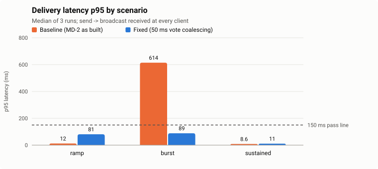
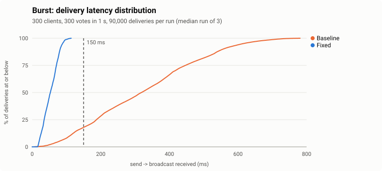
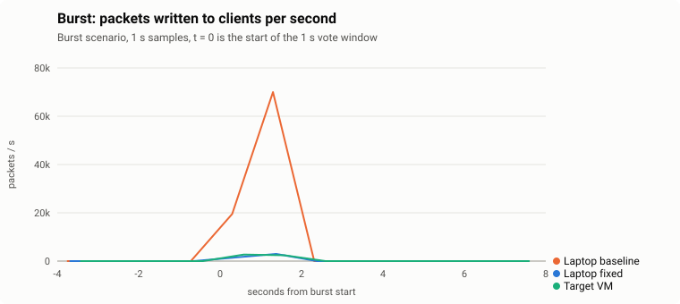
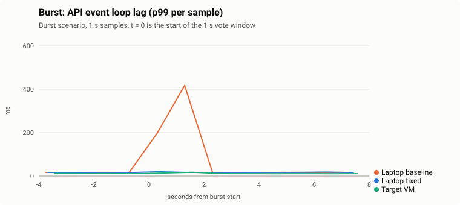
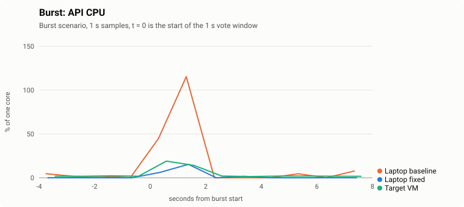
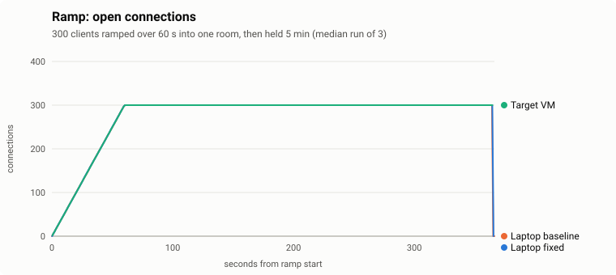
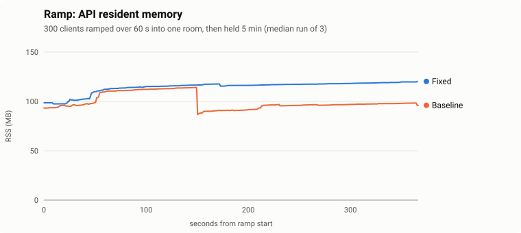
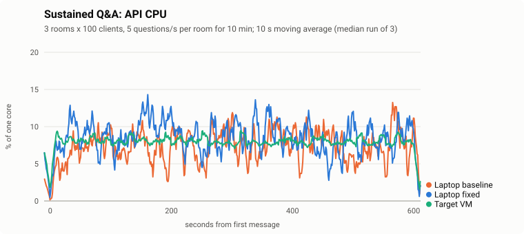
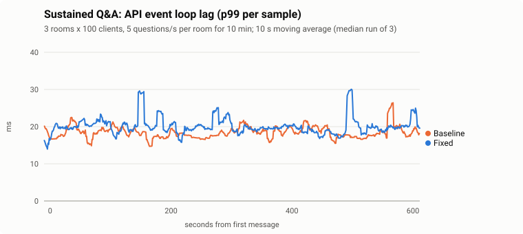
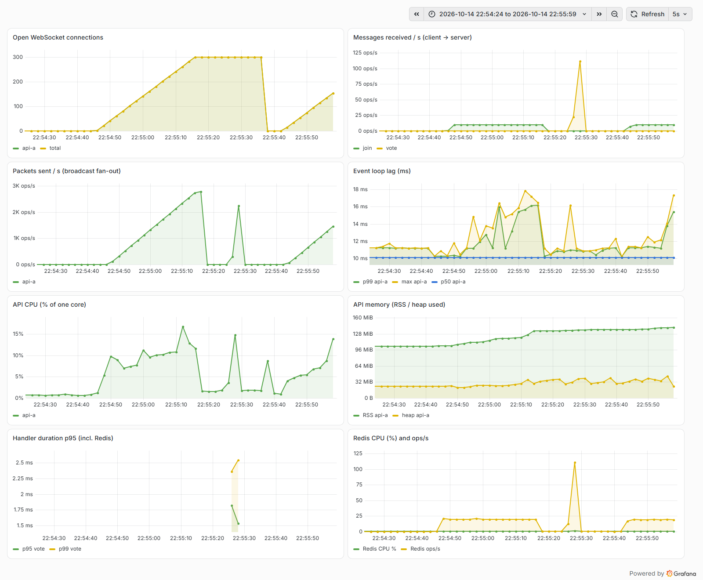

# Spike Findings Note: MD-8 WebSocket Load Test

- **Ticket:** MD-8 (Jira: MOD-13)
- **Track:** Spike (Technical Feasibility)
- **Status:** Target-VM run complete: **PASS**. The load generator ran on the same VM with its own isolated CPUs. A load generator on a separate machine without the campus VPN has not been run yet (see §5 and §10).
- **Date:** October 13–14, 2026
- **Authors:** ModDeck Team

---

## 1. Goal and Pass Criteria

### Goal
Find out whether the MD-2 real-time stack (NestJS + Socket.IO + Redis adapter) can serve a 300-student class in one room with live votes and Q&A, and where it breaks if it can't. Simulated clients speak the Socket.IO protocol directly. No UI is involved.

**Pass** = p95 latency < 150 ms **and** 0 dropped messages. Latency is the time from a client sending a message to each client in the room receiving the broadcast.

### Acceptance Criteria

- [x] Test script opens 300 WebSocket connections in one room
- [x] Burst scenario: 300 votes sent within 1 second
- [x] p50/p95/p99 latency, CPU, memory, and dropped messages recorded
- [ ] **Load generator runs on a different machine than the server.** Partly met:
  - The official runs used the target VM with the server and load generator on **separate, pinned vCPUs** (§3.2). That removes CPU interference but is still one machine.
  - A truly separate load generator was tried over the campus VPN, but the VPN dominated the latency (§5).
  - The remaining option is a laptop on campus Wi-Fi (§10).
- [x] Basic Prometheus + Grafana dashboard shows the run. It runs on the VM from `monitoring/` (Docker Compose); screenshots in §4.4.
- [x] Pass = p95 < 150 ms and 0 dropped messages. The as-built server **fails** the burst. After one fix all three scenarios **pass**, on the laptop and on the target VM (§4, §7).
- [ ] Stretch (optional, **not pursued**): 2 instances behind Nginx, 1,000+ connections. The team decided to skip it for MD-8. An exploratory laptop run without Nginx is recorded in §8 for reference only.
- [x] Findings note written

---

## 2. Setup

### Tool choice: Artillery
MD-2 uses **Socket.IO**, not raw WebSocket. Artillery has a Socket.IO engine and handles the Engine.IO handshake, rooms and acks. k6 only speaks raw WebSocket, so it would have to re-implement Socket.IO framing. Artillery 2.0.34 ships socket.io-client 4.8.4, the same version as the server.

### Machines

| Role | Machine |
| --- | --- |
| **Target VM** (official runs) | `CP26SSA2` on the campus network: 4 vCPU (QEMU Virtual CPU 2.5+), 7.2 GiB RAM + 4 GiB swap, Ubuntu (Linux 7.0.0-34), Node 22.22.1. Redis 7 and Prometheus/Grafana in Docker. |
| Laptop (dry run, baseline vs fix) | HP Pavilion Aero 13, AMD Ryzen 5 7535U (6 cores / 12 threads), 15.2 GB RAM, Windows 11 (26200), Node 24.19.0, Redis 8.10.1 (Windows port). Server and load generator on the same laptop. |

### Software

| Component | Version |
| --- | --- |
| NestJS / Socket.IO / `@socket.io/redis-adapter` | 11 / 4.8.4 / 8.3.0 |
| Artillery | 2.0.34 |
| Prometheus / Grafana | 3.15.0 / 13.2.3 |

### Changes to the MD-2 server for this test
- `GET /metrics` (prom-client):
  - connections
  - messages received per event
  - packets written to clients (fan-out)
  - handler duration per event
  - CPU, RSS, heap, event-loop lag p50/p99/max
  - Redis CPU, memory and ops/s from `INFO`
- Optional `clientMsgId` / `sentAt` fields in `vote` and `question`, echoed back in the broadcast so a client can time its own message.
- A minimal `question` event (stored in a Redis list capped at 200 per room, then broadcast as `question_posted`) for the Q&A scenario.
- The fix described in §7.

---

## 3. Method

### 3.1 Scenarios

| # | Scenario | Clients / rooms | Traffic | Deliveries expected per run |
| --- | --- | --- | --- | --- |
| 1 | **Ramp** | 300 / 1 | Join over 60 s, hold 5 min. Probe: each client votes once at a random time (~1 vote/s) | 90,000 |
| 2 | **Burst** | 300 / 1 | Every client votes once inside the same 1 s window | 90,000 |
| 3 | **Sustained** | 300 / 3 (100 each) | Q&A: 5 questions/s per room for 10 min | 900,000 |

- **Latency** is measured at every recipient, as `receive time - sentAt`. All simulated clients run on the load generator, so sender and receivers share one clock. The note also reports *echo* latency: the sender's time to see its own message.
- **Dropped** = Σ rooms (sent × clients joined) − broadcasts received. Socket.IO reconnection is off, so a dropped connection can't hide as a silent rejoin.
- **Schedule.** The runner waits until Artillery has actually started, then writes an absolute schedule that every client follows. This keeps the 300 votes inside the 1 s window. The runner flags any client that joins after sending starts. None did.
- **Server stats** were sampled from `/metrics` once per second by the runner, alongside Prometheus scraping every 2 s.
- Each scenario was run **3 times**. Tables show the **median** and the range. All numbers per run are in [results/RESULTS.md](results/RESULTS.md).

### 3.2 Target-VM setup: CPUs split between server and load generator
No second campus machine was available, and the VPN made a remote load generator unusable (§5). So the VM's 4 vCPUs were split in two, as if it were two small machines:

| vCPUs | Runs |
| --- | --- |
| 0–1 ("server") | MD-2 api (`taskset -c 0,1`), Redis, Prometheus, Grafana (`docker update --cpuset-cpus 0-1`) |
| 2–3 ("load generator") | `run.mjs` + Artillery (`taskset -c 2,3`); `MD8_LOADGEN_CPUS=2,3` makes the runner measure only these cores |

- **What this tests:** the target VM's hardware and OS, with no CPU interference between the two sides. Node's event loop is single-threaded, so the api uses about one core; 2 vCPUs is the realistic budget.
- **What it doesn't test:** the network. Clients connect over `localhost`, so real student devices on Wi-Fi add their own round trip on top.
- The load generator peaked at 26% of its 2 vCPUs, so it was never the bottleneck. No run produced a warning.

---

## 4. Results

### 4.1 Target VM (official): all pass

Median of 3 runs, with the range in brackets. Fixed server (§7).

| Scenario | p50 ms | p95 ms | p99 ms | Dropped | API CPU max | API RSS max | Result |
| --- | --- | --- | --- | --- | --- | --- | --- |
| Ramp | 58.2 | **64.8** (64.8–65.3) | 68.7 | 0 / 90,000 ×3 | 11–14 % | 141–147 MB | **PASS** |
| Burst | 43.1 | **70.9** (70.1–73.5) | 79.8 | 0 / 90,000 ×3 | 19–26 % | 123–142 MB | **PASS** |
| Sustained | 3.4 | **6.0** (5.6–6.1) | 8.1 | 0 / 900,000 ×3 | 19–23 % | 150–152 MB | **PASS** |

- **The margin is wide.** The worst p95 is 73.5 ms, about half the 150 ms budget, and the worst single delivery in any run was 105 ms.
- **The VM is steadier than the laptop.** p95 varies by ±2 ms between runs, against ±10 ms on the laptop.
- **No interference spikes.**
- **The VM is far from its limit.** The api never passed 26% of one core, event-loop p99 lag stayed at 15–22 ms, and Redis peaked under 2% CPU.
- **Nothing was dropped.** 3.24 million deliveries across the 9 runs, and no client disconnected.

### 4.2 Laptop dry run: baseline vs fix

These are the runs that found the bottleneck and checked the fix before the VM was available. Same scenarios, server and load generator sharing one Windows laptop.

| Scenario | Variant | p50 ms | p95 ms | p99 ms | Dropped | API CPU max | API RSS max | Result |
| --- | --- | --- | --- | --- | --- | --- | --- | --- |
| Ramp | Baseline | 6.6 | 12.3 (12.0–16.6) | 15.3 | 0 / 90,000 | 11–16 % | 114–118 MB | PASS |
| Ramp | Fixed | 69.2 | 81.0 (77.4–81.6) | 94.2 | 0 / 90,000 | 13–16 % | 117–124 MB | PASS |
| **Burst** | **Baseline** | 318.4 | **614.4 (505–963)** | 708.8 | 0 / 90,000 | **114–130 %** | 159–219 MB | **FAIL** |
| **Burst** | **Fixed** | 53.0 | **88.5 (76.5–93.1)** | 101.5 | 0 / 90,000 | 14–25 % | 112–122 MB | **PASS** |
| Sustained | Baseline | 3.6 | 8.6 (7.0–9.7) | 13.2 | 0 / 900,000 | 28–36 % | 201–211 MB | PASS |
| Sustained | Fixed | 4.3 | 11.2 (9.2–12.1) | 19.0 | 0 / 900,000 | 26–28 % | 200–203 MB | PASS |

### 4.3 Burst: before and after the fix

- **Before the fix:** in the median baseline run only 18% of deliveries arrive within 150 ms (12–24% across the 3 runs).
- **After the fix:** every delivery arrives within 114 ms on the laptop and within 105 ms on the VM.

Ramp (300 connections held for 5 minutes) and sustained Q&A (10 minutes):

- **Joining was quick and stable.** All 300 clients joined in every run (join p95 ≤ 2.5 ms) and stayed connected through the hold.
- **Memory is small.** It settles at 115–150 MB with 300 connections.
- **The sustained load is flat**, with no upward drift over 10 minutes, so there's no sign of a leak or queue build-up.

### 4.4 Grafana

The provisioned dashboard ("ModDeck / MD-8 WebSocket load test") during actual runs:

| Run | Where | Screenshot |
| --- | --- | --- |
| Burst | Target VM | [results/grafana/vmpin-burst-1.png](results/grafana/vmpin-burst-1.png) |
| Ramp | Target VM | [results/grafana/vmpin-ramp-2.png](results/grafana/vmpin-ramp-2.png) |
| Sustained | Target VM | [results/grafana/vmpin-sustained-2.png](results/grafana/vmpin-sustained-2.png) |
| Burst, baseline | Laptop | [results/grafana/baseline-burst-2.png](results/grafana/baseline-burst-2.png) |
| Burst, fixed | Laptop | [results/grafana/fixed-burst-1.png](results/grafana/fixed-burst-1.png) |

---

## 5. Why the official runs didn't use a remote load generator

The first plan was the laptop as load generator, connecting to the VM over the campus VPN. Measured:

| Check | Result |
| --- | --- |
| VPN round trip, 30 pings | min 14 · median 27 · **p95 94** · max 138 ms |
| 30-client burst | delivery p95 **175 ms** (join p95 187 ms) with the api at 8% CPU |
| 300-client burst ×3 | delivery p95 **1,488–1,938 ms**, 0 dropped, api ≤ 19% CPU, event-loop lag ≤ 15 ms |

The server was idle while latency hit seconds, so the delay was entirely in the VPN:
- **Jitter:** p95 round trip of 94 ms.
- **Bandwidth:** a burst sends ~6,300 messages of ~1.5 KB (~9 MB) within a second, all through one VPN tunnel to one laptop.

Real students each have their own connection, so these runs measure the VPN, not ModDeck. They're kept as `results/vpn-*` for the record.

---

## 6. Bottleneck: broadcast fan-out on one event loop

The baseline burst fails, and the cause is clear:

1. **The API is CPU-bound for that one second.** It reaches 114–130% of a core, and event-loop p99 lag jumps from ~17 ms to 350–420 ms. Every broadcast waits its turn behind that backlog, so latency grows with each vote in the burst (the CDF above is close to a straight line).
2. **The time goes to socket writes.** A CPU profile of the API over the busiest 2 s of a burst shows **80% in socket writes** (`writev` via `ws`/`engine.io`). Gateway code, the Redis adapter and ioredis together take ~15%. Logging is negligible. Each vote is broadcast to every client separately, so 300 votes × 300 clients = **90,000 socket writes** in about a second. The server measured ~78,000 packets/s at the peak.
3. **Redis is not the bottleneck.** It peaks at 11–16% CPU, and ioredis accounts for ~4% of API CPU in the profile. The `HINCRBY` + `HGETALL` pair per vote is cheap.
4. **The load generator is not the bottleneck.** It peaks at 22–66% of total CPU during the bursts, and its own latency matches the server-side lag.

The cost of a burst grows with *votes × room size*, so a single room is worst case: a 300-student class voting at once is exactly the product's peak moment.

---

## 7. Fix (applied once) and rerun

**Change:** votes are still counted in Redis immediately (`HINCRBY`, atomic). The `vote_update` broadcast is now **coalesced per room**: at most one broadcast every 50 ms, carrying the latest tally and the list of votes it covers (`batch`). During a 1 s burst a room gets ~21 broadcasts instead of 300, so the API writes ~6,300 packets instead of 90,000. Code: [events.gateway.ts](../md-2-websocket-pubsub/src/events/events.gateway.ts) (`flushVotes`). Setting `VOTE_BROADCAST_INTERVAL_MS=0` restores the original behaviour.

**Result:** on the laptop, burst p95 614 → **88.5 ms**, API CPU peak 114–130% → 14–25%, event-loop lag peak ~400 → 20–51 ms. On the target VM the burst runs at p95 **70.9 ms**. Still 0 dropped, and ramp and sustained still pass.

**Trade-off:** at low traffic every vote now waits for the window. Ramp p50 rose from 6.6 ms (baseline) to 58 ms on the VM and ~69 ms on the laptop, where Windows' ~15.6 ms timer resolution stretches the 50 ms wait. This is invisible to a human watching a poll and well inside the budget, but it is wasted time when a room is quiet.

**Schema change:** `vote_update` gains `batch: [{ option, clientMsgId?, sentAt? }]`. `votes` (the tally) and `option` are unchanged, so the existing test client still works. Only `question_posted` is not coalesced; at 5/s per room it doesn't need to be.

---

## 8. Stretch: 2 instances, 1,200 connections (exploratory, not pursued)

The stretch goal is optional and the team decided not to pursue it for MD-8. Before that decision, one exploratory run was done on the laptop. It is kept here for reference and is **not** part of the verdict.

Two API instances (`api-a` :4000, `api-b` :4001) shared one Redis through the Socket.IO Redis adapter. Clients were split evenly by connecting directly to each port, 600 / 600. Every room had clients on both instances, so every broadcast crossed Redis.

- **Correct:** 0 dropped out of 360,000 (burst) and 1,805,000 (sustained) deliveries. Cross-instance fan-out through Redis works at this scale.
- **Sustained passes:** p95 17.1 ms with 6 rooms × 200 clients at 5 questions/s per room.
- **Burst fails on the laptop:** 4 rooms × 300 clients all voting in the same second, p95 263–328 ms.
  - Neither instance is saturated (peaks of 60–100% of a core).
  - The time adds up from event-loop queuing, the 50 ms coalescing window, the `HGETALL` read, and the relay through Redis to the other instance, with 2 APIs, Redis and 2 Artillery processes competing for 6 cores.
  - It would need repeating on separate machines before drawing conclusions.
- **Nginx was not tested.** Nginx for Windows handles at most 1,024 connections per worker. The config is ready in [nginx/](nginx/) for Linux.

---

## 9. Other observations

- **Joining a room is quadratic.** Every `join` broadcasts `user_joined` to the whole room, so 300 students joining costs ~45,000 packets. It shows as the 2.5–3k packets/s rise during the connect phase in every Grafana screenshot, VM included. It's harmless spread over 60 s, but a whole class joining in a few seconds (a QR code on the projector) is a burst just like the vote. Recommend sending `user_joined` to the presenter only, or a coalesced `participant_count`.
- **Memory is not a concern.** It peaks at ~150 MB on the VM with 300 connections (~230 MB per instance with 600 in the laptop stretch run). The VM's 7.2 GiB is ample.
- **No reconnects or errors** in any run (`disconnects = 0`, no `error` events).

### Limits
- **Target VM: one machine, no network.** The CPUs are isolated, but clients connect over `localhost`, so student devices on Wi-Fi add their own round trip on top of these numbers. With p95 at 65–71 ms there is ~80 ms of budget left for that.
- **Laptop dry run.** Server and load generator shared one Windows laptop. Brief background CPU spikes hit both at once, flagged by the runner in 4 runs (load-generator CPU over 85%): baseline-ramp-1, fixed-ramp-2, fixed-sustained-2/3. Their p99/max values are inflated. Windows timers (~15.6 ms) also stretch the 50 ms window. The VM runs have neither problem.
- **Event-loop lag gauges.** prom-client resets its event-loop histogram on every scrape, and both Prometheus and the runner scrape, so a 1 s spike can land in either sample. The burst lag charts come from the runner's per-second samples. Grafana's 5 s `rate()` windows also smooth a 1 s burst.

---

## 10. Verdict

### **PASS on the target VM**

- As built, MD-2 **fails** the 300-vote burst (p95 ~614 ms on the laptop) because broadcasting each vote to every client saturates the single event loop. Redis is fine.
- With **one fix**, coalescing `vote_update` per room every 50 ms, all three scenarios pass at 300 clients per room **on the target VM**: p95 65 / 71 / 6 ms (ramp / burst / sustained), 0 dropped across 3.24 M deliveries, with the api below 26% of one core.
- **One open caveat:** these numbers exclude the network, because the load generator shared the VM, on separate CPUs. A run from a laptop on campus Wi-Fi would close the "different machine" criterion and show the Wi-Fi round trip. Given ~80 ms of headroom, it is not expected to change the verdict.
- The stretch goal (2 instances behind Nginx, 1,000+ connections) is optional and was not pursued.

---

## 11. Next steps

1. **Optional confirmation from campus Wi-Fi** (closes the "different machine" criterion):
   - With the laptop on campus Wi-Fi (VPN off), first `ping 10.4.82.23` and check that p95 is under ~15 ms with no loss.
   - Then run the 3 scenarios × 3 runs from the laptop against `http://10.4.82.23:4000`, labelled `wifi-<scenario>-<n>`. See [README.md](README.md) §2.
2. **For the product (beyond the spike):**
   - **Make coalescing leading-edge.** Broadcast the first vote in a quiet room immediately, and only batch while a burst is in progress. That keeps the ~7 ms quiet-room latency and the burst protection.
   - **Send `user_joined` to the presenter only, or as a coalesced count** (§9).
   - **Make the Prometheus metrics in `apps/api` permanent.** Connections, fan-out packets/s and event-loop lag are the early-warning signals for this design.
   - **If one class must exceed ~1,000 students,** look at sharding a room's fan-out across instances, or a uWebSockets.js-based transport, before buying a bigger VM.
