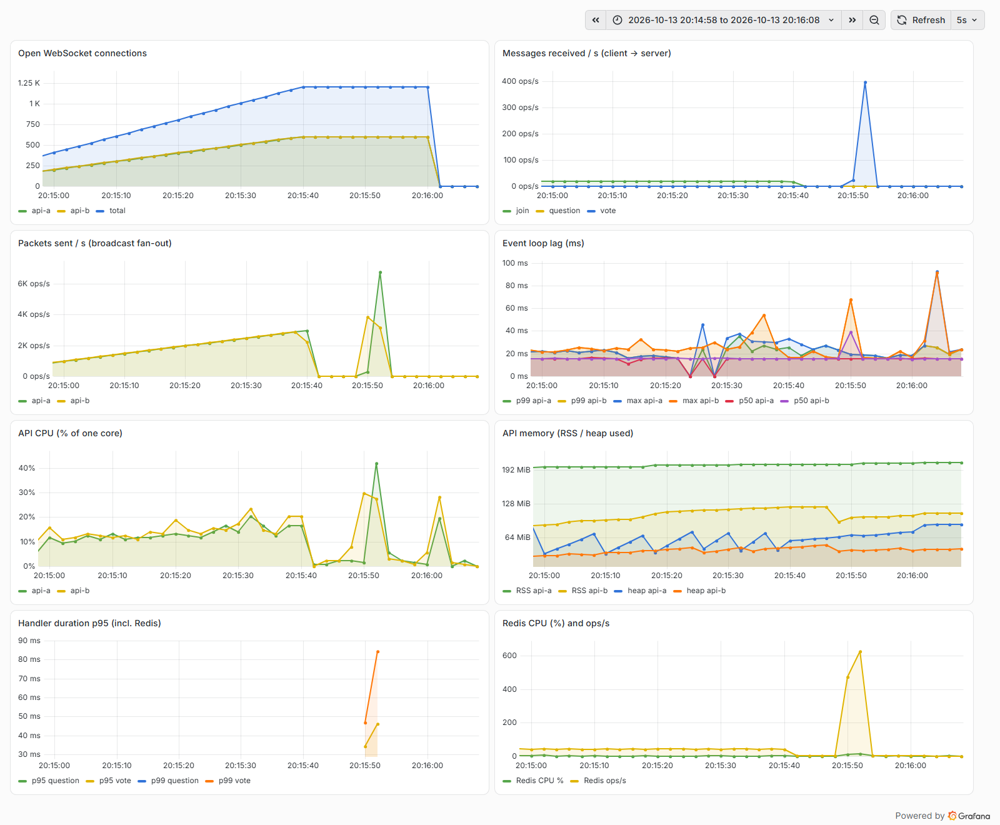

# Spike Findings Note: MD-8 WebSocket Load Test

- **Ticket:** MD-8 (Jira: MOD-13)
- **Track:** Spike (Technical Feasibility)
- **Status:** Single-machine dry run complete. The official two-machine run on the target VM is still pending (see §9).
- **Date:** October 13, 2026
- **Authors:** ModDeck Team

---

## 1. Goal and Pass Criteria

### Goal
Find out whether the MD-2 real-time stack (NestJS + Socket.IO + Redis adapter) can serve a 300-student class in one room with live votes and Q&A, and where it breaks if it can't. Simulated clients speak the Socket.IO protocol directly. No UI is involved.

**Pass** = p95 latency < 150 ms **and** 0 dropped messages. Latency is the time from a client sending a message to each client in the room receiving the broadcast.

### Acceptance Criteria

- [x] Test script opens 300 WebSocket connections in one room
- [x] Burst scenario: 300 votes sent within 1 second
- [x] p50/p95/p99 latency, CPU, memory, and dropped messages recorded
- [ ] **Load generator runs on a different machine than the server.** Not met yet: every run below used one laptop. The runbook for the VM is ready ([README.md](README.md)).
- [x] Basic Prometheus + Grafana dashboard shows the run. Checked here with native Prometheus 3.15.0 and Grafana 13.2.3. The VM uses the Docker Compose files in `monitoring/`.
- [x] Pass = p95 < 150 ms and 0 dropped messages. The as-built server **fails** the burst; after one fix all three scenarios **pass** (§4–6).
- [ ] Stretch (optional, **not pursued**): 2 instances behind Nginx, 1,000+ connections. The team decided to skip it for MD-8. An exploratory laptop run without Nginx is recorded in §7 for reference only.
- [x] Findings note written

---

## 2. Setup

### Tool choice: Artillery
MD-2 uses **Socket.IO**, not raw WebSocket. Artillery has a Socket.IO engine and handles the Engine.IO handshake, rooms and acks. k6 only speaks raw WebSocket, so it would have to re-implement Socket.IO framing. Artillery 2.0.34 ships socket.io-client 4.8.4, the same version as the server.

### Hardware (dry run: everything on one machine)

| Role | Machine |
| --- | --- |
| Server stack + load generator (same box) | HP Pavilion Aero 13 laptop, AMD Ryzen 5 7535U (6 cores / 12 threads), 15.2 GB RAM, Windows 11 (26200), on battery/AC as normal |
| Target server for the official run | VM: 4 vCPU, 8 GB RAM, 80 GB disk, Ubuntu 26.04 LTS |

### Software

| Component | Version |
| --- | --- |
| Node.js | 24.19.0 |
| NestJS / Socket.IO / `@socket.io/redis-adapter` | 11 / 4.8.4 / 8.3.0 |
| Redis | 8.10.1 (Windows MSYS2 port, persistence off) |
| Artillery | 2.0.34 |
| Prometheus / Grafana | 3.15.0 / 13.2.3 |

### Changes to the MD-2 server for this test
- `GET /metrics` (prom-client):
  - connections
  - messages received per event
  - packets written to clients (fan-out)
  - handler duration per event
  - CPU, RSS, heap, event-loop lag p50/p99/max
  - Redis CPU, memory and ops/s from `INFO`
- Optional `clientMsgId` / `sentAt` fields in `vote` and `question`, echoed back in the broadcast so a client can time its own message.
- A minimal `question` event (stored in a Redis list capped at 200 per room, then broadcast as `question_posted`) for the Q&A scenario.
- The fix described in §6.

---

## 3. Method

| # | Scenario | Clients / rooms | Traffic | Deliveries expected per run |
| --- | --- | --- | --- | --- |
| 1 | **Ramp** | 300 / 1 | Join over 60 s, hold 5 min. Probe: each client votes once at a random time (~1 vote/s) | 90,000 |
| 2 | **Burst** | 300 / 1 | Every client votes once inside the same 1 s window | 90,000 |
| 3 | **Sustained** | 300 / 3 (100 each) | Q&A: 5 questions/s per room for 10 min | 900,000 |
| S | **Stretch** | 1,200 / 4 (burst), 1,200 / 6 (sustained, 5 min) | As above, split over 2 api instances | 360,000 / 1,805,000 |

- **Latency** is measured at every recipient, as `receive time - sentAt`. All simulated clients run on the load generator, so sender and receivers share one clock. The note also reports *echo* latency: the sender's time to see its own message.
- **Dropped** = Σ rooms (sent × clients joined) − broadcasts received. Socket.IO reconnection is off, so a dropped connection can't hide as a silent rejoin.
- **Schedule.** The runner waits until Artillery has actually started, then writes an absolute schedule that every client follows. This keeps the 300 votes inside the 1 s window even though Artillery takes ~30 s to start on Windows. The runner flags any client that joins after sending starts. None did.
- **Server stats** were sampled from `/metrics` once per second by the runner, alongside Prometheus scraping every 2 s.
- Each scenario was run **3 times**. Tables show the **median** run and the range. All numbers per run are in [results/RESULTS.md](results/RESULTS.md).

---

## 4. Results

### 4.1 Summary (median of 3 runs; range of p95 in brackets)

| Scenario | Variant | p50 ms | p95 ms | p99 ms | Dropped | API CPU max | API RSS max | Result |
| --- | --- | --- | --- | --- | --- | --- | --- | --- |
| Ramp | Baseline | 6.6 | 12.3 (12.0–16.6) | 15.3 | 0 / 90,000 | 11–16 % | 114–118 MB | PASS |
| Ramp | Fixed | 69.2 | 81.0 (77.4–81.6) | 94.2 | 0 / 90,000 | 13–16 % | 117–124 MB | PASS |
| **Burst** | **Baseline** | 318.4 | **614.4 (505–963)** | 708.8 | 0 / 90,000 | **114–130 %** | 159–219 MB | **FAIL** |
| **Burst** | **Fixed** | 53.0 | **88.5 (76.5–93.1)** | 101.5 | 0 / 90,000 | 14–25 % | 112–122 MB | **PASS** |
| Sustained | Baseline | 3.6 | 8.6 (7.0–9.7) | 13.2 | 0 / 900,000 | 28–36 % | 201–211 MB | PASS |
| Sustained | Fixed | 4.3 | 11.2 (9.2–12.1) | 19.0 | 0 / 900,000 | 26–28 % | 200–203 MB | PASS |
| Stretch burst | Fixed, 2 instances | 186.8 | 287 (263–328) | 327.6 | 0 / 360,000 | 70–103 % | 206–212 MB | FAIL |
| Stretch sustained | Fixed, 2 instances | 5.0 | 17.1 (1 run) | 45.8 | 0 / 1,805,000 | 43 % | 228 MB | PASS |

CPU is % of one core; for the stretch runs it's the busier instance. **No message was dropped in any of the 22 runs** (about 9.4 million deliveries in total), and no client disconnected.

### 4.2 Burst: before and after the fix

In the median baseline run only 18% of deliveries arrive within 150 ms (12–24% across the 3 runs). After the fix, every delivery in the median run arrives within 114 ms.

### 4.3 Ramp: 300 connections held for 5 minutes

All 300 clients joined each time (join p95 ≤ 1.7 ms) and stayed connected through the hold. API memory settles at ~100–125 MB with 300 connections. That is under 0.1 MB per connection above the ~95 MB idle footprint.

### 4.4 Sustained Q&A: 10 minutes

The load is flat at 5–15% of one core with no upward drift over 10 minutes, so there's no sign of a leak or queue build-up. 1,500 deliveries/s across 3 rooms is comfortable.

### 4.5 Grafana

The provisioned dashboard ("ModDeck / MD-8 WebSocket load test") during actual runs:

| Run | Screenshot |
| --- | --- |
| Baseline burst | [results/grafana/baseline-burst-2.png](results/grafana/baseline-burst-2.png) |
| Fixed burst | [results/grafana/fixed-burst-1.png](results/grafana/fixed-burst-1.png) |
| Stretch burst (2 instances, 1,200 connections) | [results/grafana/stretch-burst-1.png](results/grafana/stretch-burst-1.png) |

---

## 5. Bottleneck: broadcast fan-out on one event loop

The baseline burst fails, and the cause is clear:

1. **The API is CPU-bound for that one second.** It reaches 114–130% of a core, and event-loop p99 lag jumps from ~17 ms to 350–420 ms. Every broadcast waits its turn behind that backlog, so latency grows with each vote in the burst (the CDF above is close to a straight line).
2. **The time goes to socket writes.** A CPU profile of the API over the busiest 2 s of a burst shows **80% in socket writes** (`writev` via `ws`/`engine.io`). Gateway code, the Redis adapter and ioredis together take ~15%. Logging is negligible. Each vote is broadcast to every client separately, so 300 votes × 300 clients = **90,000 socket writes** in about a second. The server measured ~78,000 packets/s at the peak.
3. **Redis is not the bottleneck.** It peaks at 11–16% CPU, and ioredis accounts for ~4% of API CPU in the profile. The `HINCRBY` + `HGETALL` pair per vote is cheap.
4. **The load generator is not the bottleneck.** It peaks at 22–66% of total CPU during the bursts, and its own latency matches the server-side lag.

The cost of a burst grows with *votes × room size*, so a single room is worst case: a 300-student class voting at once is exactly the product's peak moment.

---

## 6. Fix (applied once) and rerun

**Change:** votes are still counted in Redis immediately (`HINCRBY`, atomic). The `vote_update` broadcast is now **coalesced per room**: at most one broadcast every 50 ms, carrying the latest tally and the list of votes it covers (`batch`). During a 1 s burst a room gets ~21 broadcasts instead of 300, so the API writes ~6,300 packets instead of 90,000. Code: [events.gateway.ts](../md-2-websocket-pubsub/src/events/events.gateway.ts) (`flushVotes`). Setting `VOTE_BROADCAST_INTERVAL_MS=0` restores the original behaviour.

**Result:** burst p95 614 → **88.5 ms**, API CPU peak 114–130% → 14–25%, event-loop lag peak ~400 → 20–51 ms, still 0 dropped. Ramp and sustained still pass.

**Trade-off:** at low traffic every vote now waits for the window. Ramp p50 rose from 6.6 to ~69 ms: the 50 ms window, rounded up by Windows' ~15.6 ms timer resolution to ~62 ms, plus delivery. This is invisible to a human watching a poll and well inside the budget, but it is wasted time when a room is quiet.

**Schema change:** `vote_update` gains `batch: [{ option, clientMsgId?, sentAt? }]`. `votes` (the tally) and `option` are unchanged, so the existing test client still works. Only `question_posted` is not coalesced; at 5/s per room it doesn't need to be.

---

## 7. Stretch: 2 instances, 1,200 connections (exploratory, not pursued)

The stretch goal is optional and the team decided not to pursue it for MD-8. Before that decision, one exploratory run was done on the laptop. It is kept here for reference and is **not** part of the verdict.

Two API instances (`api-a` :4000, `api-b` :4001) shared one Redis through the Socket.IO Redis adapter. Clients were split evenly by connecting directly to each port: the Grafana screenshot shows 600 / 600. Every room had clients on both instances, so every broadcast crossed Redis.

- **Correct:** 0 dropped out of 360,000 (burst) and 1,805,000 (sustained) deliveries. Cross-instance fan-out through Redis works at this scale.
- **Sustained passes:** p95 17.1 ms with 6 rooms × 200 clients at 5 questions/s per room.
- **Burst fails:** 4 rooms × 300 clients all voting in the same second, p95 263–328 ms. Neither instance is saturated (peaks of 60–100% of a core, about 14k packets/s each). The time adds up from event-loop queuing (vote handler median ~20 ms, up to 100 ms, for a sub-ms Redis call), the 50 ms coalescing window, the `HGETALL` read, and the relay through Redis to the other instance. On this laptop, 2 API processes, Redis and 2 Artillery processes with several worker threads all compete for 6 cores. It would need repeating on separate machines before drawing conclusions. Four rooms voting in the same second is also a harsher case than a single class.
- **Nginx was not tested here.** Nginx for Windows handles at most 1,024 connections per worker, and 1,200 proxied clients need ~2,400. The config is ready in [nginx/](nginx/) (`least_conn`, WebSocket upgrade headers, 1 h timeouts). It would need to run on Linux.

---

## 8. Other observations

- **Joining a room is quadratic.** Every `join` broadcasts `user_joined` to the whole room, so 300 students joining costs ~45,000 packets. That's visible as the 2.5–3k packets/s rise during the ramp in Grafana. It's harmless spread over 60 s, but a whole class joining in a few seconds (a QR code on the projector) is a burst just like the vote. For a 300-person audience, the presenter needs a participant count, not 299 join notifications per student. Recommend sending `user_joined` to the presenter only, or a coalesced `participant_count`.
- **Memory is not a concern.** It peaks at ~230 MB per instance with 600 connections. The VM's 8 GB is ample.
- **No reconnects or errors** in any run (`disconnects = 0`, no `error` events).

### Limits of this dry run
- **Single machine.** Server and load generator share one laptop, so their CPU use interferes. Brief CPU spikes on the shared machine (background Windows/OneDrive activity, and in one run chart rendering) hit both processes at once. The runner flagged 4 runs where load-generator CPU briefly passed 85% (baseline-ramp-1, fixed-ramp-2, fixed-sustained-2/3). Those runs still pass, but their p99/max values are inflated. Ramp 2 and 3 of the baseline, with no spike, have p99 of 13.6–15.3 ms.
- **Windows.** Timers have ~15.6 ms resolution, which inflates the 50 ms window and the ~16 ms idle event-loop lag. Redis is an unofficial Windows port. Numbers on Linux are expected to be lower, but that needs measuring.
- **No network.** Localhost adds ~0 ms. On the VM, add the LAN round trip, typically 1–5 ms on wired campus/LAN and more over Wi-Fi or the internet.
- **Event-loop lag gauges.** prom-client resets its event-loop histogram on every scrape, and both Prometheus and the runner scrape. Each sample covers only the time since the other's scrape, so a 1 s spike can land in either one. The burst lag charts come from the runner's per-second samples. Grafana's 5 s `rate()` windows also smooth a 1 s burst.

---

## 9. Verdict

### **CONDITIONAL PASS (dry run)**

- As built, MD-2 **fails** the 300-vote burst (p95 ~614 ms) because broadcasting each vote to every client saturates the single event loop. Redis is fine.
- With **one fix**, coalescing `vote_update` per room every 50 ms, all three scenarios pass at 300 clients per room: p95 81 / 89 / 11 ms, 0 dropped across ~3.2 M deliveries per variant.
- The stretch goal (2 instances behind Nginx, 1,000+ connections) is optional and was not pursued. An exploratory laptop run showed correct cross-instance delivery (0 dropped) but a slow multi-room burst (§7).

This becomes a full PASS for MD-18 once the burst, ramp and sustained runs repeat on the **VM (server) + a separate load generator** with the same result.

---

## 10. Next steps

1. **Official run (blocks the AC):**
   - Deploy the server side to the VM (4 vCPU / 8 GB, Ubuntu 26.04) using [README.md](README.md) §1.
   - Run the scenarios from the laptop with labels `vm-<scenario>-<n>`, 3 runs each.
   - Record the VM's `lscpu`/`free -h` and the network round trip (`ping`).
   - Replace §4 with those numbers.
2. **For the product (beyond the spike):**
   - **Make coalescing leading-edge.** Broadcast the first vote in a quiet room immediately, and only batch while a burst is in progress. That keeps the ~7 ms quiet-room latency and the burst protection.
   - **Send `user_joined` to the presenter only, or as a coalesced count** (§8).
   - **Make the Prometheus metrics in `apps/api` permanent.** Connections, fan-out packets/s and event-loop lag are the early-warning signals for this design.
   - **If one class must exceed ~1,000 students,** look at sharding a room's fan-out across instances, or a uWebSockets.js-based transport, before buying a bigger VM.
